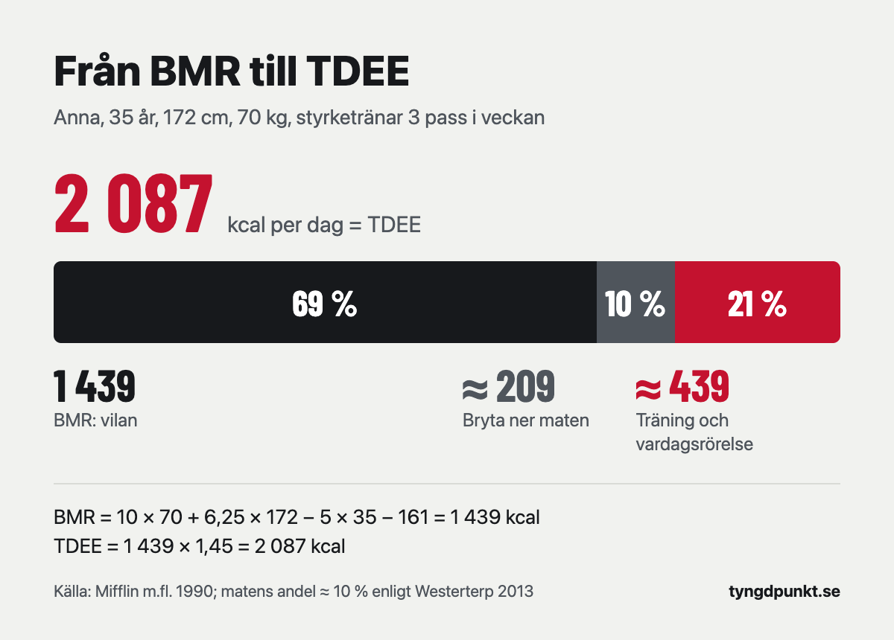

BMR är det kroppen gör av med i vila, och TDEE är allt du gör av med under ett dygn. I en nordeuropeisk studie låg vilan i snitt på cirka 1 460 kcal för kvinnor och 1 790 kcal för män. TDEE räknar du ut genom att multiplicera BMR med en aktivitetsfaktor, i kalkylatorn på sajten mellan 1,2 och 1,55.

## Vad är BMR?

BMR står för *basal metabolic rate*, på svenska basalmetabolism. Det är den energi kroppen gör av med för att hålla igång hjärtat, hjärnan, andningen och kroppsvärmen när du ligger helt stilla. Livsmedelsverket kallar det ditt basala energibehov.

I forskningen mäts BMR under strikta villkor: på morgonen direkt efter att man vaknat, i vila och innan man ätit något. Ofta ser man också förkortningen RMR eller REE, vilometabolism. Den mäts i vila men inte lika strikt, till exempel några timmar efter en måltid. Westerterp visar i sin översikt från 2004 att förbrukningen efter frukost inte hann gå ner till basalnivån före lunch, och inte före middagen heller. I vardagen används orden ändå som samma sak, och formlerna i kalkylatorer räknar ut vilometabolismen.

För de flesta är BMR den största delen av dygnets förbrukning. Därför utgår formlerna från den.

## Vad är TDEE?

TDEE står för *total daily energy expenditure*, alltså hela dygnets energiförbrukning. Livsmedelsverket och forskningen delar upp den i tre delar:

| Del | Vad det är | Ungefär hur stor |
|---|---|---|
| BMR, vilan | Det kroppen gör av med i vila | Den största delen för de flesta |
| Matens termogena effekt | Energin som går åt till att bryta ner maten | 10 % av TDEE med vanlig blandkost |
| Fysisk aktivitet | Träning och all annan rörelse under dagen | Resten, och den del som varierar mest |

Matens del kommer från Westerterp. I översikten från 2004 landar den på 5–15 procent av dygnets förbrukning med blandad kost, högre när man äter mycket protein och lägre med mycket fett. I översikten från 2013 räknar han med 10 procent som ett riktvärde.

Aktiviteten är inte bara träningspassen. Hit hör också promenaden till bussen, trappor, att stå och laga mat och att plocka i ordning hemma. Därför kan två personer med samma antal pass i veckan ha olika TDEE.

## Hur räknar man ut BMR?

Kalkylatorn använder formeln Mifflin–St Jeor. Mifflin och kollegor tog fram den 1990 efter att ha mätt vilometabolismen hos 498 friska vuxna i åldrarna 19–78 år, både normalviktiga och personer med fetma:

- **Kvinnor:** 10 × vikt (kg) + 6,25 × längd (cm) − 5 × ålder − 161
- **Män:** 10 × vikt (kg) + 6,25 × längd (cm) − 5 × ålder + 5

Den äldre Harris–Benedict-formeln från 1919 finns i många räknare på nätet. I Mifflins studie gav den 5 procent högre värden än det som faktiskt mättes.

**Vet du din fettfria massa** (vikten minus fettet) finns ett alternativ i samma studie. Fettfri massa var det enskilda mått som bäst förutsade vilan:

- BMR = 19,7 × fettfri massa (kg) + 413

Anna i räkneexemplet nedan väger 70 kg. Om hon har 28 procent fett är hennes fettfria massa 70 × 0,72 = 50,4 kg. Då blir BMR 19,7 × 50,4 + 413 = 1 406 kcal. Den vanliga formeln ger 1 439 kcal, så skillnaden är liten för henne. Men fettprocenten man får från en våg hemma är osäker, och då blir svaret osäkert också.

## Hur räknar man ut TDEE?

Du multiplicerar BMR med en aktivitetsfaktor. Faktorn säger hur många gånger mer än vilan du gör av med under ett helt dygn. Så här räknar kalkylatorn:

| Träningspass per vecka | Faktor i kalkylatorn |
|---|---|
| 0 | 1,2 |
| 1–2 | 1,4 |
| 3 | 1,45 |
| 4 | 1,5 |
| 5 eller fler | 1,55 |

**Räkneexempel.** Anna är 35 år, 172 cm lång, väger 70 kg och styrketränar tre pass i veckan.

- BMR: 10 × 70 + 6,25 × 172 − 5 × 35 − 161 = 700 + 1 075 − 175 − 161 = **1 439 kcal**
- TDEE: 1 439 × 1,45 = **2 087 kcal**, avrundat till 2 100 kcal per dag

Räknar man med att matens del är 10 procent går ungefär 209 kcal åt till att bryta ner maten. Då står träning och vardagsrörelse för ungefär 2 087 − 1 439 − 209 = 439 kcal.

**Ett exempel till.** Erik är 30 år, 180 cm, väger 80 kg och tränar fyra pass i veckan. BMR blir 800 + 1 125 − 150 + 5 = 1 780 kcal. TDEE blir 1 780 × 1,5 = 2 670 kcal, avrundat 2 650 kcal per dag.

Du kan [räkna ut din BMR och TDEE i kalkylatorn](/kaloribehov/). Den visar både vilan och den totala förbrukningen. Hur du sedan räknar fram ett dagsintag för att gå ner i vikt går vi igenom i [kaloriunderskott](/artiklar/kaloriunderskott/).

## Är kalkylatorns aktivitetsfaktor rätt?

Den är lägre än snitten i forskningen. Westerterp sammanställde 2013 mätningar på 647 friska vuxna i Nordeuropa, där förbrukningen mättes under 14 dagar med dubbelmärkt vatten, en metod där man dricker vatten med märkta syre- och väteatomer och mäter hur snabbt de lämnar kroppen. Kvinnornas TDEE var i snitt 1,70 gånger vilan och männens 1,77 gånger.

FN:s livsmedelsorgan FAO och Världshälsoorganisationen WHO delar in aktivitetsnivån i tre steg:

| Livsstil | Faktor (FAO/WHO) |
|---|---|
| Stillasittande eller lätt aktiv | 1,40–1,69 |
| Måttligt aktiv eller aktiv | 1,70–1,99 |
| Mycket aktiv | 2,00–2,40 |

Livsmedelsverkets referensvärden räknar med 1,4, 1,6 och 1,8. Det lägsta som går att leva med över tid är 1,1–1,2, alltså en person som nästan inte rör sig alls.

Kalkylatorns 1,2–1,55 ger alltså en lägre TDEE än de flesta mätningar. Startgissningen blir alltså hellre för låg än för hög. Rör du dig mycket utöver passen, har ett fysiskt jobb eller går mycket, gör du troligen av med mer än kalkylatorn säger. Det säkra sättet att ta reda på det är att följa vikten, se nedan.

## Vad är ett normalt BMR för en kvinna och en man?

I Westerterps nordeuropeiska material från 2013 var snitten de här:

| | Kvinnor | Män |
|---|---|---|
| Antal | 301 | 346 |
| Ålder, snitt | 42 år | 45 år |
| Vikt, snitt | 72 kg | 84 kg |
| Vila (BMR) | 6,1 MJ ≈ 1 460 kcal | 7,5 MJ ≈ 1 790 kcal |
| Hela dygnet (TDEE) | 10,3 MJ ≈ 2 460 kcal | 13,2 MJ ≈ 3 150 kcal |
| Faktor | 1,70 | 1,77 |

Siffrorna är omräknade från megajoule med Livsmedelsverkets faktor 1 kcal = 4,184 kJ och avrundade till tiotal.

Varför har män högre BMR? Mest för att de i snitt är större och har mer muskler och annan fettfri vävnad. Johnstone och kollegor mätte 2005 BMR hos 150 vuxna i Skottland. Fettfri massa förklarade 63 procent av skillnaderna mellan personerna, fettmassan 6 procent och åldern 2 procent. När de räknat bort kroppens sammansättning spelade könet ingen säker roll. 26 procent av skillnaderna kunde de inte förklara alls.

Det betyder att två personer med samma längd, vikt och ålder kan ha olika BMR. Ingen formel fångar det.

## Hur exakt är en BMR- och TDEE-räknare?

Ganska bra för en grupp, sämre för en enskild person. Frankenfield och kollegor jämförde 2005 de vanligaste formlerna i en systematisk översikt. Mifflin–St Jeor var den som oftast hamnade inom 10 procent av det uppmätta värdet, och den hade minst spridning. Författarna skriver ändå att felen kan bli märkbara för enskilda personer, och att äldre var dåligt representerade i studierna.

För Anna är 10 procent ungefär 210 kcal om dagen. Lägg till att aktivitetsfaktorn är en grov gissning, så kan hennes verkliga TDEE ligga en bit från 2 087 kcal åt båda hållen.

Därför är den uträknade TDEE en startpunkt. Så här tar du reda på din egen:

1. Ät ungefär lika mycket varje dag i tre veckor och skriv upp det.
2. Väg dig flera gånger i veckan och jämför veckosnitten. Hur ofta och när går vi igenom i [väga sig varje dag](/artiklar/vaga-sig/).
3. Står veckosnittet still äter du ungefär din TDEE. Går det upp eller ner vet du åt vilket håll du ligger fel.

Har du en sjukdom, är gravid eller har eller har haft en ätstörning ska du inte räkna ut ditt energibehov på egen hand. Prata med vården.

## I appen

I Tyngdpunkt räknas TDEE först ut med samma formel som här, som en startgissning. Sedan räknas din faktiska förbrukning fram ur vikttrenden och maten du loggat, och en gång i veckan får du ett förslag på ändring om du följt planen och vikten ändå går åt fel håll.

## Vanliga frågor

### Vad är skillnaden mellan BMR och TDEE?

BMR är det kroppen gör av med i vila. TDEE är hela dygnets förbrukning: vilan, energin för att bryta ner maten och all rörelse. TDEE är alltid högre än BMR. I FAO och WHO:s indelning är den 1,40–1,99 gånger så hög för den som är stillasittande till aktiv.

### Ska jag äta min BMR eller min TDEE?

Vill du ligga kvar på samma vikt är det TDEE som gäller. Vill du gå ner i vikt äter du lite under din TDEE. BMR är bara vilan, så att äta på sin BMR betyder ett underskott lika stort som all rörelse under dagen. För Anna ovan är det 648 kcal om dagen.

### Ökar muskler min BMR?

Ja. Fettfri massa, där musklerna ingår, är det som förklarar mest av skillnaderna i BMR mellan människor. Men effekten är måttlig: i Mifflins formel för fettfri massa ger varje kilo ungefär 20 kcal mer i vila, så 3 kg ger runt 60 kcal om dagen. Mer om muskler och vikt står i [väger muskler mer än fett](/artiklar/muskler-vager-mer-an-fett/).

### Ska jag lägga till kalorierna från träningsklockan?

Nej, inte om du räknar TDEE med en aktivitetsfaktor. Faktorn innehåller redan träningen, och lägger du till klockans siffra räknas den två gånger.

### Sjunker BMR med åldern?

I Mifflin–St Jeor sjunker vilan med 5 kcal per år, allt annat lika. Från 30 till 50 år blir det 100 kcal mindre per dag. I Johnstones mätningar förklarade åldern bara 2 procent av skillnaderna mellan personer.

## Källor

- Livsmedelsverket. Energi, kalorier. [livsmedelsverket.se](https://www.livsmedelsverket.se/livsmedel-och-innehall/naringsamne/energi-kalorier)
- Mifflin MD, St Jeor ST, Hill LA m.fl. (1990). A new predictive equation for resting energy expenditure in healthy individuals. *The American Journal of Clinical Nutrition*, 51(2), 241–247. [Europe PMC](https://europepmc.org/article/MED/2305711)
- Frankenfield D, Roth-Yousey L, Compher C (2005). Comparison of predictive equations for resting metabolic rate in healthy nonobese and obese adults: a systematic review. *Journal of the American Dietetic Association*, 105(5), 775–789. [Europe PMC](https://europepmc.org/article/MED/15883556)
- Westerterp KR (2004). Diet induced thermogenesis. *Nutrition & Metabolism*, 1, 5. [Europe PMC](https://europepmc.org/article/PMC/PMC524030)
- Westerterp KR (2013). Physical activity and physical activity induced energy expenditure in humans: measurement, determinants, and effects. *Frontiers in Physiology*, 4, 90. [Europe PMC](https://europepmc.org/article/PMC/PMC3636460)
- Johnstone AM, Murison SD, Duncan JS, Rance KA, Speakman JR (2005). Factors influencing variation in basal metabolic rate include fat-free mass, fat mass, age, and circulating thyroxine but not sex, circulating leptin, or triiodothyronine. *The American Journal of Clinical Nutrition*, 82(5), 941–948. [Europe PMC](https://europepmc.org/article/MED/16280423)
