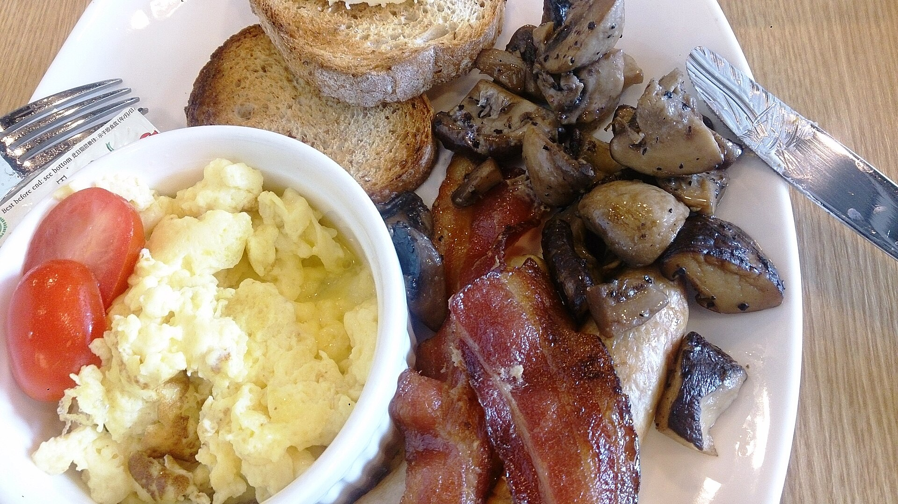
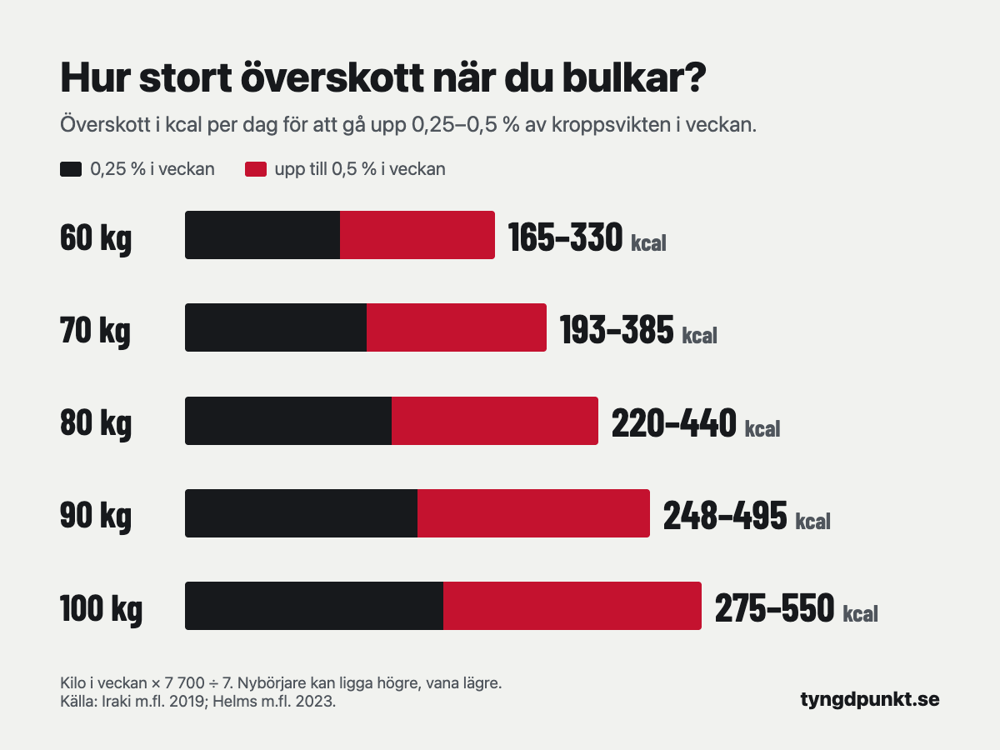

När du bulkar räcker ett litet överskott. Sikta på att gå upp 0,25–0,5 procent av kroppsvikten i veckan, vilket motsvarar ungefär 5–20 procent mer än ditt kaloribehov. Väger du 80 kg blir det 0,2–0,4 kg i veckan och ett överskott på 220–440 kcal om dagen. Nybörjare kan ligga i den övre delen, den som tränat länge i den nedre.

## Vad är en bulk och varför bulkar man?

Att bulka betyder att äta lite mer än man gör av med under en period, så att musklerna har det de behöver för att växa. Motsatsen är att deffa, då man äter mindre för att gå ner i fett. Många växlar mellan perioderna: först bygga muskler med lite överskott, sedan ta bort fettet som följde med.

Iraki och kollegor gick 2019 igenom forskningen om kost för kroppsbyggare under perioden mellan tävlingarna. Målet då är att öka muskelmassan utan att lägga på onödigt fett. De påpekar att förmågan att bygga muskler är begränsad. Ett för stort överskott lägger därför på fett i onödan, och fettet ska sedan bort i en längre eller tuffare deff.

## Hur stort kaloriöverskott behöver man för att bygga muskler?

Två översikter landar på ungefär samma siffror. Iraki och kollegor (2019) rekommenderar att nybörjare och de som tränat en tid äter cirka 10–20 procent över behovet och går upp cirka 0,25–0,5 procent av kroppsvikten i veckan. Den som tränat länge bör vara försiktigare med både överskottet och takten.

Helms och kollegor (2023) skriver 5–20 procent över behovet, eller 0,25–0,5 procent av kroppsvikten i veckan. Ju längre du har tränat, desto mindre överskott och desto långsammare takt.

Slater och kollegor (2019) föreslår ett försiktigt överskott på 1 500–2 000 kJ om dagen. Det blir ungefär 360–480 kcal, omräknat med 4,184 kJ per kcal.

Så här blir takten i kilo och överskottet i kalorier för olika kroppsvikter:

| Kroppsvikt | 0,25 % i veckan | Överskott per dag | 0,5 % i veckan | Överskott per dag |
|---|---|---|---|---|
| 60 kg | 0,15 kg | 165 kcal | 0,3 kg | 330 kcal |
| 70 kg | 0,18 kg | 193 kcal | 0,35 kg | 385 kcal |
| 80 kg | 0,2 kg | 220 kcal | 0,4 kg | 440 kcal |
| 90 kg | 0,23 kg | 248 kcal | 0,45 kg | 495 kcal |
| 100 kg | 0,25 kg | 275 kcal | 0,5 kg | 550 kcal |

Överskottet är räknat med 7 700 kcal per kilo, samma tal som kalkylatorn använder: kilo i veckan × 7 700 ÷ 7.

## Ger ett större överskott mer muskler?

Mest mer fett. Det visar tre studier på personer som redan styrketränade.

Garthe och kollegor lät 39 elitidrottare öka i vikt under 8–12 veckor, med fyra styrkepass i veckan utöver sin vanliga träning. Den ena gruppen fick en kostplan med överskott och åt i snitt 3 585 kcal om dagen. Den andra åt som de ville, i snitt 2 964 kcal. Gruppen med kostplan gick upp mer i vikt, 3,9 procent mot 1,5 procent. Fettmassan ökade med 15 procent mot 3 procent, men ökningen av den fettfria massan skilde sig inte mellan grupperna. Enligt Irakis översikt drog forskarna slutsatsen att 200–300 kcal om dagen kan passa vältränade idrottare bättre än 500 kcal.

Helms och kollegor lottade 21 vana lyftare till tre grupper som i åtta veckor åt på sitt behov, 5 procent över eller 15 procent över, och tränade tre pass i veckan. 17 fullföljde. Mellan grupperna gick det inte att se någon skillnad i muskeltjocklek eller i knäböj. Bänkpressen ökade däremot mer i gruppen med 15 procents överskott, och hudvecken, som mäter fettet under huden, blev tjockare. När forskarna i stället jämförde alla deltagare var viktökningen tydligt kopplad till mer fett men bara svagt till större muskler. Deras slutsats är att snabbare viktökning främst ökar fettet.

Ribeiro och kollegor jämförde elva manliga kroppsbyggare under fyra veckor. Gruppen som åt 67,5 kcal per kilo och dag ökade sin muskelmassa med 2,7 procent och sitt kroppsfett med 7,4 procent. Gruppen som åt 50,1 kcal per kilo ökade musklerna med 1,1 procent och fettet med 0,8 procent. Mer mat gav alltså mer muskler i den lilla studien, men fettet ökade mycket mer än musklerna.

Ett större överskott kan alltså ge lite mer muskler, men fettet ökar betydligt snabbare.

## Hur många kalorier ska man äta när man bulkar?

Börja med ditt kaloribehov och lägg till överskottet för den takt du valt. [Räkna ut ditt kaloribehov](/kaloribehov/) i kalkylatorn och välj målet Bygga muskler. Där kan du välja 0,1, 0,25 eller 0,5 kg i veckan.

**Räkneexempel.** Sara är 27 år, 165 cm lång, väger 60 kg och har styrketränat tre pass i veckan i några månader. Hon är ny på gymmet och kan sikta på den övre delen av spannet.

- Vilan: 10 × 60 + 6,25 × 165 − 5 × 27 − 161 ≈ 1 335 kcal.
- Med tre pass i veckan: 1 335 × 1,45 ≈ 1 936 kcal om dagen.
- Takt 0,5 procent: 60 × 0,005 = 0,3 kg i veckan.
- Överskott: 0,3 × 7 700 ÷ 7 = 330 kcal om dagen, ungefär 17 procent över behovet.
- Att äta: 1 936 + 330 ≈ 2 270 kcal om dagen.

Väljer Sara 0,25 kg i veckan i kalkylatorn blir överskottet 275 kcal och målet avrundat 2 200 kcal.

Erik är 34 år, 180 cm och väger 85 kg. Han har tränat i sex år och fyra pass i veckan. Hans behov blir 1 810 × 1,5 = 2 715 kcal. Med 0,25 procent i veckan, ungefär 0,21 kg, blir överskottet runt 234 kcal och målet runt 2 950 kcal om dagen. Det är knappt 9 procent över behovet, vilket passar den som har tränat länge.

## Varför går vikten inte upp som räknat?

Talet 7 700 kcal per kilo gäller kroppsfett. Muskler består till största delen av vatten. Slater och kollegor räknar med att ett kilo muskel innehåller ungefär 5 000–5 200 kJ, alltså runt 1 200 kcal. Samtidigt kostar det energi att bygga vävnaden och att träna, och hur mycket har ingen studie kunnat mäta säkert. Uträkningen är därför en startgissning.

Det som avgör är vågen. Iraki och kollegor föreslår att man väger sig varje dag eller flera gånger i veckan och följer snittet för veckan, eftersom vikten svänger från dag till dag. Går snittet upp snabbare än planen drar du ner överskottet, och står det still lägger du till lite. Hur du väger dig så att siffrorna går att lita på står i [väga sig varje dag](/artiklar/vaga-sig/).

Räkna också om när du gått upp några kilo. Behovet ökar med vikten, så samma mängd mat ger ett allt mindre överskott.

## Hur mycket protein ska man äta när man bulkar?

Iraki och kollegor rekommenderar 1,6–2,2 gram protein per kilo kroppsvikt och dag, fördelat på 3–6 måltider. Kalkylatorn räknar med 2,0 gram per kilo när målet är att bygga muskler. För Sara blir det 2,0 × 60 = 120 gram om dagen, för Erik 2,0 × 85 = 170 gram. Hur du når det med vanlig mat står i [hur mycket protein per dag](/artiklar/hur-mycket-protein-per-dag/).

När proteinet är på plats kan resten av överskottet komma från kolhydrater och fett, efter vad du tycker om och orkar äta.

## Måste man bulka för att bygga muskler?

Nej. Slater och kollegor skriver att det inte är känt om energin för att bygga muskler måste komma från maten eller kan tas från kroppens fettförråd. Studier har visat tydlig muskeltillväxt hos överviktiga personer som började styrketräna och åt mindre än de gjorde av med, med mycket protein. Har du en del fett att ta av kan det alltså fungera att gå ner i fett och bygga muskler samtidigt. Det tar vi upp i [gå ner i fett och bygga muskler](/artiklar/ga-ner-i-fett-och-bygga-muskler/).

För den som redan är smal och har tränat länge är ett litet överskott det enklaste sättet att ge musklerna det de behöver.

Vill du gå upp i vikt på grund av sjukdom eller undervikt, eller har du haft en ätstörning, prata med vården innan du ändrar hur du äter.

## I appen

I Tyngdpunkt loggar du både träning och mat. En gång i veckan jämför vi vikttrenden med styrkan i varje övning, så att du ser om du bygger muskler eller mest lägger på fett, och föreslår en ändring, till exempel en lugnare takt, med uträkningen synlig.

## Vanliga frågor

### Hur mycket ska man gå upp i vikt per vecka när man bulkar?

Ungefär 0,25–0,5 procent av kroppsvikten i veckan. För den som väger 70 kg blir det 0,18–0,35 kg. Nybörjare kan ligga i den övre delen, den som tränat i flera år i den nedre.

### Vad är skillnaden mellan lean bulk och vanlig bulk?

Lean bulk är en bulk med litet överskott och långsam viktökning, för att hålla nere fettet. Det motsvarar i stort sett rekommendationerna i den här artikeln. En snabb bulk med stort överskott ger mer vikt men, enligt studierna ovan, främst mer fett.

### Hur länge ska man bulka?

Det finns ingen fast tid i forskningen. Studierna ovan pågick i 4–12 veckor. Många bulkar i några månader och avslutar när de lagt på mer fett än de vill. Ju lugnare takt, desto längre kan bulken pågå innan det blir mycket fett att deffa bort.

### Gäller samma sak för kvinnor?

Ja, rekommendationerna anges i procent av kroppsvikten och behovet, så de fungerar oavsett kön. Den som väger mindre får färre kilo i veckan och ett mindre överskott i kalorier.

## Källor

- Iraki J, Fitschen P, Espinar S, Helms E (2019). Nutrition Recommendations for Bodybuilders in the Off-Season: A Narrative Review. *Sports (Basel)*, 7(7), 154. [Europe PMC](https://europepmc.org/article/PMC/PMC6680710)
- Helms ER, Spence AJ, Sousa C, Kreiger J, Taylor S, Oranchuk DJ, Dieter BP, Watkins CM (2023). Effect of Small and Large Energy Surpluses on Strength, Muscle, and Skinfold Thickness in Resistance-Trained Individuals: A Parallel Groups Design. *Sports Medicine – Open*, 9, 102. [Europe PMC](https://europepmc.org/article/PMC/PMC10620361)
- Slater GJ, Dieter BP, Marsh DJ, Helms ER, Shaw G, Iraki J (2019). Is an Energy Surplus Required to Maximize Skeletal Muscle Hypertrophy Associated With Resistance Training. *Frontiers in Nutrition*, 6, 131. [Europe PMC](https://europepmc.org/article/PMC/PMC6710320)
- Garthe I, Raastad T, Refsnes PE, Sundgot-Borgen J (2013). Effect of nutritional intervention on body composition and performance in elite athletes. *European Journal of Sport Science*, 13(3), 295–303. [Europe PMC](https://europepmc.org/article/MED/23679146)
- Ribeiro AS, Nunes JP, Schoenfeld BJ, Aguiar AF, Cyrino ES (2019). Effects of Different Dietary Energy Intake Following Resistance Training on Muscle Mass and Body Fat in Bodybuilders: A Pilot Study. *Journal of Human Kinetics*, 70, 125–134. [Europe PMC](https://europepmc.org/article/PMC/PMC6942464)
