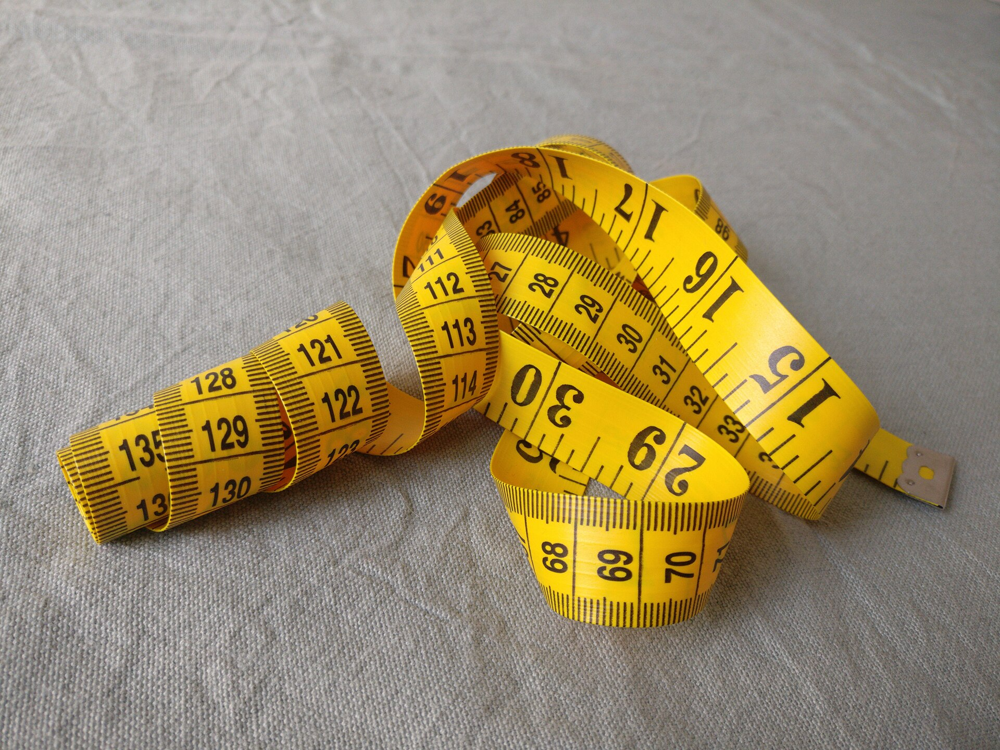
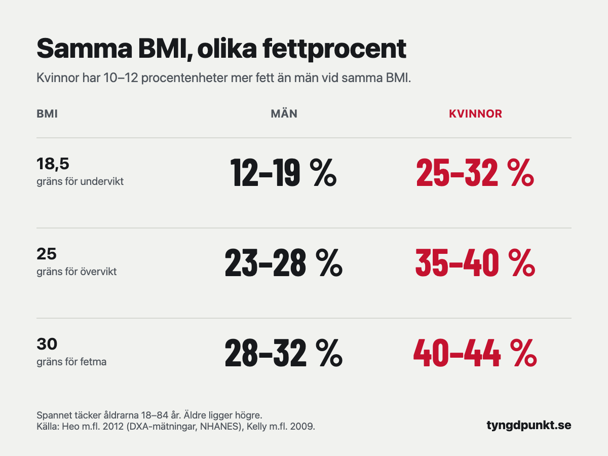

Det finns ingen gräns som alla forskare är överens om. Men i en stor amerikansk studie motsvarade normalt BMI (18,5–25) ungefär 12–28 procent fett hos män och 25–40 procent hos kvinnor, beroende på ålder och ursprung. Kvinnor har 10–12 procentenheter mer fett än män, och för båda ökar fettprocenten med åldern.

## Vad är normal fettprocent?

Fettprocent är hur stor del av kroppsvikten som är fett. Väger du 80 kg och har 20 procent fett bär du 16 kg fett. Resten, 64 kg, är fettfri massa: muskler, skelett, organ och vatten.

Någon officiell gräns för vad som är normalt finns inte. Heo och kollegor skrev 2012 att det saknas enighet om gränser för vuxna. De gjorde därför en egen översättning. De utgick från drygt 12 900 amerikaner som mätts med DXA, en röntgenmetod som skiljer fett från annan vävnad, och räknade ut vilken fettprocent som motsvarar de vanliga BMI-gränserna. Uträkningen gjordes för tre åldersgrupper (18–29, 30–49 och 50–84 år) och tre grupper efter ursprung.

| BMI | Män | Kvinnor |
|---|---|---|
| 18,5 (gräns för undervikt) | 12–19 % | 25–32 % |
| 25 (gräns för övervikt) | 23–28 % | 35–40 % |
| 30 (gräns för fetma) | 28–32 % | 40–44 % |

Källa: Heo m.fl. (2012), avrundat till hela procent. Spannet i varje ruta täcker de tre åldersgrupperna och de tre grupperna efter ursprung.

Läs tabellen så här: en man vars fettprocent ligger mellan raderna för 18,5 och 25 har ungefär lika mycket fett som en normalviktig man i studien. Den äldsta gruppen hade de högsta gränserna, så den övre delen av spannet passar bättre om du är över 50.

Tabellen säger vad som är vanligt vid normalt BMI, inte vad som är bäst för just dig. Har du en sjukdom, är gravid eller har eller har haft en ätstörning: prata med vården om din vikt och ditt fett i stället för att jämföra med en tabell.

## Varför har kvinnor högre fettprocent än män?

Kvinnor lagrar mer fett än män, och det gäller i alla åldrar. Karastergiou och kollegor sammanfattade 2012 forskningen om fett hos kvinnor och män. Vid samma BMI har kvinnor i regel ungefär 10 procentenheter mer fett, och skillnaden finns genom hela livet. Kelly och kollegor kom fram till nästan samma sak i det stora amerikanska materialet: skillnaden mellan män och kvinnor låg på 11–12 procentenheter och var ganska konstant med åldern.

Fettet sitter också på olika ställen. Kvinnor har relativt mer fett på höfter och lår, män mer fett inne i buken runt organen. Enligt översikten sitter 80–90 procent av allt kroppsfett under huden, och fettet i buken står för 6–20 procent, med högre andel hos män. Fettet på höfter och lår är enligt översikten kopplat till ett skydd mot typ 2-diabetes och åderförkalkning, till skillnad från fettet i buken.

Två saker följer av det. En kvinna med 30 procent fett och en man med 20 procent kan ha ungefär lika mycket fett i förhållande till sin kropp. Och gränser som är gjorda för män går inte att använda för kvinnor.

## Ökar fettprocenten med åldern?

Ja, i genomsnitt. Kelly och kollegor tog fram referensvärden ur DXA-mätningar av amerikaner mellan 8 och 85 år. Hos männen ökade medianen för fettprocent hela vägen från 17 till 85 år. Hos kvinnorna ökade den till ungefär 65 år och planade sedan ut.

Musklerna minskar också med åren, vilket vi går igenom med källa i [väger muskler mer än fett](/artiklar/muskler-vager-mer-an-fett/). Får du mindre muskler och lika mycket fett stiger fettprocenten, även om vikten är densamma. Styrketräning hjälper dig att behålla dem.

## Hur mäter man fettprocent?

Det finns flera sätt, och alla är uppskattningar. Kuriyan går 2018 igenom metoderna. Den noggrannaste är en så kallad fyrkomponentsmodell, där fett, vatten, protein och mineraler mäts var för sig. Den kräver flera mätningar i labb och används mest i forskning.

| Metod | Hur den fungerar | Vad som stör |
|---|---|---|
| DXA | Röntgen med låg stråldos skiljer fett, muskler och skelett | Kräver vård eller labb |
| Fettvåg (bioimpedans) | En svag ström går genom kroppen, och fett leder sämre än vatten | Vätska, mat, träning, menscykel, var du står |
| Kaliper (hudvecksmätning) | Hudvecken mäts på flera ställen och räknas om med en formel | Vem som mäter, vilken kaliper och vilken formel |
| Midjemått | Mäter inte fett men följer förändringen | Mat i magen och var du mäter |

Fettvågen är det vanligaste sättet hemma. Den mäter hur lätt strömmen går genom kroppen och räknar ut fettet med en formel. Kuriyan räknar upp vad som kan ge fel: hur mycket vätska du har i kroppen, om du har tränat, vad du har ätit, ägglossning och var elektroderna sitter. I en jämförelse med fyrkomponentsmodellen hos vuxna i södra Indien underskattade bioimpedans fettprocenten med 5,5 procentenheter. Med kalipern blev fettmassan i samma studie fel med i snitt 6,6 kg.

Siffran på vågen är alltså osäker, både jämfört med andra och från dag till dag. Den blir mest användbar om du väger dig under samma förhållanden, till exempel på morgonen efter toalettbesöket och före frukost, och följer trenden över flera veckor. Samma råd gäller vikten, som vi skriver om i [väga sig varje dag](/artiklar/vaga-sig/).

## Hur räknar man ut hur mycket fett man ska gå ner?

Med fettprocenten kan du räkna ut både fettet och den fettfria massan. Sedan går det att räkna baklänges till en målvikt.

- Fettmassa = vikt × fettprocent
- Fettfri massa = vikt − fettmassa
- Målvikt = fettfri massa ÷ (1 − målets fettprocent)

**Räkneexempel.** Johan väger 90 kg och mäter 25 procent fett. Han vill ner till 20 procent och behålla musklerna.

- Fett: 90 × 0,25 = 22,5 kg
- Fettfri massa: 90 − 22,5 = 67,5 kg
- Målvikt: 67,5 ÷ 0,80 ≈ 84,4 kg
- Fett att gå ner: 90 − 84,4 ≈ 5,6 kg

Räknar vi med 7 700 kcal per kilo fett motsvarar det ungefär 5,6 × 7 700 ≈ 43 000 kcal. Med ett underskott på 500 kcal om dagen tar det 43 000 ÷ 500 = 86 dagar, drygt 12 veckor. [Räkna ut ditt kaloribehov](/kaloribehov/) för att se var ditt underskott börjar.

Uträkningen förutsätter att Johan behåller den fettfria massan. Därför behöver han fortsätta styrketräna och äta tillräckligt med protein. Hur du gör det står i [deffa utan att tappa muskler](/artiklar/deffa-utan-att-tappa-muskler/). Bygger han samtidigt muskler kommer han till 20 procent vid en något högre vikt, vilket vi förklarar i [gå ner i fett och bygga muskler](/artiklar/ga-ner-i-fett-och-bygga-muskler/).

Kom ihåg att vågens fettprocent kan slå fel med flera procentenheter. Se målvikten som en riktning, inte som en exakt siffra.

## Säger BMI samma sak som fettprocent?

Inte helt. BMI räknar bara med vikt och längd och vet inte vad vikten består av. Kuriyan påpekar att fettprocenten vid ett visst BMI skiljer sig med ålder, kön och ursprung, och att BMI inte visar var fettet sitter.

Den som styrketränar mycket kan få ett högt BMI av musklerna, trots en låg fettprocent. Åt andra hållet kan en äldre person med lite muskler ha normalt BMI och ändå mycket fett. Fettprocenten säger mer om vad kroppen består av, men den är svårare att mäta rätt. Följ därför flera saker tillsammans: vikttrenden, midjemåttet och styrkan.

## I appen

I Tyngdpunkt loggar du både träning och mat. En gång i veckan ställer vi vikttrenden mot styrkan i varje övning, till exempel "Går ner och blir starkare", så att du ser om det är fett eller muskler som rör sig.

## Vanliga frågor

### Vad är normal fettprocent för en man?

Vid normalt BMI hade män i Heos studie ungefär 12–28 procent fett. Den lägre delen gäller vid BMI 18,5 och den högre vid BMI 25. Äldre män låg högre än yngre.

### Vad är normal fettprocent för en kvinna?

Vid normalt BMI hade kvinnor ungefär 25–40 procent fett. Kvinnor har i regel 10–12 procentenheter mer fett än män vid samma BMI, så 30 procent är inte mycket för en kvinna.

### Kan man lita på fettprocenten från vågen?

Inte som exakt siffra. Vätska, mat och träning påverkar mätningen, och i en studie underskattade bioimpedans fettprocenten med 5,5 procentenheter. Väg dig under samma förhållanden och följ trenden över flera veckor.

### Hur räknar man ut hur många kilo fett man har?

Multiplicera vikten med fettprocenten. Väger du 70 kg och har 30 procent fett är det 70 × 0,30 = 21 kg fett.

## Källor

- Heo M, Faith MS, Pietrobelli A, Heymsfield SB (2012). Percentage of body fat cutoffs by sex, age, and race-ethnicity in the US adult population from NHANES 1999–2004. *American Journal of Clinical Nutrition*, 95(3), 594–602. [PubMed](https://pubmed.ncbi.nlm.nih.gov/22301924/)
- Kelly TL, Wilson KE, Heymsfield SB (2009). Dual energy X-ray absorptiometry body composition reference values from NHANES. *PLoS ONE*, 4(9), e7038. [PMC](https://pmc.ncbi.nlm.nih.gov/articles/PMC2737140/)
- Karastergiou K, Smith SR, Greenberg AS, Fried SK (2012). Sex differences in human adipose tissues – the biology of pear shape. *Biology of Sex Differences*, 3(1), 13. [PMC](https://pmc.ncbi.nlm.nih.gov/articles/PMC3411490/)
- Kuriyan R (2018). Body composition techniques. *Indian Journal of Medical Research*, 148(5), 648–658. [Europe PMC](https://europepmc.org/article/PMC/PMC6366261)
