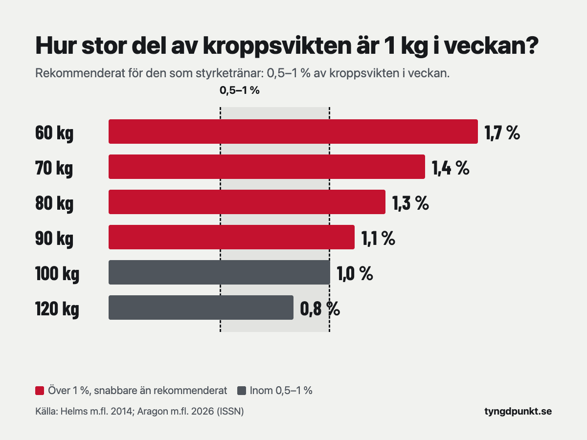

För att gå ner 1 kg i veckan behöver du äta ungefär 1 100 kcal mindre per dag än du gör av med, eftersom ett kilo kroppsfett motsvarar omkring 7 700 kcal. För den som styrketränar rekommenderas 0,5–1 procent av kroppsvikten i veckan. Ett kilo i veckan ligger alltså inom det spannet först när du väger runt 100 kg.

## Hur många kalorier ska man äta för att gå ner 1 kg i veckan?

Räkningen är densamma som för alla takter. Ett kilo kroppsfett motsvarar ungefär 7 700 kcal, och 7 700 ÷ 7 blir 1 100 kcal per dag. Det du ska äta är alltså ditt kaloribehov minus 1 100 kcal. Varifrån siffran 7 700 kommer och hur underskottet räknas för andra takter står i [kaloriunderskott: så räknar du ut hur stort det ska vara](/artiklar/kaloriunderskott/).

**Räkneexempel.** Johan är 41 år, 183 cm lång, väger 98 kg och styrketränar fyra pass i veckan.

- Vilan med Mifflin–St Jeor: 10 × 98 + 6,25 × 183 − 5 × 41 + 5 = 980 + 1 144 − 205 + 5 = 1 924 kcal.
- Kaloribehovet med fyra pass: 1 924 × 1,5 = 2 886 kcal.
- Att äta för 1 kg i veckan: 2 886 − 1 100 = 1 786 kcal, alltså **ungefär 1 800 kcal per dag**.

För Johan är 1 kg i veckan ungefär 1 procent av kroppsvikten, alltså den övre gränsen för vad som rekommenderas. Väljer han 0,5 kg i veckan i stället blir det runt 2 350 kcal per dag.

Gör samma räkning för en kvinna som är 30 år, 168 cm lång, väger 65 kg och tränar tre pass i veckan. Vilan blir 10 × 65 + 6,25 × 168 − 5 × 30 − 161 = 1 389 kcal och kaloribehovet 1 389 × 1,45 = 2 014 kcal. Med 1 100 kcal mindre återstår ungefär 900 kcal per dag. Det är så lite mat att det är svårt att få i sig tillräckligt med protein och näring, och för hennes vikt är 1 kg i veckan 1,5 procent, klart över den rekommenderade takten.

Du kan [räkna ut ditt eget kaloribehov](/kaloribehov/) i kalkylatorn. Den snabbaste takten där är 0,75 kg i veckan. Vill du räkna på 1 kg drar du av ytterligare 275 kcal från det resultatet. Hur själva kaloribehovet räknas fram går vi igenom i [hur många kalorier per dag du behöver](/artiklar/hur-manga-kalorier-per-dag/).

## Är det rimligt att gå ner 1 kg i veckan?

Det beror på hur mycket du väger. Ett kilo är en större del av kroppen för den som väger 60 kg än för den som väger 120 kg, och därför anges rekommendationerna i procent av kroppsvikten.

Helms och kollegor gick 2014 igenom forskningen om att gå ner i fett utan att tappa muskler. De rekommenderar ett kaloriintag som ger en viktnedgång på ungefär 0,5–1 procent av kroppsvikten i veckan. ISSN, det internationella sällskapet för idrottsnutrition, kom 2026 fram till samma spann för idrottare: den som inte går ner mer än 0,5–1 procent i veckan har lättast att behålla musklerna.

| Kroppsvikt | 1 kg i veckan är | Rekommenderad takt (0,5–1 %) | Underskott per dag |
|---|---|---|---|
| 60 kg | 1,7 % | 0,3–0,6 kg | 330–660 kcal |
| 70 kg | 1,4 % | 0,35–0,7 kg | 385–770 kcal |
| 80 kg | 1,3 % | 0,4–0,8 kg | 440–880 kcal |
| 90 kg | 1,1 % | 0,45–0,9 kg | 495–990 kcal |
| 100 kg | 1,0 % | 0,5–1 kg | 550–1 100 kcal |
| 120 kg | 0,8 % | 0,6–1,2 kg | 660–1 320 kcal |

Väger du under 100 kg är 1 kg i veckan snabbare än vad som rekommenderas för den som vill behålla musklerna. Väger du mer ryms det inom spannet.

## Är det farligt att gå ner 1 kg i veckan?

Takten i sig är inget vi kan bedöma för en enskild person. Har du en sjukdom, är gravid eller ammar, eller har eller har haft en ätstörning ska du prata med vården innan du lägger upp en viktnedgång.

Däremot visar forskningen att ett stort underskott gör det svårare att behålla musklerna. Ashtary-Larky och kollegor lät 36 personer med övervikt som inte tränade gå ner minst 5 procent av vikten, antingen på 5 veckor med ett underskott på 1 000–1 500 kcal per dag, eller på 15 veckor med 500–750 kcal per dag. Den snabba gruppen gick ner 5,1 kg, ungefär 1 kg i veckan, och den långsamma 5,5 kg.

| | Snabb (5 veckor) | Långsam (15 veckor) |
|---|---|---|
| Vikt | −5,1 kg | −5,5 kg |
| Fettmassa | −2,9 kg | −4,5 kg |
| Fettfri massa | −2,2 kg | −1,0 kg |
| Vilometabolism | −59 kcal | −23 kcal |

Vikten sjönk nästan lika mycket, men i den snabba gruppen var en större del av det fettfri massa, och vilometabolismen, alltså det kroppen gör av med i vila, sjönk mer. Kroppssammansättningen mättes med en våg som skickar en svag ström genom kroppen. ISSN påpekar att sådana mätningar under korta perioder kan påverkas av vätska och glykogen, så siffrorna är ungefärliga. Studien var också liten.

Murphy och Koehler sammanställde 2022 studier där deltagarna styrketränat med ett kaloriunderskott i minst tre veckor. Styrkan ökade lika mycket som hos dem som åt som vanligt, men den fettfria massan ökade mindre. Deras slutsats är att den som vill behålla musklerna under en viktnedgång bör undvika underskott större än 500 kcal per dag. 1 kg i veckan är mer än dubbelt så mycket.

Och håller det i längden? Purcell och kollegor, i en studie som ISSN beskriver, lät deltagarna gå ner 12,5 procent av vikten antingen snabbt med en mycket kalorifattig kost eller långsamt med ett underskott på 400–500 kcal per dag. Efter en uppföljning på 2,7 år hade båda grupperna gått upp 73,6 procent av det de gått ner. På sikt spelade takten ingen roll för hur mycket som kom tillbaka.

## Varför går man ner mer än 1 kg den första veckan?

Vikten på vågen är inte bara fett. Enligt ISSN påverkas den kortsiktigt av vätska, glykogen (kolhydratförrådet i musklerna och levern) och vad som finns i magen och tarmarna. Skär du ner på kolhydrater minskar glykogenet, och med det försvinner en del vatten. En stor del av det som syns på vågen de första veckorna kan därför vara vatten och inte fett.

Det fungerar åt andra hållet också. Saltig mat, en resa, ett ovant eller tungt pass eller menscykeln kan få vikten att stå still eller gå upp några dagar, fast fettet minskar.

Därför säger en enskild vägning lite. ISSN rekommenderar att man följer ett snitt över 7–14 dagar och jämför med minst ett mått till, till exempel midjemåttet eller styrkan på gymmet.

## Hur länge kan man gå ner 1 kg i veckan?

Det blir svårare ju längre du håller på, om du äter samma mängd hela tiden. Kaloribehovet sjunker när du går ner i vikt. I Mifflin–St Jeor minskar vilan med 10 kcal för varje kilo.

Johan i exemplet ovan har efter 10 kg ett kaloribehov på ungefär 2 736 kcal i stället för 2 886, alltså 150 kcal mindre. Äter han fortfarande 1 800 kcal blir underskottet runt 940 kcal per dag, vilket motsvarar ungefär 0,85 kg i veckan. Samtidigt är 1 kg nu 1,1 procent av hans vikt på 88 kg. Ju längre han kommer, desto mer måste han dra ner för att hålla samma takt, och desto längre över rekommendationen hamnar han.

Formeln fångar inte allt. Enligt ISSN påverkas både kroppen och vanorna av en viktnedgång, och båda drar åt samma håll: man gör av med mindre energi.

Helms och kollegor skriver att en viktnedgång på 0,5–1 procent i veckan som får pågå längre än två till fyra månader kan vara bättre för musklerna än kortare och hårdare perioder. Har du mycket att gå ner är det ett skäl att planera för en längre tid i stället för en högre takt.

## Hur går man ner 1 kg i veckan utan att tappa muskler?

Ett stort underskott ökar risken att tappa muskler, men enligt ISSN kan tillräckligt med protein och styrketräning minska den.

- **Styrketräna.** Fortsätt med samma övningar och försök hålla vikterna. Sjunker styrkan vecka efter vecka är det ett tecken på att takten är för hög.
- **Ät mycket protein.** Proteinkalkylatorn räknar med 2,2 gram per kilo kroppsvikt när målet är att gå ner i fett. För Johan blir det ungefär 215 gram per dag. Varför den siffran används står i [hur mycket protein per dag du behöver](/artiklar/hur-mycket-protein-per-dag/).
- **Börja lugnare.** Väger du under 100 kg kan du sikta på 1 procent av kroppsvikten i stället för ett helt kilo. För den som väger 70 kg blir underskottet 770 kcal per dag i stället för 1 100, och då finns det mer mat att få in proteinet i.

## I appen

I Tyngdpunkt loggar du både träning och mat. En gång i veckan jämför vi vikttrenden med styrkan i varje övning: går vikten ner och styrkan håller är takten rätt, och sjunker styrkan kan förslaget vara en lugnare takt, med uträkningen synlig.

## Vanliga frågor

### Hur många kalorier ska man dra ner för att gå ner 1 kg i veckan?

Ungefär 1 100 kcal per dag, eller 7 700 kcal per vecka, räknat från ditt kaloribehov. Är behovet 2 500 kcal blir det omkring 1 400 kcal per dag.

### Kan man gå ner mer än 1 kg i veckan?

Vikten kan sjunka mer, särskilt de första veckorna, men mycket av det är vatten och glykogen. För den som styrketränar rekommenderas högst 1 procent av kroppsvikten i veckan om man vill behålla musklerna.

### Hur många kilo kan man gå ner på en månad?

Med 1 kg i veckan blir det ungefär 4 kg på en månad. Med den rekommenderade takten på 0,5–1 procent av kroppsvikten blir det för den som väger 80 kg ungefär 1,6–3,2 kg på fyra veckor.

### Går man ner 1 kg i veckan med promenader?

Det som räknas är det totala underskottet på ungefär 1 100 kcal per dag, oavsett om det kommer från mindre mat eller mer rörelse. Promenader ökar det du gör av med, men har du redan räknat med dem i kaloribehovet ska du inte lägga till dem en gång till.

## Källor

- Aragon AA, Campbell BI, Schoenfeld BJ, m.fl. (2026). International Society of Sports Nutrition position stand: diets for body weight reduction. *Journal of the International Society of Sports Nutrition*, 23(1). [Europe PMC](https://europepmc.org/article/PMC/PMC13665703)
- Helms ER, Aragon AA, Fitschen PJ (2014). Evidence-based recommendations for natural bodybuilding contest preparation: nutrition and supplementation. *Journal of the International Society of Sports Nutrition*, 11, 20. [Europe PMC](https://europepmc.org/article/PMC/PMC4033492)
- Ashtary-Larky D, Ghanavati M, Lamuchi-Deli N, m.fl. (2017). Rapid weight loss vs. slow weight loss: which is more effective on body composition and metabolic risk factors? *International Journal of Endocrinology and Metabolism*, 15(3), e13249. [Europe PMC](https://europepmc.org/article/PMC/PMC5702468)
- Murphy C, Koehler K (2022). Energy deficiency impairs resistance training gains in lean mass but not strength: A meta-analysis and meta-regression. *Scandinavian Journal of Medicine & Science in Sports*, 32, 125–137. [Europe PMC](https://europepmc.org/article/MED/34623696)
