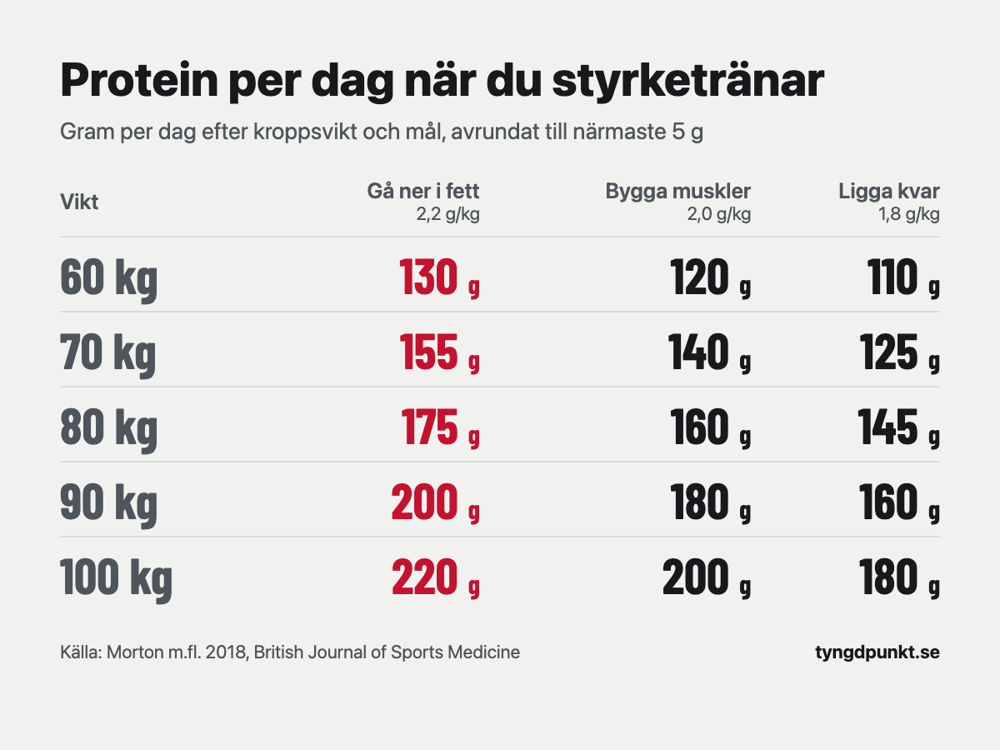

Styrketränar du behöver du ungefär 1,6–2,2 gram protein per kilo kroppsvikt och dag. Väger du 75 kg blir det 120–165 gram. Under en deff finns det skäl att ligga i den övre delen. Tränar du inte räcker 0,83 gram per kilo, enligt de nordiska näringsrekommendationerna.

## Hur mycket protein behöver man om man inte tränar?

Livsmedelsverket följer de nordiska näringsrekommendationerna (NNR 2023), och de säger 0,83 gram protein per kilo kroppsvikt och dag för vuxna. Siffran är densamma för kvinnor och män och för alla vuxna åldrar. Väger du 64 kg behöver du alltså 53 gram om dagen.

Rekommendationen säger också att 10–20 procent av energin ska komma från protein. De flesta som äter vanlig svensk mat kommer därför upp i behovet med god marginal. Livsmedelsverkets egna exempel visar att en kvinna som tränar och äter 2 500 kcal om dagen får i sig 63–125 gram protein, bara genom att protein står för 10–20 procent av maten.

0,83 gram är alltså inget mål för den som vill bygga muskler. Det är den nivå där kroppen klarar sitt grundbehov. För idrottare skriver Livsmedelsverket att behovet kan ligga mellan 1,2 och 2,0 gram per kilo för den som tränar mycket hårt.

## Hur mycket protein per dag om man tränar?

Det bästa underlaget är en metaanalys av Morton och kollegor från 2018, den största på området när den kom. Den samlade 49 studier med 1 863 deltagare som styrketränade, där en del fick extra protein och en del inte.

Resultatet: extra protein gav mer muskler och mer styrka. Men effekten på den fettfria massan, alltså allt utom fett, planade ut vid ungefär 1,6 gram per kilo och dag. Över det syntes ingen ytterligare vinst i snitt. Osäkerhetsspannet för den gränsen gick från 1,03 till 2,2 gram. Författarna skriver därför att det kan vara klokt att rekommendera omkring 2,2 gram per kilo för den som vill få ut så mycket som möjligt av träningen.

Det internationella idrottsnutritionssällskapet ISSN landar nära samma siffror. I sitt ställningstagande från 2017 skriver de att 1,4–2,0 gram per kilo och dag räcker för de flesta som tränar.

[Räkna ut ditt proteinbehov](/proteinbehov/) efter vikt och mål. Kalkylatorn och appen räknar så här:

| Mål | Protein per kilo och dag |
|---|---|
| Gå ner i fett | 2,2 g (på målvikten, om du har en) |
| Bygga muskler | 2,0 g |
| Ligga kvar | 1,8 g |

Vi ligger alltså i den övre delen av Mortons spann. 1,6 gram är ett snitt, och en del behöver mer. Då är det säkrare att räkna lite högt än att hamna under gränsen.

| Kroppsvikt | Gå ner i fett (2,2 g) | Bygga muskler (2,0 g) | Ligga kvar (1,8 g) |
|---|---|---|---|
| 60 kg | 130 g | 120 g | 110 g |
| 70 kg | 155 g | 140 g | 125 g |
| 80 kg | 175 g | 160 g | 145 g |
| 90 kg | 200 g | 180 g | 160 g |
| 100 kg | 220 g | 200 g | 180 g |

Siffrorna är avrundade till närmaste 5 gram, precis som i kalkylatorn.

## Hur mycket protein per dag för att gå ner i vikt?

När du äter mindre än du gör av med tar kroppen energi från både fett och muskler. Mer protein hjälper till att behålla musklerna. ISSN skriver att 2,3–3,1 gram per kilo kan behövas för att behålla så mycket muskler som möjligt hos vältränade personer under en deff.

Appen och kalkylatorn räknar med 2,2 gram per kilo när du vill gå ner i fett. Har du en målvikt räknas proteinet på den i stället för på vikten i dag. Det är ett medvetet val: för den som väger mycket blir 2,2 gram på dagens vikt en stor mängd, och det är svårt att få i sig varje dag. Den som vill ligga högre, i ISSN:s spann, kan göra det.

**Räkneexempel.** Johan väger 98 kg och vill ner till 88 kg. Han räknar på målvikten:

- 88 kg × 2,2 g = 193,6 g, avrundat 195 g protein om dagen.
- Med fyra måltider blir det ungefär 49 g per måltid.

Hade han räknat på dagens vikt hade det blivit 98 × 2,2 = 215 g. Skillnaden är 20 gram, ungefär en burk kvarg mindre att få i sig.

Proteinet är bara en del av en deff. Hur mycket du ska äta totalt räknar du ut med [kalkylatorn för kaloribehov](/kaloribehov/).

## Behöver kvinnor och män olika mycket protein?

Inte per kilo. Både NNR:s 0,83 gram och siffrorna för den som tränar räknas per kilo kroppsvikt. Skillnaden i gram kommer av att män i snitt väger mer.

En kvinna på 65 kg som vill bygga muskler behöver 65 × 2,0 = 130 g om dagen. En man på 85 kg med samma mål behöver 85 × 2,0 = 170 g. Det är samma regel, bara olika vikt.

Mortons sammanställning hade både kvinnor och män med, bland annat 14 studiegrupper med enbart kvinnor. Siffran 1,6 gram gäller hela gruppen.

## Hur mycket protein per måltid?

Mängden per dag är det som betyder mest. Men det är lättare att komma upp i den om proteinet sprids över dagen.

Schoenfeld och Aragon gick 2018 igenom forskningen om protein per måltid. De föreslår 0,4 gram per kilo och måltid, i minst fyra måltider. Det ger minst 1,6 gram per kilo och dag. Vill du upp till 2,2 gram per kilo med fyra måltider blir det högst 0,55 gram per kilo och måltid.

För en person som väger 60 kg betyder det 24–33 gram protein per måltid. Du har kanske hört att musklerna bara kan använda 20–25 gram åt gången och att resten går till spillo. Schoenfeld och Aragon går igenom det påståendet och menar att det inte håller fullt ut: en del av proteinet utöver det används ändå till att bygga vävnad.

Så här mycket protein ger några vanliga livsmedel, enligt Livsmedelsverkets databas:

| Livsmedel | Protein | Energi |
|---|---|---|
| Kvarg naturell 0,2 %, 250 g | 25 g | 160 kcal |
| Kycklingfilé, stekt utan skinn, 125 g | 29 g | 145 kcal |
| 3 kokta ägg (cirka 165 g) | 20 g | 225 kcal |
| Cottage cheese 4 %, 200 g | 27 g | 200 kcal |
| Tonfisk i vatten, avrunnen, 130 g | 31 g | 140 kcal |
| Havregrynsgröt med mjölk, 3 dl (300 g) | 12 g | 265 kcal |

Kvarg, kyckling, cottage cheese och tonfisk ger mycket protein för få kalorier. Det gör dem praktiska under en deff.

## Vad händer om man äter för mycket protein?

För friska vuxna har forskningen inte visat att mer protein skadar njurarna. En metaanalys av Devries och kollegor från 2018 samlade 28 studier med 1 358 friska vuxna. Där jämfördes kost med mycket protein, minst 1,5 gram per kilo eller minst 100 gram om dagen, med kost som hade mindre. Förändringen i njurfunktion skilde sig inte mellan grupperna.

Det som händer om du äter mer protein än du behöver är framför allt att det tar plats från annan mat. Proteinet innehåller kalorier precis som resten av maten. Över cirka 2,2 gram per kilo syns inte mer muskler i snitt, enligt Mortons analys.

Har du en njursjukdom eller någon annan sjukdom som påverkar vad du kan äta, prata med vården innan du ändrar hur mycket protein du äter.

## I appen

Tyngdpunkt visar hur mycket protein du har kvar i dag och föreslår proteinrika varor bland det du brukar äta.

## Vanliga frågor

### Hur många gram protein per dag ska man äta?

Tränar du inte räcker 0,83 gram per kilo kroppsvikt, alltså cirka 60 gram om du väger 72 kg. Styrketränar du är 1,6–2,2 gram per kilo ett bra spann, vilket för samma person blir 115–160 gram.

### Räknas protein på vikten eller på den fettfria massan?

Rekommendationerna i den här artikeln räknas på kroppsvikten. Under en deff räknar kalkylatorn på målvikten om du har en, eftersom det ger en siffra som går att nå i vardagen.

### Behöver man proteinpulver?

Nej. Pulver är ett enkelt sätt att få i sig protein, men vanlig mat räcker. Kvarg, kyckling, ägg, cottage cheese och tonfisk ger 20–31 gram per portion.

### Är det viktigt att äta protein direkt efter träningen?

Inte särskilt. Mortons analys fann att det som avgjorde var hur mycket protein man åt under hela dagen. När på dagen spelade liten roll, om någon alls.

### Gäller det här om man är över 50?

Mortons analys visade att extra protein gav mindre effekt med stigande ålder. Kalkylatorn räknar ändå med samma siffror per kilo oavsett ålder. Har du en sjukdom eller tar läkemedel, fråga vården.

## Källor

- Morton RW, Murphy KT, McKellar SR m.fl. (2018). A systematic review, meta-analysis and meta-regression of the effect of protein supplementation on resistance training-induced gains in muscle mass and strength in healthy adults. *British Journal of Sports Medicine*, 52(6), 376–384. [Europe PMC](https://europepmc.org/article/PMC/PMC5867436)
- Schoenfeld BJ, Aragon AA (2018). How much protein can the body use in a single meal for muscle-building? Implications for daily protein distribution. *Journal of the International Society of Sports Nutrition*, 15, 10. [Europe PMC](https://europepmc.org/article/PMC/PMC5828430)
- Jäger R, Kerksick CM, Campbell BI m.fl. (2017). International Society of Sports Nutrition Position Stand: protein and exercise. *Journal of the International Society of Sports Nutrition*, 14, 20. [Europe PMC](https://europepmc.org/article/PMC/PMC5477153)
- Devries MC, Sithamparapillai A, Brimble KS m.fl. (2018). Changes in Kidney Function Do Not Differ between Healthy Adults Consuming Higher- Compared with Lower- or Normal-Protein Diets: A Systematic Review and Meta-Analysis. *The Journal of Nutrition*, 148(11), 1760. [Europe PMC](https://europepmc.org/article/PMC/PMC6236074)
- Livsmedelsverket. Protein. [livsmedelsverket.se](https://www.livsmedelsverket.se/livsmedel-och-innehall/naringsamne/protein)
- Livsmedelsverket. Livsmedelsdatabasen, version från dataportalen (kvarg 3243, kycklingfilé 1170, ägg 2205, cottage cheese 70, tonfisk 1278, havregrynsgröt 2124). [dataportal.livsmedelsverket.se](https://dataportal.livsmedelsverket.se/livsmedel/)
