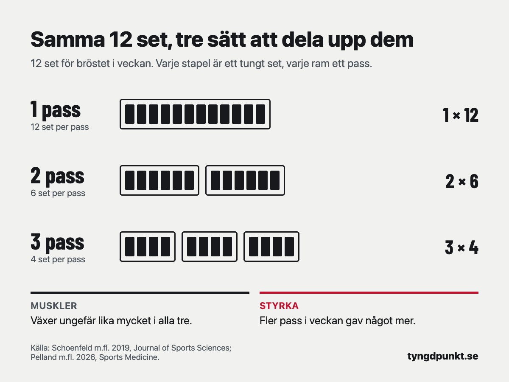

Träna varje muskelgrupp minst två gånger i veckan. En metaanalys från 2016 fann att två pass gav mer muskeltillväxt än ett. Senare genomgångar visar att antalet set i veckan betyder mer. Med samma antal set spelar det liten roll om de delas på ett, två eller tre pass. För styrka verkar fler pass ge något mer.

## Hur många gånger i veckan ska man träna samma muskelgrupp?

Två gånger i veckan är en bra grund för de flesta. Mer än så går bra, men det är inte frekvensen i sig som får musklerna att växa. Det är antalet tunga set.

Schoenfeld och kollegor gick 2016 igenom tio studier som jämförde hur många gånger i veckan en muskelgrupp tränades. Grupperna gjorde lika många set i veckan, bara uppdelade på olika många pass. Fler pass gav större ökning av muskelstorleken: effektstorleken var 0,49 mot 0,30 för färre pass. Författarnas slutsats var att de stora muskelgrupperna bör tränas minst två gånger i veckan. Om tre gånger är bättre än två kunde de inte säga.

Schoenfeld, Grgic och Krieger gjorde om analysen 2019, nu med 25 studier. Då försvann skillnaden. När antalet set var detsamma växte musklerna lika mycket oavsett hur ofta de tränades, och det gällde även vana personer och både över- och underkropp. I studierna där fler pass också innebar fler set gav fler pass ett litet försprång, men skillnaden mellan en och tre gånger i veckan var måttlig. Slutsatsen blev att man kan välja frekvens efter vad som passar, så länge antalet set är detsamma.

Pelland och kollegor gick 2026 igenom 67 studier med 2 058 deltagare och kom fram till samma sak. Effekten av fler pass på muskeltillväxten var så liten att den kan vara noll, medan antalet set gav tydlig effekt.

| Genomgång | Underlag | Vad den visade om frekvens |
|---|---|---|
| Schoenfeld 2016 | 10 studier | Två pass i veckan gav mer tillväxt än ett |
| Schoenfeld 2019 | 25 studier | Med samma antal set ingen skillnad för musklerna |
| Grgic 2018 | 22 studier | Fler pass gav mer styrka, men inte med samma antal set |
| Pelland 2026 | 67 studier, 2 058 deltagare | Liten eller ingen effekt på musklerna, tydlig effekt på styrkan |

Varför rekommenderar vi då ändå två gånger i veckan? För att det gör det lättare att få ihop tillräckligt många set. Ska bröstet ha 12 set i veckan är 6 set på två pass enklare att orka med än 12 på ett. Hur många set som behövs går vi igenom i artikeln om [hur många set per muskelgrupp du behöver i veckan](/artiklar/set-per-muskelgrupp/).

## Blir man starkare av att träna samma muskel oftare?

Ja, troligen lite. Här skiljer sig styrkan från muskelstorleken.

Grgic och kollegor slog 2018 ihop 22 studier om frekvens och styrka. Ju fler pass i veckan, desto större ökning: effektstorleken var 0,74 vid ett pass, 0,82 vid två, 0,93 vid tre och 1,08 vid fyra eller fler. I studierna där alla gjorde lika många set försvann skillnaden. Författarna drog slutsatsen att fler pass främst hjälper eftersom de gör det möjligt att träna mer.

Pellands genomgång från 2026 pekar ändå på att fler pass ger mer styrka. Effekten avtar för varje pass som läggs till. Varför det blir så mätte studierna inte.

Grgics genomgång hade några fler detaljer. Fler pass gav mer styrka i flerledsövningar som bänkpress och knäböj, men inte i enledsövningar. Effekten var tydlig för överkroppen men inte säker för benen, och tydlig för kvinnor men inte säker för män. De flesta studierna gjordes på otränade personer, så för vana lyftare är underlaget tunnare.

## Hur lägger man upp veckan?

Utgå från hur många set du vill göra per muskelgrupp och hur många dagar du kan träna. Sedan väljer du ett upplägg som ger varje muskel två eller fler pass i veckan.

| Pass i veckan | Upplägg | Varje muskelgrupp tränas |
|---|---|---|
| 2 | Helkropp × 2 | 2 gånger i veckan |
| 3 | Helkropp × 3 | 3 gånger i veckan |
| 4 | Överkropp och underkropp, två av varje | 2 gånger i veckan |
| 5 | Ett pass per muskelgrupp (bröst, rygg, ben …) | 1 gång i veckan |
| 6 | Press, drag och ben, två av varje | 2 gånger i veckan |

Det klassiska upplägget med en muskelgrupp per dag ger bara ett pass i veckan per muskel. Det går att bygga muskler så också, om antalet set är detsamma. Nackdelen är att alla set för en muskel hamnar på samma pass, och de sista seten kan bli sämre när du är trött.

**Räkneexempel.** Johan kan träna tre dagar i veckan och vill göra 12 set för bröstet. Han kan:

- köra ett bröstpass med 12 set: 1 × 12 = 12 set,
- köra två pass med 6 set och ett pass utan bröst: 2 × 6 = 12 set,
- köra helkropp tre gånger med 4 set bröst varje gång: 3 × 4 = 12 set.

För musklerna ger alla tre ungefär samma resultat, enligt Schoenfeld 2019 och Pelland 2026. Vill Johan också bli starkare i bänkpress talar Pellands genomgång för alternativet med tre pass. Dessutom blir varje pass kortare.

## Kan man träna samma muskelgrupp två dagar i rad?

Det går, men musklerna orkar oftast mindre andra dagen om första passet var tungt.

Morán-Navarro och kollegor lät tio vana män köra bänkpress och knäböj på tre sätt och mätte återhämtningen upp till 72 timmar efteråt. När varje set kördes tills det inte gick en rep till tog återhämtningen längre tid, upp till 24–48 timmar. När de stannade halvvägs, med 5 reps av 10 möjliga, återhämtade de sig snabbare mellan 24 och 48 timmar, även med dubbelt så många set.

Belcher och kollegor lät tolv vana män köra 4 set tills det inte gick en rep till, på 80 procent av maxvikten i knäböj, bänkpress och marklyft. Efter knäböjen var stångfarten på en vikt motsvarande 70 procent av max fortfarande 8,61 procent lägre i upp till 72 timmar.

Det praktiska rådet blir:

- **Tunga set ända till gränsen:** låt det gå ungefär två dagar innan samma muskel tränas tungt igen.
- **Set med några reps kvar:** återhämtningen går fortare, och det blir lättare att träna samma muskel oftare.
- **Två dagar i rad:** fungerar bäst om den ena dagen är lätt eller om du tränar andra övningar för samma muskel.

Läs mer om hur nära gränsen seten behöver vara i artikeln om [hur många reps du behöver för att bygga muskler](/artiklar/reps-for-att-bygga-muskler/).

## Kan man träna samma muskelgrupp varje dag?

Det går, men forskningen vi läst ger inget stöd för att det är bättre. Med samma antal set i veckan blir varje pass bara kortare. 12 set för bröstet blir knappt 2 set om dagen med sex pass i veckan. Det kan passa den som tränar hemma en stund varje dag, men för de flesta på gym är två till tre pass per muskel enklare.

Träning varje dag tar också bort vilodagarna. Har du ont i en led eller känner att styrkan sjunker från pass till pass kan det vara ett tecken på att du behöver mer vila. Har du en skada eller sjukdom: rådgör med vården innan du ökar träningen.

## Hur ofta ska man träna ben och armar?

Samma regel gäller: två gånger i veckan är en bra grund, och antalet set betyder mer än antalet pass. Schoenfeld 2019 fann ingen skillnad mellan över- och underkropp när antalet set var detsamma.

Fördelar du knäböj och marklyft på två pass blir varje benpass kortare. Armarna tränas också i flerledsövningar: biceps arbetar i rodd och triceps i bänkpress. Pelland och kollegor fick bäst träff när sådana set räknades som halva set för armarna. Räknar du så när du summerar veckan kan armarna behöva färre egna set.

Deffar du är det särskilt viktigt att behålla träningen. Det är den som säger åt kroppen att behålla musklerna. Läs mer om hur du [deffar utan att tappa muskler](/artiklar/deffa-utan-att-tappa-muskler/).

## I appen

I Tyngdpunkt ingår program som ökar vikt och reps själva efter hur passen gick, och en gång i veckan kan förslaget vara ett set till, med uträkningen synlig.

## Vanliga frågor

### Räcker det att träna en muskelgrupp en gång i veckan?

För musklerna kan det räcka om antalet set i veckan är tillräckligt, enligt Schoenfeld 2019. Men alla set hamnar då på samma pass, och det blir svårare att hålla kvaliteten. Två gånger i veckan är oftast enklare.

### Är helkropp bättre än en split?

Inte för musklerna, om antalet set är detsamma. Helkropp tre gånger i veckan ger varje muskel tre pass, och det kan ge något mer styrka enligt Pelland 2026. Välj det upplägg du orkar följa.

### Hur ofta ska en nybörjare träna samma muskelgrupp?

Två till tre gånger i veckan, gärna med helkroppspass. De flesta studierna i Grgics genomgång gjordes på otränade, och sammantaget gav fler pass mer styrka.

### Hur länge ska en muskel vila mellan passen?

Efter tunga set ända till gränsen tog återhämtningen upp till 24–48 timmar i Morán-Navarros studie. Kör du set med några reps kvar går det fortare. Två dagars vila mellan tunga pass för samma muskel är en rimlig tumregel.

### Gäller samma sak för kvinnor?

Ja, utgå från samma råd. I Grgics genomgång gav fler pass tydligt mer styrka hos kvinnor, medan effekten inte var säker hos män. Underlaget är mindre för kvinnor.

## Källor

- Schoenfeld BJ, Ogborn D, Krieger JW (2016). Effects of Resistance Training Frequency on Measures of Muscle Hypertrophy: A Systematic Review and Meta-Analysis. *Sports Medicine*, 46(11), 1689–1697. [Europe PMC](https://europepmc.org/article/MED/27102172)
- Schoenfeld BJ, Grgic J, Krieger J (2019). How many times per week should a muscle be trained to maximize muscle hypertrophy? A systematic review and meta-analysis of studies examining the effects of resistance training frequency. *Journal of Sports Sciences*, 37(11), 1286–1295. [Europe PMC](https://europepmc.org/article/MED/30558493)
- Grgic J, Schoenfeld BJ, Davies TB, Lazinica B, Krieger JW, Pedisic Z (2018). Effect of Resistance Training Frequency on Gains in Muscular Strength: A Systematic Review and Meta-Analysis. *Sports Medicine*, 48(5), 1207–1220. [Europe PMC](https://europepmc.org/article/MED/29470825)
- Pelland JC, Remmert JF, Robinson ZP, Hinson SR, Zourdos MC (2026). The Resistance Training Dose Response: Meta-Regressions Exploring the Effects of Weekly Volume and Frequency on Muscle Hypertrophy and Strength Gains. *Sports Medicine*, 56(2), 481–505. [Europe PMC](https://europepmc.org/article/MED/41343037)
- Morán-Navarro R, Pérez CE, Mora-Rodríguez R, de la Cruz-Sánchez E, González-Badillo JJ, Sánchez-Medina L, Pallarés JG (2017). Time course of recovery following resistance training leading or not to failure. *European Journal of Applied Physiology*, 117(12), 2387–2399. [Europe PMC](https://europepmc.org/article/MED/28965198)
- Belcher DJ, Sousa CA, Carzoli JP, Johnson TK, Helms ER, Visavadiya NP, Zoeller RF, Whitehurst M, Zourdos MC (2019). Time course of recovery is similar for the back squat, bench press, and deadlift in well-trained males. *Applied Physiology, Nutrition, and Metabolism*, 44(10), 1033–1042. [Europe PMC](https://europepmc.org/article/MED/30779596)
