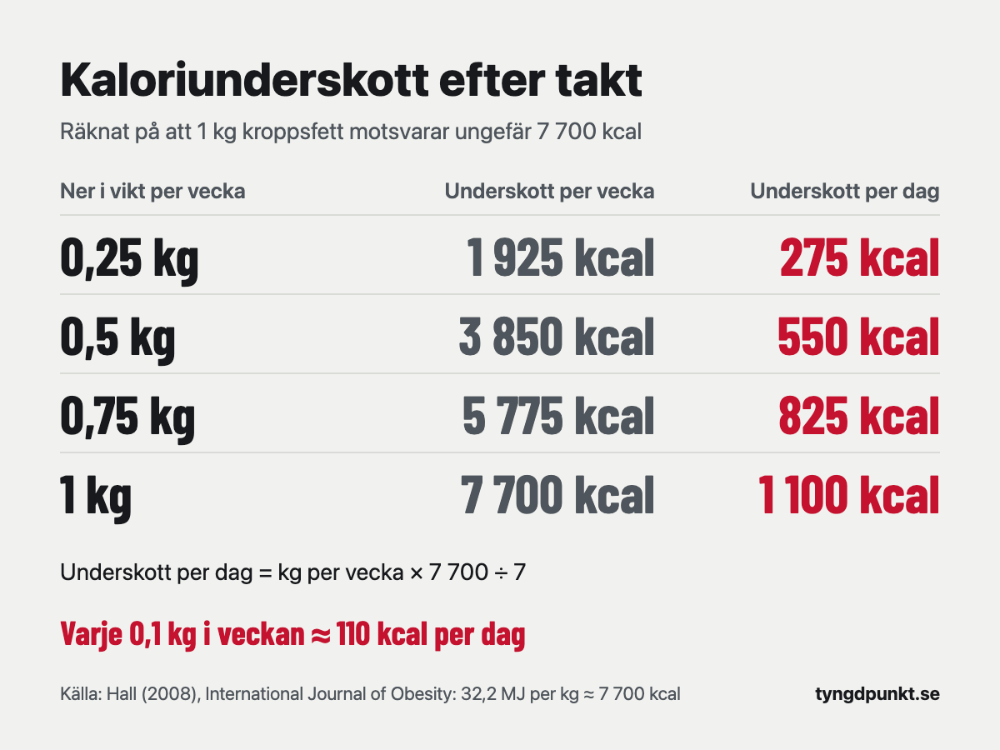

Ett kaloriunderskott är skillnaden mellan det du gör av med och det du äter. Du räknar ut det genom att först ta fram ditt kaloribehov och sedan dra av underskottet. Ett kilo kroppsfett motsvarar ungefär 7 700 kcal, så 0,5 kg i veckan kräver omkring 550 kcal mindre per dag. Styrketränar du brukar 0,5–1 procent av kroppsvikten i veckan rekommenderas.

## Vad är ett kaloriunderskott?

Kroppen gör av med energi hela dygnet: i vila, när den bryter ner maten och när du rör dig. Summan kallas kaloribehov. Äter du lika mycket som du gör av med står vikten still. Äter du mindre ligger du på ett kaloriunderskott, och kroppen tar mellanskillnaden från sina egna förråd, mest från fettet.

Underskottet mäts oftast i kcal per dag. Det räknas alltid mot ditt eget behov. 1 800 kcal om dagen kan vara ett stort underskott för en person och inget underskott alls för en annan.

## Hur räknar man ut sitt kaloriunderskott?

Det görs i tre steg.

1. **Räkna ut ditt kaloribehov.** Vilan räknas med Mifflin–St Jeor och multipliceras med en faktor för hur mycket du tränar. Hur det går till steg för steg står i [hur många kalorier per dag du behöver](/artiklar/hur-manga-kalorier-per-dag/).
2. **Välj en takt**, alltså hur många kilo i veckan du vill gå ner.
3. **Räkna om takten till kcal per dag:** kilo per vecka × 7 700 ÷ 7. Dra resultatet från kaloribehovet.

Siffran 7 700 kommer från den gamla tumregeln att det krävs ett underskott på 3 500 kcal för att gå ner ett pund. Omräknat blir det 32,2 MJ per kilo, eller ungefär 7 700 kcal. Eftersom 7 700 ÷ 7 är 1 100 motsvarar varje 0,1 kg i veckan ungefär 110 kcal per dag.

| Ner i vikt per vecka | Underskott per vecka | Underskott per dag |
|---|---|---|
| 0,25 kg | 1 925 kcal | 275 kcal |
| 0,5 kg | 3 850 kcal | 550 kcal |
| 0,75 kg | 5 775 kcal | 825 kcal |
| 1 kg | 7 700 kcal | 1 100 kcal |

**Räkneexempel.** Emma är 34 år, 165 cm lång, väger 72 kg och styrketränar tre pass i veckan.

- Vilan: 10 × 72 + 6,25 × 165 − 5 × 34 − 161 = 720 + 1 031 − 170 − 161 = 1 420 kcal.
- Kaloribehovet med tre pass: 1 420 × 1,45 = 2 059 kcal.
- Underskottet för 0,5 kg i veckan: 0,5 × 7 700 ÷ 7 = 550 kcal.
- Att äta: 2 059 − 550 = 1 509 kcal, avrundat till **1 500 kcal per dag**.

Väljer Emma 0,25 kg i veckan blir det 1 800 kcal per dag, och med 0,75 kg blir det 1 250 kcal. Formeln är densamma för kvinnor och män. Det enda som skiljer är att vilan får −161 i stället för +5.

Du kan [räkna ut ditt kaloriunderskott](/kaloribehov/) i kalkylatorn. Välj "Gå ner i fett" och en takt på 0,25, 0,5 eller 0,75 kg i veckan, så visar den hela uträkningen.

## Hur stort kaloriunderskott ska man ha?

Ett bra sätt är att utgå från kroppsvikten i stället för ett fast antal kilo. Helms och kollegor gick 2014 igenom forskningen om att gå ner i fett och samtidigt behålla musklerna, och de rekommenderar ett kaloriintag som ger en viktnedgång på ungefär 0,5–1 procent av kroppsvikten i veckan.

Så här blir det i kcal per dag:

| Kroppsvikt | 0,5 % per vecka | 1 % per vecka | Underskott per dag |
|---|---|---|---|
| 60 kg | 0,3 kg | 0,6 kg | 330–660 kcal |
| 70 kg | 0,35 kg | 0,7 kg | 385–770 kcal |
| 80 kg | 0,4 kg | 0,8 kg | 440–880 kcal |
| 90 kg | 0,45 kg | 0,9 kg | 495–990 kcal |
| 100 kg | 0,5 kg | 1 kg | 550–1 100 kcal |

För Emma på 72 kg blir det 0,36–0,72 kg i veckan, eller ungefär 400–800 kcal per dag. Väljer hon 0,75 kg i veckan hamnar hon strax över den övre gränsen.

Finns det något att vinna på att välja den lägre delen? Garthe och kollegor lät 24 elitidrottare som styrketränade fyra gånger i veckan gå ner i vikt i två olika takter: 0,7 procent och 1,4 procent av kroppsvikten i veckan. Den långsamma gruppen åt 19 procent mindre än vanligt och den snabba 30 procent mindre. Båda grupperna gick ner ungefär 5,5 procent i vikt. Den långsamma gruppen ökade sin fettfria massa med 2,1 procent, medan den snabba låg kvar på samma nivå. Den långsamma gruppen behövde i gengäld 8,5 veckor, mot 5,3 veckor för den snabba.

Studien var liten och gjordes på idrottare, så den säger inte allt om en vanlig gymbesökare. Men den pekar åt samma håll som rekommendationen: en lugnare takt gör det lättare att behålla och bygga muskler.

## Är 500 kcal per dag ett bra kaloriunderskott?

500 kcal är den siffra många utgår från. Räknat med 7 700 kcal per kilo blir det ungefär 0,45 kg i veckan. Om det är lagom beror på hur mycket du väger. För den som väger 60 kg är 0,45 kg i veckan ungefär 0,75 procent av kroppsvikten. För den som väger 100 kg är det 0,45 procent, alltså strax under det rekommenderade spannet.

Murphy och Koehler sammanställde 2022 de randomiserade studier där deltagarna styrketränat i minst tre veckor med ett kaloriunderskott. Styrkan ökade lika mycket som hos dem som åt som vanligt, men den fettfria massan ökade mindre. I deras analys räckte ett underskott på ungefär 500 kcal per dag för att musklerna inte skulle växa alls. Författarna drar slutsatsen att den som vill behålla musklerna under en viktnedgång bör undvika underskott större än 500 kcal per dag.

Ett underskott på 1 000 kcal per dag motsvarar ungefär 0,9 kg i veckan. För den som väger 90 kg är det 1 procent av kroppsvikten, den övre gränsen hos Helms och kollegor. För den som väger 60 kg är det 1,5 procent, och dessutom blir det inte mycket mat kvar. Emma skulle med 1 000 kcal mindre äta runt 1 050 kcal per dag, och det gör det svårt att få i sig tillräckligt med protein. Hur mycket protein du behöver under en viktnedgång går vi igenom i [hur mycket protein per dag](/artiklar/hur-mycket-protein-per-dag/).

## Varför går jag inte ner så mycket som underskottet säger?

7 700 kcal per kilo är en tumregel, och Kevin Hall räknade 2008 ut när den stämmer och när den inte gör det. Enligt hans modell stämmer regeln ungefär för personer med mer än 30 kg kroppsfett. För den som har mindre fett överskattar den hur stort underskott som krävs per kilo. En större del av det man går ner är då fettfri massa, som innehåller mindre energi än fett. Du kan alltså gå ner i vikt snabbare än tabellen säger, men en större del av det är inte fett.

Det finns fler skäl till att verkligheten avviker:

- **Kaloribehovet är en uppskattning.** Formeln ger ett snitt för många människor, inte ditt exakta behov. Varför den kan slå fel för en enskild person går vi igenom i [hur många kalorier per dag](/artiklar/hur-manga-kalorier-per-dag/).
- **Behovet minskar när du går ner.** I Mifflin–St Jeor sjunker vilan med 10 kcal för varje kilo. Har Emma gått ner 5 kg gör hon av med 50 kcal mindre i vila, eller ungefär 70 kcal mindre per dag med träningen inräknad. Samma mat ger då ett mindre underskott.
- **Loggningen är sällan exakt.** Små missar varje dag blir snabbt några hundra kcal.

Det säkraste är att se underskottet som en startpunkt. Väg dig några gånger i veckan och jämför snittet över två till tre veckor med den takt du räknat med. Går det för långsamt eller för fort justerar du med 100–200 kcal och följer vikten igen.

Har du en sjukdom, är gravid eller ammar, eller har eller har haft en ätstörning, ska du inte lägga upp ett kaloriunderskott på egen hand. Prata med vården.

## I appen

I Tyngdpunkt är underskottet en startgissning. En gång i veckan räknar vi ut din faktiska förbrukning ur vikttrenden och maten du loggat, och har du följt planen men vikten ändå går fel får du ett förslag på en ändring, med uträkningen synlig.

## Vanliga frågor

### Hur räknar man ut kaloriunderskott för en kvinna?

På samma sätt som för en man. Vilan räknas med Mifflin–St Jeor (10 × vikt + 6,25 × längd − 5 × ålder − 161), multipliceras med en faktor för träningen, och sedan dras underskottet av. En kvinna på 165 cm och 72 kg som är 34 år och tränar tre pass i veckan hamnar på 1 500 kcal per dag för 0,5 kg i veckan.

### Hur mycket kaloriunderskott per vecka behövs för att gå ner ett halvt kilo?

Ungefär 3 850 kcal, eller 550 kcal per dag. För ett kilo i veckan krävs ungefär 7 700 kcal, eller 1 100 kcal per dag.

### Ska man lägga till kalorierna från träningen?

Nej, inte om kaloribehovet är räknat med en aktivitetsfaktor. Träningen ingår redan i faktorn. Lägger du till kalorierna från en träningsklocka ovanpå räknas träningen två gånger, och underskottet blir mindre än du tror.

### Vad är skillnaden mellan kaloribehov och kaloriunderskott?

Kaloribehovet är det du gör av med på en dag. Underskottet är hur mycket mindre än så du äter. Behovet minus underskottet är det du ska äta.

## Källor

- Hall KD (2008). What is the required energy deficit per unit weight loss? *International Journal of Obesity*, 32, 573–576. [Europe PMC](https://europepmc.org/article/PMC/PMC2376744)
- Helms ER, Aragon AA, Fitschen PJ (2014). Evidence-based recommendations for natural bodybuilding contest preparation: nutrition and supplementation. *Journal of the International Society of Sports Nutrition*, 11, 20. [Europe PMC](https://europepmc.org/article/PMC/PMC4033492)
- Garthe I, Raastad T, Refsnes PE, Koivisto A, Sundgot-Borgen J (2011). Effect of two different weight-loss rates on body composition and strength and power-related performance in elite athletes. *International Journal of Sport Nutrition and Exercise Metabolism*, 21, 97–104. [Europe PMC](https://europepmc.org/article/MED/21558571)
- Murphy C, Koehler K (2022). Energy deficiency impairs resistance training gains in lean mass but not strength: A meta-analysis and meta-regression. *Scandinavian Journal of Medicine & Science in Sports*, 32, 125–137. [Europe PMC](https://europepmc.org/article/MED/34623696)
