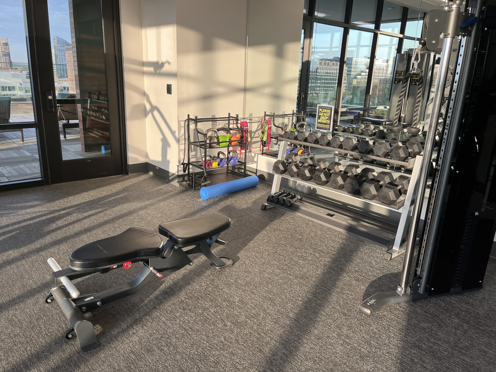
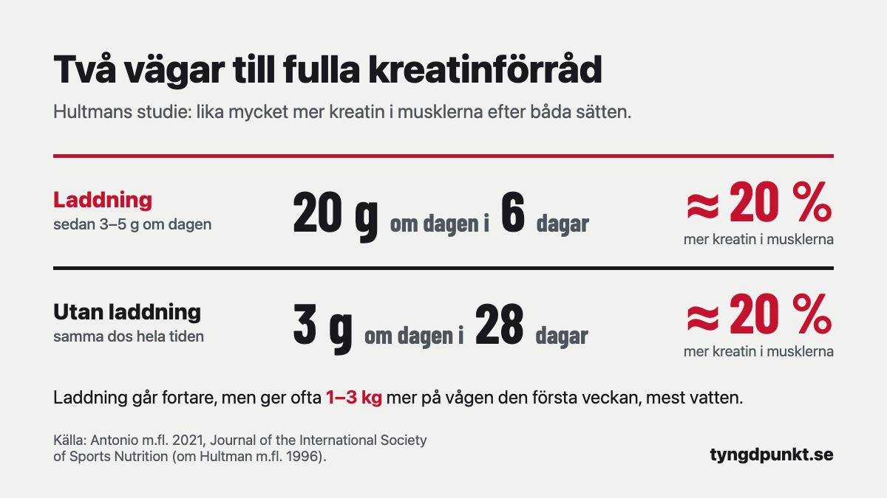

Kreatin hjälper musklerna att orka mer i korta, tunga ansträngningar, som ett set knäböj. Över några månaders styrketräning ger det lite mer styrka och muskler än samma träning utan. Det räcker med 3–5 gram kreatinmonohydrat om dagen. Effekten kommer efter ungefär fyra veckor, eller efter en vecka om du börjar med en högre dos.

## Vad är kreatin och vad gör det i kroppen?

Kreatin är ett ämne som kroppen gör själv och som också finns i kött och fisk. Ungefär 95 procent av det finns i skelettmusklerna. Där lagras det mest som fosfokreatin, en snabb energireserv som musklerna använder de första sekunderna av en hård ansträngning.

Kroppen behöver fylla på 1–3 gram kreatin om dagen, beroende på hur mycket muskler man har. Ungefär hälften kommer från maten och resten tillverkar levern och njurarna. Ett skålpund (454 gram) rått nötkött eller lax innehåller ungefär 1–2 gram.

Med vanlig blandkost är kreatinförråden i musklerna fyllda till 60–80 procent. Ett tillskott höjer dem med 20–40 procent. Det är därför kreatin fungerar: med fullare förråd orkar musklerna lite mer innan de tröttnar. Den som äter lite eller inget kött har ofta lägre förråd från början och kan få större ökning av ett tillskott.

## Vad är kreatin bra för när man tränar?

Den internationella föreningen för idrottsnutrition, ISSN, skriver i sitt ställningstagande från 2017 att kreatinmonohydrat är det mest effektiva kosttillskottet som finns för att orka mer vid hård träning och öka muskelmassan. Det som händer är att du klarar lite mer i set som tas nära max, till exempel en rep till. Över veckor blir det mer träning, och det är den som ger resultatet.

Hur stor är då effekten? Två metaanalyser, från 2023 och 2025, har räknat på det:

| Mått | Kreatin + styrketräning jämfört med bara styrketräning | Studie |
|---|---|---|
| Bänkpress | 1,4 kg mer | Kazeminasab 2025, 69 studier |
| Knäböj | 5,6 kg mer | Kazeminasab 2025, 69 studier |
| Benpress | 3,1 kg mer, men inte statistiskt säkert | Kazeminasab 2025, 69 studier |
| Handgrepp | Ingen säker skillnad | Kazeminasab 2025, 69 studier |
| Muskeltjocklek | 0,10–0,16 cm mer | Burke 2023, 10 studier |

Kazeminasab och kollegor gick igenom 69 studier med 1 937 deltagare. Kreatin tillsammans med styrketräning gav mer styrka i bänkpress och knäböj än placebo. Skillnaderna var små och syntes tydligast hos yngre vuxna och hos män.

Burke och kollegor tittade bara på studier som mätt musklerna direkt, med magnetkamera, datortomografi eller ultraljud. Kreatin gav en mycket liten extra ökning i muskeltjocklek, både i över- och underkroppen.

Kreatin är alltså ingen genväg. Det lägger några kilo på stången och en dryg millimeter på musklerna, ovanpå det som träningen ger. Har du inte koll på grunderna, som [tillräckligt med protein](/artiklar/hur-mycket-protein-per-dag/) och [tillräckligt många set](/artiklar/set-per-muskelgrupp/), gör de mer skillnad.

## Hur mycket kreatin ska man ta per dag?

Det finns två sätt att börja, och båda fyller förråden lika mycket till slut.

| Sätt | Dos | Hur länge | Förråden fulla |
|---|---|---|---|
| Med laddning | 20 g om dagen (4 × 5 g), sedan 3–5 g om dagen | 5–7 dagar laddning | Efter ungefär en vecka |
| Utan laddning | 3–5 g om dagen | Hela tiden | Efter ungefär fyra veckor |

I en klassisk studie av Hultman och kollegor ökade kreatinet i musklerna lika mycket, cirka 20 procent, efter 3 gram om dagen i 28 dagar som efter 20 gram om dagen i 6 dagar. Laddning går alltså fortare, men den behövs inte. Vårt råd är att hoppa över den om du inte har bråttom. Du slipper magbesvären och den snabba viktökningen.

Laddning kan också anges per kilo kroppsvikt: 0,3 g/kg om dagen i 5–7 dagar. Den vanliga dagsdosen därefter är 3–5 gram, eller 0,1 g/kg. Enligt ISSN kan större idrottare behöva 5–10 gram om dagen för att hålla förråden fulla.

**Räkneexempel.** Johan väger 90 kg och vill börja med kreatin.

- Laddar han blir det 0,3 × 90 = 27 gram om dagen i 5–7 dagar. Doser över 10 gram åt gången kan ge magbesvär, så han delar upp det på tre doser om 9 gram.
- Efter laddningen tar han 5 gram om dagen. Räknat per kilo blir 0,1 × 90 = 9 gram, så för hans storlek är det övre spannet rimligt.
- Hoppar han över laddningen tar han 5 gram om dagen från början och har fulla förråd efter ungefär fyra veckor.

Sara väger 60 kg. För henne räcker 3 gram om dagen, och hon behöver inte ladda.

Den form som är mest studerad är kreatinmonohydrat. Det är den som har använts i de flesta studierna om dos, upptag och effekt.

## Hur lång tid tar det innan kreatin ger effekt?

Det beror på hur du börjar. Med laddning är förråden fulla efter 5–7 dagar. Utan laddning tar det ungefär fyra veckor. Först när förråden är fulla kan du räkna med full effekt.

Därefter syns effekten på samma sätt som träningen: gradvis, över veckor och månader. I Burkes genomgång pågick alla studierna i minst sex veckor. Förvänta dig inte att märka något efter ett enskilt pass.

## Ska man ta kreatin före eller efter träning?

Det spelar troligen ingen roll. Antonio och kollegor gick 2025 igenom de studier som jämfört kreatin före och efter passet. De gav liknande resultat för styrka och muskeltjocklek. En dos på 5 gram kan ta upp till två timmar att nå sin högsta nivå i blodet, så exakt när du tar den kring passet påverkar knappast hur mycket som når musklerna.

Det viktiga är att ta kreatinet varje dag, så att förråden hålls fulla. Dosen är daglig, så ta den även på vilodagar. Välj en tid som du kommer ihåg, till exempel till frukosten.

## Går man upp i vikt av kreatin?

Ja, ofta lite i början. En laddning med 20 gram om dagen i 5–7 dagar ger vanligen 1–3 kg mer på vågen, och det mesta är vatten som binds i musklerna. Tar du 3–5 gram om dagen utan laddning blir ökningen mindre märkbar.

Fettet ökar däremot inte. Antonio och kollegor skriver i sin genomgång från 2021 att kreatin inte ökar fettmassan, och i studier med äldre som styrketränade gick gruppen med kreatin snarare ner något mer i fettprocent.

Det här är bra att veta om du deffar. Börjar du med kreatin mitt i en deff kan vågen stå still eller gå upp den första veckan, trots att du ligger på underskott. Det betyder inte att planen har slutat fungera. Ge det ett par veckor innan du drar slutsatser, och läs mer om [varför vikten står still trots kaloriunderskott](/artiklar/vikten-star-still/).

## Har kreatin några biverkningar?

För friska vuxna som håller sig till de vanliga doserna är kreatin väl studerat och tolereras bra. ISSN beskriver studier med upp till 30 gram om dagen i fem år utan problem hos friska personer. Det vanligaste är att vikten går upp lite de första dagarna, som beskrivs ovan.

**Magen.** Stora doser på en gång, över 10 gram, kan ge diarré. Dela upp dosen om du laddar.

**Njurarna.** Rädslan går tillbaka på ett fall från 1998, en ung man som hade haft njursjukdom i åtta år och tog läkemedel. Sedan dess har många kontrollerade studier gjorts. Hos friska personer har de vanliga doserna inte visat någon negativ effekt på njurarna. De fall av nedsatt njurfunktion som rapporterats har gällt personer med njursjukdom, andra läkemedel eller doser långt över de rekommenderade. **Har du en njursjukdom eller tar läkemedel, fråga vården innan du börjar.**

**Håret.** Kopplingen till håravfall kommer från en enda studie från 2009. Rugbyspelare som tog kreatin fick 56 procent högre halt av hormonet DHT efter en veckas laddning, och 40 procent högre efter ytterligare två veckor. Värdena låg inom normala gränser, och resultatet har inte upprepats i andra studier.

## Vanliga frågor

### Fungerar kreatin för kvinnor?

Ja, men effekten kan vara mindre. I Kazeminasabs metaanalys syntes styrkeökningen tydligt hos män men inte hos kvinnor. En möjlig förklaring är att kvinnor ofta har högre kreatinhalt i musklerna från början och därför får mindre ökning. Dosen är densamma, 3–5 gram om dagen.

### Måste man ladda med kreatin?

Nej. 3–5 gram om dagen fyller förråden lika mycket som laddning, det tar bara längre tid, ungefär fyra veckor i stället för en. Vill du undvika den snabba viktökningen är det enklare att hoppa över laddningen.

### Ska man ta kreatin om man inte tränar?

Kreatin ger mest tillsammans med träning. Antonio och kollegor beskriver en studie där kvinnor som tog 3 gram om dagen i två år, utan att styrketräna, inte fick mer muskelmassa. Effekten kommer av att du orkar träna lite mer.

### Kan man få i sig tillräckligt med kreatin från maten?

Inte för att fylla förråden helt. Med vanlig blandkost får du i dig 1–2 gram om dagen, och då är förråden fyllda till 60–80 procent. För att få i dig 3–5 gram till skulle du behöva äta runt ett kilo kött eller fisk om dagen, eller mer.

### Är kreatin en steroid?

Nej. Anabola steroider är läkemedel som efterliknar testosteron. Kreatin har en annan kemisk uppbyggnad och verkar på ett annat sätt: det fyller på musklernas snabba energireserv. Samma ämne finns i kött och fisk. Är du gravid, ammar eller har en sjukdom ska du prata med vården innan du tar kosttillskott.

## Källor

- Kreider RB, Kalman DS, Antonio J, Ziegenfuss TN, Wildman R, Collins R, Candow DG, Kleiner SM, Almada AL, Lopez HL (2017). International Society of Sports Nutrition position stand: safety and efficacy of creatine supplementation in exercise, sport, and medicine. *Journal of the International Society of Sports Nutrition*, 14, 18. [Europe PMC](https://europepmc.org/article/PMC/PMC5469049)
- Antonio J, Candow DG, Forbes SC, Gualano B, Jagim AR, Kreider RB, Rawson ES, Smith-Ryan AE, VanDusseldorp TA, Willoughby DS, Ziegenfuss TN (2021). Common questions and misconceptions about creatine supplementation: what does the scientific evidence really show? *Journal of the International Society of Sports Nutrition*, 18(1), 13. [Europe PMC](https://europepmc.org/article/PMC/PMC7871530)
- Antonio J, Brown AF, Candow DG, Chilibeck PD, Ellery SJ, Forbes SC, Gualano B, Jagim AR, Kerksick C, Kreider RB m.fl. (2025). Part II. Common questions and misconceptions about creatine supplementation: what does the scientific evidence really show? *Journal of the International Society of Sports Nutrition*, 22(1), 2441760. [Europe PMC](https://europepmc.org/article/PMC/PMC11703406)
- Kazeminasab F, Kerchi AB, Sharafifard F, Zarreh M, Forbes SC, Camera DM, Lanhers C, Wong A, Nordvall M, Bagheri R, Dutheil F (2025). The Effects of Creatine Supplementation on Upper- and Lower-Body Strength and Power: A Systematic Review and Meta-Analysis. *Nutrients*, 17(17), 2748. [Europe PMC](https://europepmc.org/article/PMC/PMC12430374)
- Burke R, Piñero A, Coleman M, Mohan A, Sapuppo M, Augustin F, Aragon AA, Candow DG, Forbes SC, Swinton P, Schoenfeld BJ (2023). The Effects of Creatine Supplementation Combined with Resistance Training on Regional Measures of Muscle Hypertrophy: A Systematic Review with Meta-Analysis. *Nutrients*, 15(9), 2116. [Europe PMC](https://europepmc.org/article/PMC/PMC10180745)
