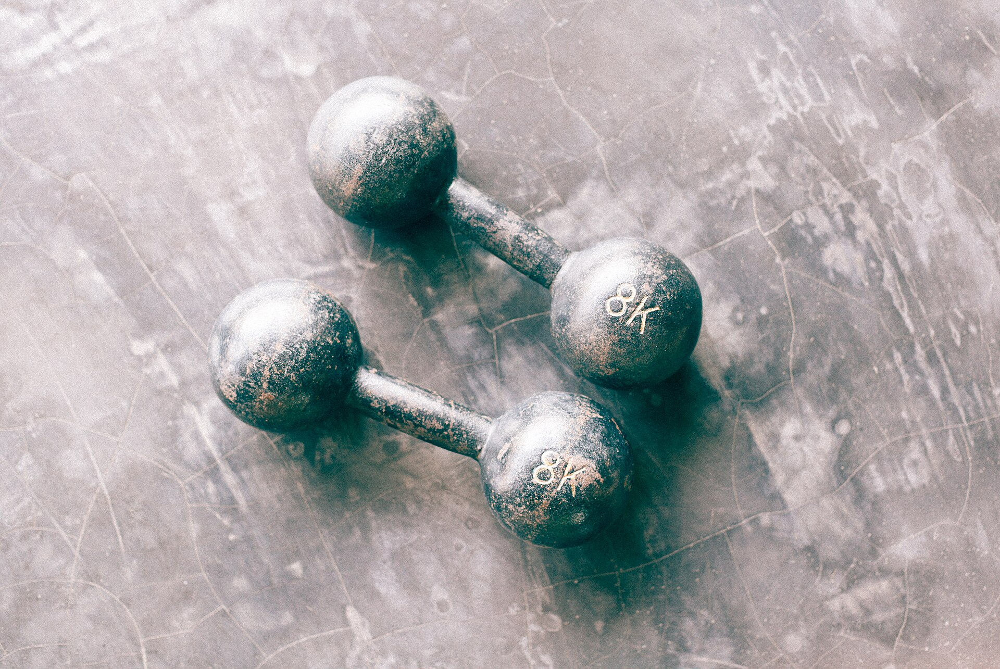
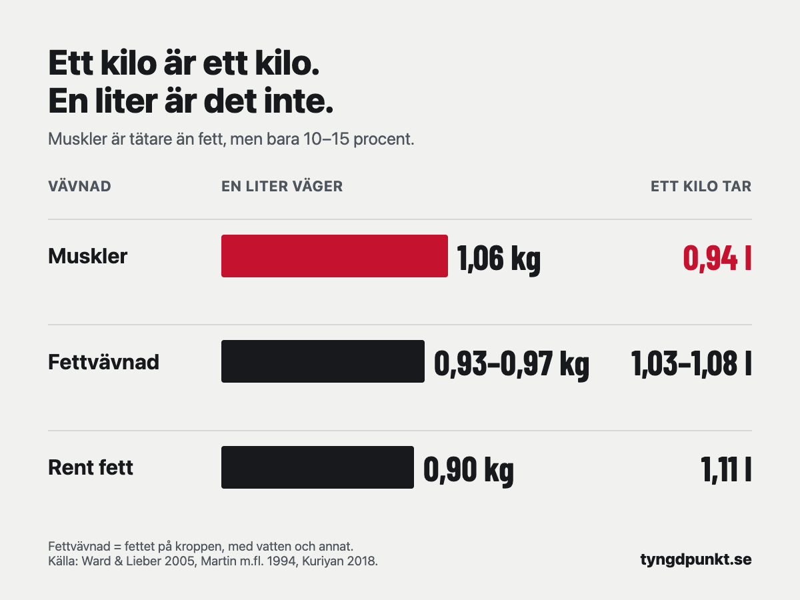

Nej, ett kilo muskler väger lika mycket som ett kilo fett. Det som skiljer är att muskler är tätare. En liter muskler väger ungefär 1,06 kg och en liter fettvävnad 0,93–0,97 kg. Liter för liter väger muskler alltså ungefär 10–15 procent mer, och ett kilo muskler tar mindre plats än ett kilo fett.

## Stämmer det att muskler väger mer än fett?

Både ja och nej. Ett kilo är ett kilo, oavsett vad det är gjort av. Men frågan handlar oftast om något annat, nämligen om lika stora bitar. Lägger du en liter muskler och en liter fett på var sin våg är det musklerna som väger mest.

Skillnaden kallas densitet, alltså hur mycket något väger per liter. Vatten väger ungefär 1 kg per liter. Muskler är något tyngre än vatten och fett något lättare. Det är därför fett flyter ovanpå soppan.

Det låter som en detalj, men det avgör hur du ska läsa av vågen när du börjar träna.

## Hur mycket mer väger muskler än fett?

Inom forskningen räknar man ofta med att muskler väger 1,06 g per kubikcentimeter, alltså 1,06 kg per liter. Ward och Lieber skriver 2005 att det är det värde som brukar användas. Själva mätte de upp 1,11 i konserverade muskelprover från människa, så musklerna kan vara ännu lite tätare än så.

För fett finns två siffror, och de är lätta att blanda ihop:

- **Rent fett** väger ungefär 0,90 kg per liter. Det är det värde som används i den enklaste modellen för kroppssammansättning, där kroppen delas i fett och allt annat. Samma modell räknar med 1,10 kg per liter för allt som inte är fett (Kuriyan 2018).
- **Fettvävnad**, alltså det fett du har på kroppen, är inte bara fett. Den innehåller också vatten och lite annat. Martin och kollegor vägde 1994 all fettvävnad hos sex män som donerat sina kroppar till forskningen och mätte hur mycket den tog plats. Den vägde 0,925–0,970 kg per liter. Andelen rent fett i vävnaden låg mellan 54 och 85 procent, och den var högre hos dem som hade mer fett.

| Vävnad | Vikt per liter | Volym per kilo |
|---|---|---|
| Rent fett | 0,90 kg | 1,11 liter |
| Fettvävnad | 0,93–0,97 kg | 1,03–1,08 liter |
| Muskler | 1,06 kg | 0,94 liter |

Volymen per kilo är uträknad ur vikten per liter: 1 ÷ 1,06 ≈ 0,94 liter för muskler och 1 ÷ 0,97 ≈ 1,03 till 1 ÷ 0,925 ≈ 1,08 liter för fettvävnad.

Jämför muskler med fettvävnad, eftersom det är den som finns på kroppen. Då väger en liter muskler 1,06 ÷ 0,97 ≈ 1,09 till 1,06 ÷ 0,925 ≈ 1,15 gånger så mycket som en liter fett. Det är 10–15 procent mer. Skillnaden finns, men den är mindre än många tror.

## Varför säger man att muskler väger mer än fett?

För att det förklarar något som många upplever. Du börjar styrketräna, kläderna sitter lösare, men vågen står still. Har du gått ner ett kilo fett och byggt ett kilo muskler väger du lika mycket. Men kilot muskler tar ungefär 0,94 liter och kilot fett 1,03–1,08 liter, så kroppen har blivit något mindre.

Det är alltså inte fel att säga att muskler väger mer än fett, så länge man menar per liter. Det blir fel när meningen används för att förklara varför vikten går upp flera kilo de första veckorna med träning. Så snabbt bygger ingen muskler.

## Varför går man upp i vikt när man börjar träna?

Det beror oftast på vatten och inte på muskler. Musklerna lagrar kolhydrater som glykogen, och glykogenet binder vatten. Fernández-Elías och kollegor mätte 2015 att varje gram glykogen lagrades med minst 3 gram vatten. Fylls förråden på syns det på vågen, utan att det är vare sig muskler eller fett.

Ett nytt eller tungt pass kan också ge svullnad i musklerna under några dagar. Det och andra skäl till att vikten hoppar upp och ned går vi igenom i [varför står vikten still trots kaloriunderskott](/artiklar/vikten-star-still/).

Musklerna växer betydligt långsammare. Lopez och kollegor slog 2022 ihop 114 studier med 4 184 personer med övervikt. De som bara styrketränade ökade sin fettfria massa, alltså allt utom fett, med 0,8 kg och gick ner 1,0 kg fett jämfört med dem som inte tränade. Kroppen har förändrats, men vågen har knappt rört sig.

**Räkneexempel.** Lisa väger 80 kg och börjar styrketräna. Hon äter som förut. Efter en tid har hon fått samma förändring som snittet i Lopez sammanställning.

- Fett: −1,0 kg, vilket är ungefär 1,03–1,08 liter fettvävnad.
- Fettfri massa: +0,8 kg. Räknat som muskler blir det 0,8 ÷ 1,06 ≈ 0,75 liter.
- Vikten: 80 − 1,0 + 0,8 = 79,8 kg. Vågen visar 0,2 kg mindre.
- Volymen: 0,75 − 1,03 ≈ −0,28 till 0,75 − 1,08 ≈ −0,33 liter. Kroppen har krympt med ungefär en tredjedels liter.

På vågen syns knappt någon skillnad. Midjemåttet och styrkan är bättre mått på vad som hänt. Vill du samtidigt gå ner mer i fett behövs ett litet underskott. Hur du kombinerar de två står i [kan man gå ner i fett och bygga muskler samtidigt](/artiklar/ga-ner-i-fett-och-bygga-muskler/).

## Hur mycket väger musklerna i kroppen?

En stor del av vikten. Janssen och kollegor mätte 2000 musklerna med magnetkamera hos 468 kvinnor och män mellan 18 och 88 år. Männen hade i snitt 33,0 kg skelettmuskler, 38,4 procent av kroppsvikten. Kvinnorna hade 21,0 kg, 30,6 procent av vikten.

| | Skelettmuskler | Andel av kroppsvikten |
|---|---|---|
| Män | 33,0 kg | 38,4 % |
| Kvinnor | 21,0 kg | 30,6 % |

Källa: Janssen m.fl. (2000), snitt för 468 vuxna.

I studien började andelen muskler minska redan hos unga vuxna. Den totala mängden minskade märkbart först i slutet av 40-årsåldern, och mest i benen. Det är ett skäl att fortsätta styrketräna med åren.

## Hur vet man om man bygger muskler eller lägger på fett?

Inte med vågen ensam. Den väger allt på en gång: muskler, fett, vatten och det du har i magen. Följ i stället tre saker tillsammans:

- **Styrkan.** Ökar vikterna eller antalet reps över veckorna bygger du sannolikt muskler.
- **Midjemåttet.** Mät på samma ställe och vid samma tid på dagen. Minskar det medan vikten står still minskar troligen fettet.
- **Vikttrenden.** Väg dig några gånger i veckan och följ snittet, inte enskilda dagar.

| Vikten | Midjan | Styrkan | Troligast |
|---|---|---|---|
| Står still | Minskar | Ökar | Mindre fett, mer muskler |
| Ökar långsamt | Står still | Ökar | Mest muskler |
| Ökar snabbt | Ökar | Står still | Mest fett |
| Minskar | Minskar | Håller | Mindre fett, musklerna behålls |

Tabellen är en tumregel och inget mått. Vatten kan flytta både vikten och midjan några dagar i taget, så titta på flera veckor.

Står både vikten, midjan och styrkan still i flera veckor äter du troligen runt ditt behov. [Räkna ut ditt kaloribehov](/kaloribehov/) för att se var du ligger. Vill du gå ner i fett utan att förlora det du byggt finns mer i [deffa utan att tappa muskler](/artiklar/deffa-utan-att-tappa-muskler/).

Har du en sjukdom, är gravid eller har eller har haft en ätstörning: prata med vården innan du ändrar kost eller vikt.

## I appen

I Tyngdpunkt loggar du både träning och mat. En gång i veckan ställer vi vikttrenden mot styrkan i varje övning, till exempel "Går ner och blir starkare", så att du ser om det är fett eller muskler som rör sig.

## Vanliga frågor

### Väger ett kilo muskler mer än ett kilo fett?

Nej. Ett kilo väger alltid ett kilo. Skillnaden är att ett kilo muskler tar ungefär 0,94 liter och ett kilo fettvävnad 1,03–1,08 liter. Musklerna tar alltså mindre plats.

### Hur mycket väger en liter muskler?

Ungefär 1,06 kg. Det är det värde som oftast används i forskningen. I Ward och Liebers mätningar på muskelprover från människa var det 1,11 kg.

### Kan fett bli muskler?

Nej. Fett och muskler är olika vävnader. Du kan gå ner i fett och bygga muskler under samma period, men det ena förvandlas inte till det andra.

### Gäller det kvinnor också?

Ja. Muskler och fett har samma täthet hos kvinnor och män. Det som skiljer är mängden. I Janssens studie hade kvinnorna i snitt 21,0 kg muskler och männen 33,0 kg.

## Källor

- Ward SR, Lieber RL (2005). Density and hydration of fresh and fixed human skeletal muscle. *Journal of Biomechanics*, 38, 2317–2320. [Europe PMC](https://europepmc.org/article/MED/16154420)
- Kuriyan R (2018). Body composition techniques. *Indian Journal of Medical Research*, 148(5), 648–658. [Europe PMC](https://europepmc.org/article/PMC/PMC6366261)
- Martin AD, Daniel MZ, Drinkwater DT, Clarys JP (1994). Adipose tissue density, estimated adipose lipid fraction and whole body adiposity in male cadavers. *International Journal of Obesity and Related Metabolic Disorders*, 18(2), 79–83. [Europe PMC](https://europepmc.org/article/MED/8148928)
- Fernández-Elías VE, Ortega JF, Nelson RK, Mora-Rodriguez R (2015). Relationship between muscle water and glycogen recovery after prolonged exercise in the heat in humans. *European Journal of Applied Physiology*, 115(9), 1919–1926. [Europe PMC](https://europepmc.org/article/MED/25911631)
- Lopez P, Taaffe DR, Galvão DA, m.fl. (2022). Resistance training effectiveness on body composition and body weight outcomes in individuals with overweight and obesity across the lifespan: A systematic review and meta-analysis. *Obesity Reviews*, 23(5), e13428. [Europe PMC](https://europepmc.org/article/PMC/PMC9285060)
- Janssen I, Heymsfield SB, Wang ZM, Ross R (2000). Skeletal muscle mass and distribution in 468 men and women aged 18–88 yr. *Journal of Applied Physiology*, 89(1), 81–88. [Europe PMC](https://europepmc.org/article/MED/10904038)
