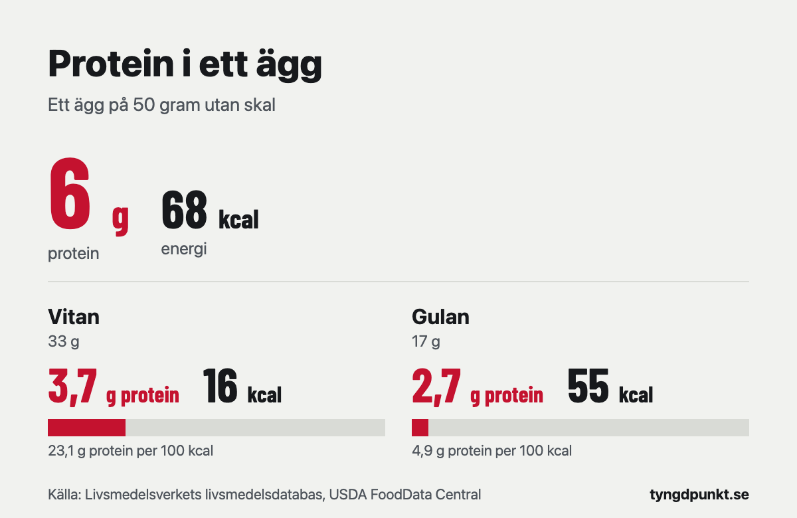

Ett ägg ger ungefär 6 gram protein. Livsmedelsverket anger 12,1 gram protein per 100 gram ägg, och ett vanligt ägg väger omkring 50 gram utan skal. Det ger också runt 68 kcal. Drygt hälften av proteinet sitter i vitan, resten i gulan. Kokt, stekt eller rått spelar ingen roll för mängden protein.

## Hur mycket protein är det i ett ägg per 100 gram?

Livsmedelsverket analyserade ägg från 20 svenska äggproducenter 2025. Värdena nedan kommer från deras livsmedelsdatabas och gäller 100 gram av den ätbara delen, alltså utan skal.

| Livsmedel (100 g) | Protein | Energi |
|---|---|---|
| Ägg, rått | 12,1 g | 136 kcal |
| Ägg, kokt | 12,1 g | 136 kcal |
| Ägg, stekt | 13,2 g | 190 kcal |
| Äggröra | 11,7 g | 198 kcal |
| Äggvita, rå | 11,1 g | 48 kcal |
| Äggula, rå | 15,9 g | 325 kcal |

Kokt och rått ägg har samma värden. Kokningen tillför ingenting och tar inte bort något. Stekt ägg har lite mer protein per 100 gram eftersom vatten kokar bort i pannan, så samma mängd protein ryms i färre gram. Det har också fler kalorier, eftersom ägget suger upp stekfett. Äggröran innehåller annat än ägg, och då sjunker proteinet per 100 gram medan kalorierna ökar.

En stor översikt om äggets näringsvärde av Réhault-Godbert och kollegor landar på nästan samma siffror: 12,5 gram protein per 100 gram helt ägg, 15,9 gram i gulan och 10,9 gram i vitan.

## Hur mycket protein är det i ett kokt ägg?

Ett kokt ägg ger ungefär lika mycket som ett rått, alltså omkring 6 gram. Siffran går att kontrollera på två sätt.

I en studie från Maastricht av Fuchs och kollegor vägde forskarna äggen noga, och fem ägg gav 30 gram protein. Det blir 6 gram per ägg. Räknar man baklänges med Livsmedelsverkets 12,1 gram per 100 gram motsvarar det ett ägg på ungefär 50 gram utan skal. Den amerikanska livsmedelsdatabasen (USDA) anger också 50 gram för ett stort ägg utan skal.

Äggen i butiken sorteras efter vikt med skal. Enligt Svenska Ägg väger ett litet ägg (S) 43–53 gram, ett medelstort (M) 53–63 gram, ett stort (L) 63–73 gram och ett extra stort (XL) mer än 73 gram. Medelvikten är ungefär 58 gram. Skalet väger några gram, så den ätbara delen är alltid lite mindre än siffran på kartongen. Ett ägg i storlek L eller XL ger därför något mer än 6 gram och ett S-ägg något mindre.

Vill du räkna exakt kan du knäcka ägget i en skål på en våg och ta vikten gånger 0,121. Ett ägg som väger 55 gram utan skal ger 6,7 gram protein.

## Hur mycket protein finns i äggvitan och i äggulan?

Gulan har högre proteinhalt per gram, men vitan väger mer. Därför kommer det mesta av proteinet från vitan.

USDA anger att ett stort ägg består av 33 gram vita och 17 gram gula. Med Livsmedelsverkets värden blir det:

- **Vitan:** 33 g × 11,1 % = knappt 4 gram protein (3,7 g) och 16 kcal.
- **Gulan:** 17 g × 15,9 % = knappt 3 gram protein (2,7 g) och 55 kcal.

De två delarna blir tillsammans lite mer än 6 gram, eftersom vitan och gulan analyseras var för sig. Skillnaden är några tiondels gram och spelar ingen roll i vardagen.

Den stora skillnaden gäller kalorierna. Nästan allt fett sitter i gulan, och gulan står för ungefär fyra femtedelar av äggets kalorier. Räknar man protein per 100 kcal blir skillnaden tydlig:

| Del av ägget | Protein per 100 kcal |
|---|---|
| Äggvita | 23,1 g |
| Helt ägg | 8,9 g |
| Äggula | 4,9 g |

Under en deff, när varje kalori räknas, kan det därför löna sig att blanda hela ägg med extra äggvitor. Hur stort underskott du behöver läser du om i artikeln om [kaloriunderskott](/artiklar/kaloriunderskott/).

## Hur många ägg behövs för att få 30 gram protein?

Fem ägg. Det var just den mängden forskarna i Maastricht gav sina försökspersoner efter träning, och fem ägg gav 30 gram protein, 23 gram fett och 1 400 kJ, alltså cirka 335 kcal.

| Antal ägg (50 g utan skal) | Protein | Energi |
|---|---|---|
| 1 | 6 g | 68 kcal |
| 2 | 12 g | 136 kcal |
| 3 | 18 g | 204 kcal |
| 4 | 24 g | 272 kcal |
| 5 | 30 g | 340 kcal |
| 6 | 36 g | 408 kcal |

Proteinet är avrundat till hela gram.

**Räkneexempel.** Sara väger 65 kg, styrketränar och vill bygga muskler. Med 2,0 gram per kilo behöver hon 130 gram protein om dagen. Tre ägg till frukost ger 18 gram, ungefär en sjundedel av dagens behov.

Vill hon komma upp i 30 gram vid frukosten har hon två vägar:

- **Fem hela ägg:** 30 gram protein och 340 kcal.
- **Tre hela ägg och tre äggvitor:** 18 + 11 = 29 gram protein och 204 + 48 = ungefär 250 kcal.

Proteinet blir nästan detsamma, men det andra alternativet ger knappt 90 kcal mindre. Under en deff kan det vara värt det. Bygger hon muskler och äter i överskott spelar skillnaden mindre roll.

Hur mycket protein du själv behöver beror på vikt och mål. [Räkna ut ditt proteinbehov](/proteinbehov/) med kalkylatorn, som räknar med 2,2 gram per kilo när du vill gå ner i fett, 2,0 gram när du vill bygga muskler och 1,8 gram när du vill ligga kvar. Varför de siffrorna valts står i artikeln [hur mycket protein per dag](/artiklar/hur-mycket-protein-per-dag/).

## Tar kroppen upp proteinet bättre om ägget är kokt?

Ja, men för musklerna verkar det inte göra någon skillnad.

En liten studie av Evenepoel och kollegor från 1998 mätte hur mycket av äggproteinet som tas upp innan det når tjocktarmen. Fem personer som opererats och hade en tarmöppning åt 25 gram äggprotein, en gång kokt och en gång rått. Av det kokta proteinet togs 90,9 procent upp, av det råa bara 51,3 procent.

Fuchs studie från 2022 ställde frågan som den som tränar bryr sig om: blir det mer muskelprotein? Där fick 45 styrketränande unga män antingen fem råa ägg, fem kokta ägg eller en frukost med lite protein efter ett träningspass. Med kokta ägg steg halten av essentiella aminosyror i blodet 20 procent mer på toppen. Uppbyggnaden av muskelprotein de närmaste fem timmarna skilde sig däremot inte mellan råa och kokta ägg. Båda grupperna låg högre än gruppen som fick den proteinfattiga frukosten.

Det finns alltså ingen anledning att dricka råa ägg för musklernas skull. Tillagat ägg tas upp bättre, och i studien blev effekten på musklerna densamma.

## Är ägg en bra proteinkälla jämfört med annan mat?

Ja, särskilt när ägget är tillagat. Réhault-Godbert och kollegor skriver att 91–94 procent av proteinet i kokt äggvita tas upp. Ägg är dessutom billigt och går snabbt att laga.

Räknat per kalori ger hela ägg däremot mindre protein än många andra proteinkällor, eftersom gulan innehåller mycket fett. Enligt Livsmedelsverket ger mager kvarg 15,6 gram protein per 100 kcal och stekt kycklingfilé 19,8 gram. Hela ägg ger 8,9 gram.

Ägg passar därför bra som en del av proteinet, särskilt till frukost. Den som vill ha mycket protein för få kalorier får mer ut av äggvita eller av magra mejeriprodukter. Hur mycket du totalt ska äta för att gå ner eller ligga kvar i vikt räknar du ut i artikeln [hur många kalorier per dag](/artiklar/hur-manga-kalorier-per-dag/).

## I appen

I Tyngdpunkt räknar vi ägget med Livsmedelsverkets värden, och appen visar hur mycket protein du har kvar i dag och föreslår proteinrika varor bland det du brukar äta.

## Vanliga frågor

### Hur mycket protein är det i 3 ägg?

Ungefär 18 gram, om varje ägg väger omkring 50 gram utan skal. Tre ägg ger också runt 204 kcal.

### Hur mycket protein är det i en äggvita?

Knappt 4 gram. Vitan i ett stort ägg väger ungefär 33 gram och innehåller 11,1 gram protein per 100 gram. Den ger bara 16 kcal.

### Har ett stekt ägg mer protein än ett kokt?

Nej, inte per ägg. Per 100 gram ser stekt ägg ut att ha mer protein, men det beror på att vatten kokar bort i pannan. Däremot får det stekta ägget fler kalorier från stekfettet.

### Hur många ägg kan man äta per dag?

Svenska Ägg skriver att Livsmedelsverket inte har någon maxgräns för hur många ägg vuxna kan äta per dag, men att det alltid är bra att äta varierat. Har du höga blodfetter eller en sjukdom som påverkar vad du kan äta, fråga vården.

### Räknas äggets vikt med eller utan skal?

Näringsvärdena gäller ägget utan skal. Storleken på kartongen (S, M, L och XL) gäller vikten med skal, så den ätbara delen är några gram lättare.

## Källor

- Livsmedelsverket. Livsmedelsdatabasen, version från dataportalen (ägg rått 1225, äggula rå 1226, äggvita rå 1227, ägg stekt 1233, äggröra 2197, ägg kokt 2205, kvarg 3243, kycklingfilé 1170). [dataportal.livsmedelsverket.se](https://dataportal.livsmedelsverket.se/livsmedel/)
- Réhault-Godbert S, Guyot N, Nys Y (2019). The Golden Egg: Nutritional Value, Bioactivities, and Emerging Benefits for Human Health. *Nutrients*, 11(3), 684. [Europe PMC](https://europepmc.org/article/PMC/PMC6470839)
- Fuchs CJ, Hermans WJH, Smeets JSJ m.fl. (2022). Raw Eggs To Support Postexercise Recovery in Healthy Young Men: Did Rocky Get It Right or Wrong? *The Journal of Nutrition*, 152(11), 2376–2386. [Europe PMC](https://europepmc.org/article/PMC/PMC9644172)
- Evenepoel P, Geypens B, Luypaerts A m.fl. (1998). Digestibility of cooked and raw egg protein in humans as assessed by stable isotope techniques. *The Journal of Nutrition*. [Europe PMC](https://europepmc.org/article/MED/9772141)
- U.S. Department of Agriculture. FoodData Central, SR Legacy: Egg, whole, raw, fresh (171287); Egg, white, raw, fresh (172183); Egg, yolk, raw, fresh (172184). [fdc.nal.usda.gov](https://fdc.nal.usda.gov/)
- Svenska Ägg. Fun facts om ägg (äggens storlekar och vikt). [svenskaagg.se](https://www.svenskaagg.se/om-agg/funfacts)
- Svenska Ägg. Vanliga frågor. [svenskaagg.se](https://www.svenskaagg.se/om-agg/faq)
