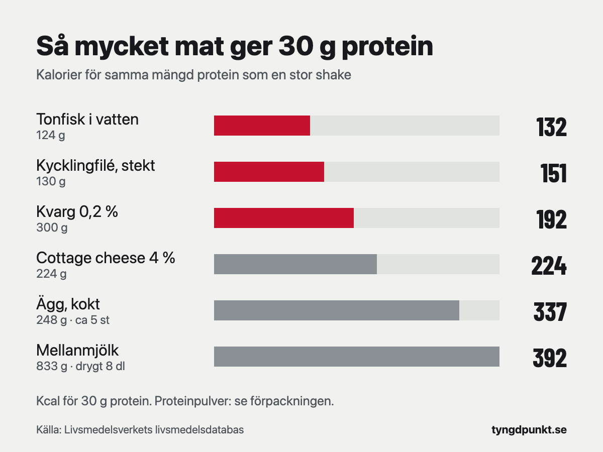

Nej, inte om du får i dig tillräckligt med protein från vanlig mat. Proteinpulver är protein, oftast från mjölk, och gör ingen annan nytta än samma mängd protein från kvarg eller kyckling. I en metaanalys av 49 studier gav extra protein mer muskler, men effekten planade ut vid ungefär 1,6 gram per kilo och dag.

## Behöver man proteinpulver när man tränar?

Det beror på hur mycket protein du redan äter. Morton och kollegor samlade 2018 49 studier med 1 863 deltagare som styrketränade i minst sex veckor. En grupp fick extra protein, oftast vassleprotein eller annat mjölkprotein, och en grupp fick det inte.

Gruppen med extra protein fick i snitt 0,30 kg mer fettfri massa, alltså allt utom fett, och 2,49 kg mer på maxlyftet. Det är en verklig skillnad, men en liten. Författarna skriver själva att träningen var den mycket starkare orsaken till att deltagarna blev större och starkare.

Den viktigaste siffran är var effekten tog slut. Över ett totalt intag på ungefär 1,6 gram protein per kilo och dag gav extra protein ingen ytterligare ökning av den fettfria massan. Ligger du redan där med vanlig mat tillför pulvret alltså inget. Ligger du under kan det vara ett enkelt sätt att ta igen skillnaden.

Livsmedelsverket säger ungefär samma sak. De skriver att det sällan finns behov av proteinpulver för den som är fysiskt aktiv, eftersom protein finns i det mesta man äter. Enligt deras undersökningar kommer i snitt 17 procent av kalorierna i svenskarnas mat från protein.

Hur mycket protein du själv behöver, och varför siffrorna ser ut som de gör, står i artikeln [hur mycket protein per dag](/artiklar/hur-mycket-protein-per-dag/).

## Vad är proteinpulver gjort av?

Det vanligaste är vassleprotein, på engelska whey. Mjölkens protein består av två delar, kasein och vassle. När man tillsätter syra till mjölk klumpar kaseinet ihop sig och vasslen blir kvar ovanpå. Proteinet filtreras sedan för att skiljas från mjölkens laktos och fett.

Enligt det internationella idrottsnutritionssällskapet ISSN finns det två huvudsorter:

| Sort | Andel protein | Vad det betyder |
|---|---|---|
| Koncentrat | 29–80 % av torrvikten, i sportprodukter oftast 70–80 % | Mindre filtrerat, en del av mjölkens laktos och fett finns kvar |
| Isolat | mer än 90 % | Mer filtrerat, nästan bara protein |

Ett mått koncentrat på 30 gram ger alltså ungefär 21–24 gram protein. Exakt hur mycket står på förpackningen. Räkna i gram protein, inte i skopor, eftersom skoporna skiljer sig mellan märken.

Det finns också kaseinpulver, äggviteprotein och vegetabiliska pulver från soja, ärter eller ris. Vassle och kasein har mest leucin, en aminosyra som ISSN lyfter fram som viktig för muskeluppbyggnaden: 11 procent respektive 9,3 procent av proteinet. Vassle tas upp snabbt och kasein långsamt. För de vegetabiliska pulvren, utom soja, är forskningen om träningseffekter än så länge tunn.

I Mortons metaanalys spelade sorten ändå liten roll. Författarna drar slutsatsen att detaljer som sort, tidpunkt och dos efter passet betyder lite eller inget för resultatet. Det som räknas är hur mycket protein du får i dig totalt.

## Proteinpulver eller vanlig mat: vad är skillnaden?

Kroppen skiljer inte på protein från en shake och protein från en tallrik, så länge mängden och kvaliteten är densamma. Skillnaden är praktisk: pulvret går snabbt, håller länge och väger lite i väskan. Maten ger annat på köpet, som vitaminer, mineraler och fibrer.

Så här mycket vanlig mat behövs för samma 30 gram protein som en stor shake:

| 30 g protein från | Mängd | Energi |
|---|---|---|
| Tonfisk i vatten, avrunnen | 124 g | 132 kcal |
| Kycklingfilé, stekt | 130 g | 151 kcal |
| Kvarg naturell, fett 0,2 % | 300 g | 192 kcal |
| Cottage cheese, fett 4 % | 224 g | 224 kcal |
| Drickkvarg | 556 g | 233 kcal |
| Ägg, kokt | 248 g (ungefär 5 ägg) | 337 kcal |
| Mellanmjölk | 833 g (drygt 8 dl) | 392 kcal |

Värdena kommer från Livsmedelsverkets livsmedelsdatabas. Proteinpulver finns inte med där, så titta på förpackningen. Ett isolat blandat i vatten ger nästan bara protein och därför få kalorier per gram protein.

Kvarg, kyckling och tonfisk ger alltså mycket protein för få kalorier, precis som pulvret. Vill du ha fler alternativ med mycket protein och lite kalorier finns en längre tabell i artikeln [proteinrik mat med lite kalorier](/artiklar/proteinrik-mat-lite-kalorier/).

## Hur mycket proteinpulver ska man ta per dag?

Så mycket som saknas för att du ska nå ditt dagsbehov, och inte mer. Se pulvret som ett sätt att fylla ett hål i maten.

I studierna som Morton gick igenom fick deltagarna mellan 4 och 106 gram extra protein om dagen, i snitt 36 gram. ISSN rekommenderar 20–40 gram protein per måltid, eller 0,25 gram per kilo kroppsvikt, och att proteinet sprids ut över dagen med 3–4 timmars mellanrum. En shake med 20–40 gram protein motsvarar alltså en vanlig proteinrik måltid.

**Räkneexempel.** Sara väger 65 kg, styrketränar tre gånger i veckan och vill bygga muskler. Med 2,0 gram per kilo behöver hon 65 × 2,0 = 130 gram protein om dagen. Frukost, lunch och middag ger henne ungefär 100 gram. Det saknas 30 gram.

Hon kan ta igen det med 300 gram kvarg (192 kcal), en burk tonfisk i en sallad (132 kcal) eller en shake med 30 gram protein från pulver. Alla tre ger lika mycket protein. Hon väljer det som är enklast en vanlig dag, och slipper pulvret helt de dagar maten räcker.

[Räkna ut ditt proteinbehov](/proteinbehov/) efter vikt och mål. Kalkylatorn räknar med 2,2 gram per kilo när du vill gå ner i fett, 2,0 gram när du vill bygga muskler och 1,8 gram när du vill ligga kvar. Det är i den övre delen av Mortons spann, eftersom 1,6 gram är ett snitt och en del behöver mer.

## När ska man ta proteinpulver?

När det passar dig. ISSN skriver att protein ger effekt både före och efter passet, och att träningens påverkan på musklerna håller i sig i minst 24 timmar, men avtar ju längre tid som går. Det finns alltså ingen brådska att dricka shaken direkt efter passet.

Morton fann inte heller att mängden protein direkt efter passet påverkade resultatet. Det som spelar roll är dagens totala mängd, gärna fördelad på flera måltider.

ISSN nämner en tidpunkt särskilt: 30–40 gram kasein före sänggåendet ökade muskeluppbyggnaden under natten i studierna.

## Är proteinpulver bra för viktnedgång?

Proteinpulver i sig får dig inte att gå ner i vikt. Det är [kaloriunderskottet](/artiklar/kaloriunderskott/) som gör det. Livsmedelsverket påpekar också att protein utöver behovet inte blir muskler av sig självt. Äter du mer energi än du gör av med kan överskottet lagras som fett, även om det kommer från protein.

Men pulvret kan vara till nytta under en deff. Livsmedelsverket skriver att det finns en liten risk att få för lite protein just när man både tränar och äter mindre. ISSN skriver att tillskott är ett praktiskt sätt att få tillräckligt med protein med få kalorier, och att den som styrketränar kan behöva 2,3–3,1 gram per kilo under en period med underskott för att behålla så mycket muskler som möjligt.

Med färre kalorier att röra sig med blir det svårare att nå proteinmålet med bara vanlig mat. Där kan en shake hjälpa. Den kan lika gärna bytas mot kvarg, kyckling eller fisk.

Har du en ätstörning, har haft det eller har en sjukdom som påverkar vad du kan äta: prata med vården innan du lägger om kosten.

## Är proteinpulver farligt?

För friska vuxna tyder forskningen inte på att mer protein är farligt. Den vanligaste oron gäller njurarna. Devries och kollegor gick 2018 igenom 28 studier med 1 358 friska vuxna och fann att en proteinrik kost inte försämrade njurarnas funktion jämfört med normal eller låg proteinmängd. Med proteinrik menade de minst 1,5 gram per kilo, minst 20 procent av energin eller minst 100 gram om dagen.

Har du en njursjukdom eller någon annan sjukdom gäller inte det här. Fråga vården innan du ökar proteinet.

Livsmedelsverket skriver om kosttillskott i allmänhet att de flesta som säljs i Sverige går att äta utan risk för friska vuxna. Men det har hittats produkter med föroreningar och odeklarerade ämnen, till exempel läkemedel, hormonliknande ämnen och höga halter koffein. Det är ett skäl att köpa från kända tillverkare och läsa innehållsförteckningen.

## I appen

I Tyngdpunkt loggar du maten med Livsmedelsverkets värden, och appen visar hur mycket protein du har kvar i dag och föreslår proteinrika varor bland det du brukar äta.

## Vanliga frågor

### Behöver man ta proteinpulver varje dag?

Nej. Pulvret behövs bara de dagar maten inte räcker till ditt proteinbehov. Får du i dig tillräckligt med protein från maten kan du hoppa över det.

### Kan man bygga muskler utan proteinpulver?

Ja. Det som avgör är träningen och hur mycket protein du äter totalt. I Mortons metaanalys kom en del av det extra proteinet från vanlig mat, som nötkött och yoghurt, och sorten spelade liten roll.

### Är proteinpulver annorlunda för kvinnor?

Inte enligt det som finns. Morton såg inga tydliga skillnader mellan könen, men påpekar att betydligt färre studier gjorts på kvinnor. Behovet räknas på samma sätt, i gram per kilo kroppsvikt.

### Blir man tjock av proteinpulver?

Inte av pulvret i sig. En shake ger kalorier som all annan mat. Äter du mer energi än du gör av med går du upp i vikt, oavsett om energin kommer från protein, fett eller kolhydrater.

## Källor

- Morton RW, Murphy KT, McKellar SR m.fl. (2018). A systematic review, meta-analysis and meta-regression of the effect of protein supplementation on resistance training-induced gains in muscle mass and strength in healthy adults. *British Journal of Sports Medicine*, 52(6), 376–384. [Europe PMC](https://europepmc.org/article/PMC/PMC5867436)
- Jäger R, Kerksick CM, Campbell BI m.fl. (2017). International Society of Sports Nutrition Position Stand: protein and exercise. *Journal of the International Society of Sports Nutrition*, 14, 20. [Europe PMC](https://europepmc.org/article/PMC/PMC5477153)
- Devries MC, Sithamparapillai A, Brimble KS m.fl. (2018). Changes in Kidney Function Do Not Differ between Healthy Adults Consuming Higher- Compared with Lower- or Normal-Protein Diets: A Systematic Review and Meta-Analysis. *The Journal of Nutrition*, 148(11), 1760. [Europe PMC](https://europepmc.org/article/PMC/PMC6236074)
- Livsmedelsverket. Protein. [livsmedelsverket.se](https://www.livsmedelsverket.se/livsmedel-och-innehall/naringsamne/protein)
- Livsmedelsverket. Risker med kosttillskott. [livsmedelsverket.se](https://www.livsmedelsverket.se/livsmedel-och-innehall/kosttillskott/risker-med-kosttillskott)
- Livsmedelsverket. Livsmedelsdatabasen, version från dataportalen (tonfisk i vatten 1278, kycklingfilé stekt 1170, kvarg 0,2 % 3243, cottage cheese 70, drickkvarg 6089, ägg kokt 2205, mellanmjölk 150). [dataportal.livsmedelsverket.se](https://dataportal.livsmedelsverket.se/livsmedel/)
