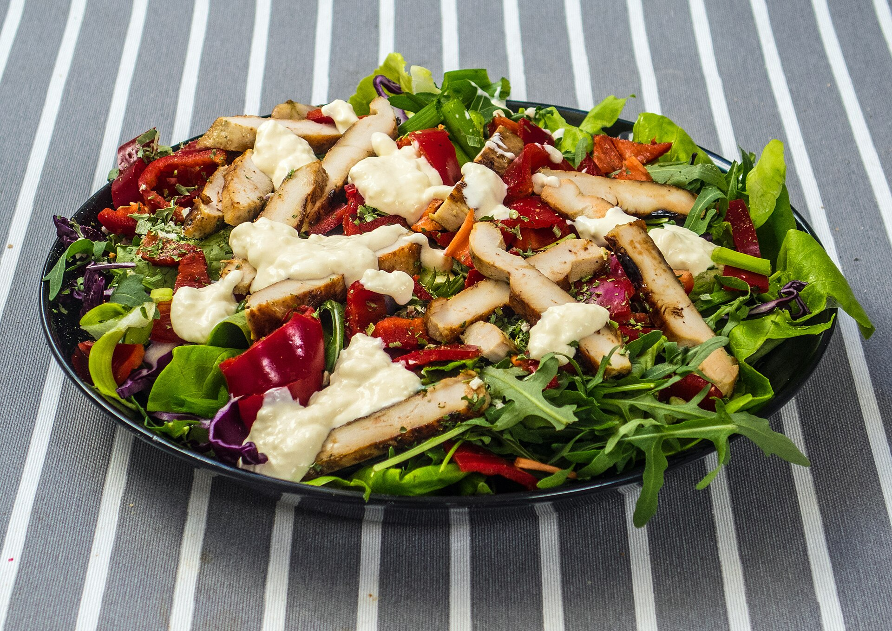
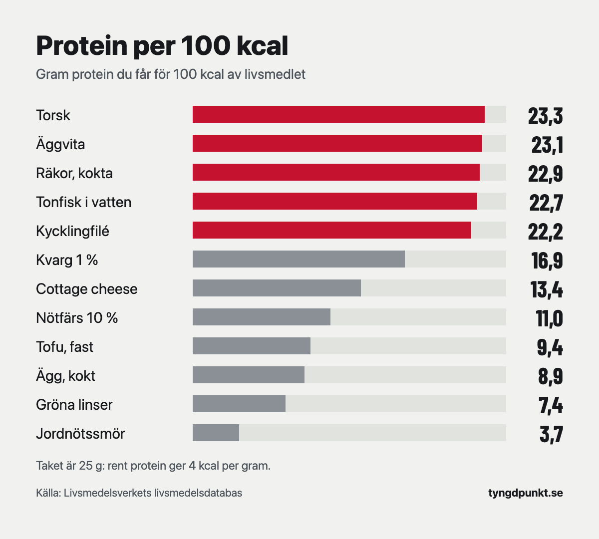

Mest protein för minst kalorier får du från mager fisk och skaldjur, äggvita, kyckling- och kalkonfilé och tonfisk i vatten. De ger 22–23 gram protein per 100 kcal, enligt Livsmedelsverkets livsmedelsdatabas. Mager kvarg ger runt 16 gram och kokt ägg knappt 9 gram. Bland vegetariska livsmedel ligger tofu, sojabönor och linser på 7–9 gram per 100 kcal.

## Hur räknar man protein per kalori?

Det enklaste måttet är gram protein per 100 kcal. Du tar proteinet och delar med kalorierna, båda per 100 gram, och gångrar med 100:

**protein per 100 kcal = gram protein ÷ kcal × 100**

Mager kvarg med 1 procent fett har 12,7 gram protein och 75 kcal per 100 gram. Det ger 12,7 ÷ 75 × 100 = 16,9 gram protein per 100 kcal.

Måttet säger något annat än "gram protein per 100 gram". Jordnötssmör har 22,6 gram protein per 100 gram, nästan lika mycket som kycklingfilé. Men det har också 615 kcal, så per 100 kcal blir det bara 3,7 gram. Att ett livsmedel har mycket protein betyder alltså inte att det har lite kalorier.

Rent protein ger 4 kcal per gram. Ett livsmedel som bara bestod av protein skulle alltså ge 25 gram per 100 kcal. Det är taket. Torsk och äggvita ligger nära det, eftersom de nästan inte innehåller något fett eller några kolhydrater.

## Vilken mat har mest protein per kalori?

Tabellen bygger på Livsmedelsverkets värden. Siffrorna gäller 100 gram av livsmedlet i det skick som anges, så rå kyckling räknas per gram rå vikt.

| Livsmedel (100 g) | Protein | Energi | Protein per 100 kcal |
|---|---|---|---|
| Torsk, rå | 18,2 g | 78 kcal | 23,3 g |
| Sej, rå | 19,1 g | 82 kcal | 23,3 g |
| Äggvita, rå | 11,1 g | 48 kcal | 23,1 g |
| Räkor, kokta | 17,6 g | 77 kcal | 22,9 g |
| Tonfisk i vatten, avrunnen | 24,1 g | 106 kcal | 22,7 g |
| Kalkonfilé, rå | 24,1 g | 106 kcal | 22,7 g |
| Kycklingfilé, rå | 23,1 g | 104 kcal | 22,2 g |
| Fläskfilé, rå | 20,6 g | 107 kcal | 19,3 g |
| Kvarg, fett 1 % | 12,7 g | 75 kcal | 16,9 g |
| Kvarg naturell, fett 0,2 % | 10,0 g | 64 kcal | 15,6 g |
| Grekisk yoghurt 0 %, smaksatt med sötningsmedel | 9,1 g | 59 kcal | 15,4 g |
| Cottage cheese, fett 4 % | 13,4 g | 100 kcal | 13,4 g |
| Nötfärs, fett 10 %, rå | 20,1 g | 182 kcal | 11,0 g |
| Lax, odlad, rå | 20,2 g | 210 kcal | 9,6 g |
| Ägg, kokt | 12,1 g | 136 kcal | 8,9 g |

Fisk, skaldjur, fågel och äggvita ligger alla över 22 gram. Sedan kommer mejeriprodukterna med lite fett. Fetare kött, lax och hela ägg ger mindre protein per kalori. De är fortfarande bra mat, men varje gram protein kostar mer energi, och det märks mest när kalorierna är få.

## Spelar tillagningen någon roll?

Ja, när det tillförs fett. Rå kycklingfilé ger 22,2 gram protein per 100 kcal. Stekt kycklingfilé ger 19,8 gram, eftersom stekfettet lägger till kalorier. Samma sak gäller tonfisk på burk: i vatten blir det 22,7 gram per 100 kcal, i olja 13,2 gram.

Kokning och stekning utan fett ändrar inte förhållandet. Kokt och stekt torsk har samma 23,3 gram per 100 kcal som rå torsk. Vatten kokar bort, och då ökar både proteinet och kalorierna per 100 gram lika mycket.

Det är alltså oftast fettet du lagar maten med, och såsen du äter till, som avgör hur många kalorier proteinet kostar.

## Vilken vegetarisk mat har mycket protein och lite kalorier?

Den vegetariska listan ser annorlunda ut. Baljväxter innehåller mycket kolhydrater, och därför blir proteinet per kalori lägre än i fisk och kyckling.

| Livsmedel (100 g) | Protein | Energi | Protein per 100 kcal |
|---|---|---|---|
| Tofu, fast | 6,6 g | 70 kcal | 9,4 g |
| Sojabönor, kokta | 11,0 g | 128 kcal | 8,6 g |
| Sojabönor, färska förvällda (edamame) | 10,9 g | 130 kcal | 8,4 g |
| Kidneybönor, konserv | 8,8 g | 110 kcal | 8,0 g |
| Gröna ärtor, kokta | 5,2 g | 69 kcal | 7,5 g |
| Gröna linser, kokta | 9,4 g | 127 kcal | 7,4 g |
| Kikärtor, konserv | 7,5 g | 128 kcal | 5,9 g |

Den som äter ägg och mejeriprodukter har det enklare. Äggvita, kvarg, grekisk yoghurt och cottage cheese ligger alla mellan 13 och 23 gram per 100 kcal, högre än allt i den vegetabiliska tabellen. Tofu varierar mellan märken, så titta på näringsvärdet på förpackningen. Värdet ovan är Livsmedelsverkets för fast tofu.

Den som äter helt växtbaserat kan räkna med att proteinet kostar fler kalorier. Det går fortfarande att komma upp i en hög proteinmängd, men en större del av dagens kalorier går åt till det.

## Hur får man i sig mycket protein utan att äta för mycket kalorier?

Det handlar om att låta de magra källorna bära det mesta av proteinet. Skillnaden syns tydligt om man räknar på 40 gram protein, ungefär en stor måltid:

| 40 g protein från | Mängd | Energi |
|---|---|---|
| Tonfisk i vatten | 166 g | 176 kcal |
| Kycklingfilé, stekt | 174 g | 202 kcal |
| Kvarg, fett 0,2 % | 400 g | 256 kcal |
| Ägg, kokt | 331 g (ungefär 6–7 ägg) | 450 kcal |
| Gröna linser, kokta | 426 g | 540 kcal |
| Jordnötssmör | 177 g | 1 088 kcal |

**Räkneexempel.** Johan väger 90 kg och deffar. Med 2,2 gram per kilo behöver han 198 gram protein om dagen. Om allt proteinet kom från livsmedel med runt 20 gram per 100 kcal skulle det kosta ungefär 990 kcal. Om det i stället kom från livsmedel med 8,9 gram per 100 kcal, som hela ägg, skulle samma mängd protein kosta runt 2 225 kcal. Det är troligen mer än hela hans kaloribudget under en deff.

Ingen äter förstås bara en sorts mat. Men exemplet visar varför det blir lättare att nå proteinmålet på ett kaloriunderskott om några måltider bygger på kyckling, fisk, kvarg eller äggvita. Då finns det kalorier kvar till kolhydrater, fett, grönsaker och sådant man tycker om.

Hur mycket protein du själv behöver beror på vikt och mål. [Räkna ut ditt proteinbehov](/proteinbehov/) med kalkylatorn. Den räknar med 2,2 gram per kilo när du vill gå ner i fett, 2,0 gram när du vill bygga muskler och 1,8 gram när du vill ligga kvar. Varför de siffrorna valts står i artikeln [hur mycket protein per dag](/artiklar/hur-mycket-protein-per-dag/).

## Är proteinrik mat bra för viktnedgång?

Ja, av tre skäl som forskningen stöder, men effekterna är måttliga.

**Det mättar.** En metaanalys av Dhillon och kollegor från 2016 fann att måltider med mer protein gav högre skattad mättnad än måltider med mindre protein. Fem studier ingick i själva metaanalysen och 28 i en enklare genomgång som pekade åt samma håll. Författarna skriver själva att resultatet gäller under snävt definierade förhållanden och att man ska vara försiktig med att dra slutsatser om kroppsvikt.

**Kroppen gör av med mer energi när den bryter ned protein.** Westerterp sammanfattar i en översikt från 2004 att 20–30 procent av energin i protein går åt till att ta hand om det, mot 5–10 procent för kolhydrater och 0–3 procent för fett. Av 100 kcal protein blir alltså 20–30 kcal värme. Det är en verklig skillnad, men den ersätter inte ett kaloriunderskott.

**Mer av vikten som försvinner är fett.** Wycherley och kollegor gick 2012 igenom 24 studier med 1 063 vuxna som åt lika många kalorier, antingen med mer protein eller med vanlig mängd. Studierna varade i genomsnitt 12,1 veckor. Gruppen med mer protein gick ner 0,79 kg mer i vikt och 0,87 kg mer i fett, och behöll 0,43 kg mer av den fettfria massan. Tre av fem studier som mätte mättnad fann att den högre proteinmängden mättade mer.

Det som avgör om vikten går ner är fortfarande underskottet. Hur stort det bör vara läser du i artikeln om [kaloriunderskott](/artiklar/kaloriunderskott/).
Har du en ätstörning, eller har haft det, eller en sjukdom som påverkar vad du kan äta: prata med vården innan du lägger om kosten.

## I appen

I Tyngdpunkt loggar du maten med Livsmedelsverkets värden, och appen visar hur mycket protein du har kvar i dag och föreslår proteinrika varor bland det du brukar äta.

## Vanliga frågor

### Vilket livsmedel har mest protein?

Räknat per 100 gram ligger till exempel hårdost högt, med 29,2 gram. Räknat per kalori ligger mager fisk, räkor och äggvita högst, med 23 gram per 100 kcal. Vilket mått som passar beror på om du vill få i dig mycket protein på liten plats eller på få kalorier.

### Är kvarg eller cottage cheese bäst?

Mager kvarg ger mer protein per kalori: 15,6–16,9 gram per 100 kcal mot 13,4 gram för cottage cheese med 4 procent fett. Skillnaden är liten, så välj det du tycker om och äter regelbundet.

### Är ägg proteinrik mat med lite kalorier?

Hela ägg ger 8,9 gram protein per 100 kcal, ungefär som tofu och sojabönor. Äggvitan ensam ger 23,1 gram. Mer om det står i artikeln om [protein i ägg](/artiklar/protein-i-agg/).

### Vilket kött har minst kalorier?

Av köttet i tabellen har kalkonfilé, kycklingfilé och fläskfilé minst kalorier per gram protein, med 19–23 gram protein per 100 kcal. Nötfärs med 10 procent fett ger 11,0 gram.

### Är frukt och grönsaker proteinrika?

Inte särskilt. Gröna ärtor, som ofta nämns som en proteinrik grönsak, ger 5,2 gram protein per 100 gram. Det räcker inte långt mot ett dagsbehov på 150–200 gram, så proteinet behöver komma från annat.

## Källor

- Livsmedelsverket. Livsmedelsdatabasen, version från dataportalen (torsk rå 1246, torsk stekt 1337, torsk kokt 1335, sej rå 1202, äggvita rå 1227, räka kokt 1395, tonfisk i vatten 1278, tonfisk i olja 1275, kalkonfilé rå 1162, kycklingfilé rå 1173, kycklingfilé stekt 1170, fläskfilé rå 970, kvarg 1 % 75, kvarg 0,2 % 3243, grekisk yoghurt 7146, cottage cheese 70, nötfärs 10 % 951, lax odlad 1255, ägg kokt 2205, tofu fast 905, sojabönor kokta 888, sojabönor förvällda 5860, kidneybönor 3816, gröna ärtor 2547, gröna linser 3821, kikärtor 3815, jordnötssmör 1559, hårdost 23 % 78). [dataportal.livsmedelsverket.se](https://dataportal.livsmedelsverket.se/livsmedel/)
- Dhillon J, Craig BA, Leidy HJ m.fl. (2016). The Effects of Increased Protein Intake on Fullness: A Meta-Analysis and Its Limitations. *Journal of the Academy of Nutrition and Dietetics*, 116(6), 968–983. [Europe PMC](https://europepmc.org/article/MED/26947338)
- Westerterp KR (2004). Diet induced thermogenesis. *Nutrition & Metabolism*, 1, 5. [Europe PMC](https://europepmc.org/article/PMC/PMC524030)
- Wycherley TP, Moran LJ, Clifton PM, Noakes M, Brinkworth GD (2012). Effects of energy-restricted high-protein, low-fat compared with standard-protein, low-fat diets: a meta-analysis of randomized controlled trials. *The American Journal of Clinical Nutrition*, 96(6), 1281–1298. [Europe PMC](https://europepmc.org/article/MED/23097268)
