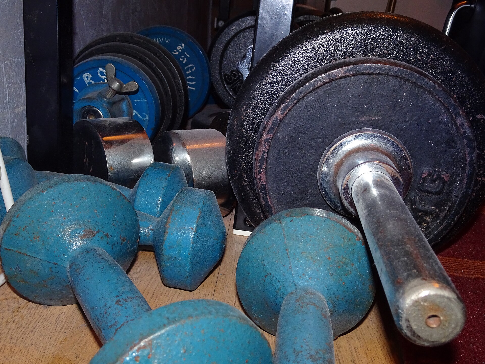
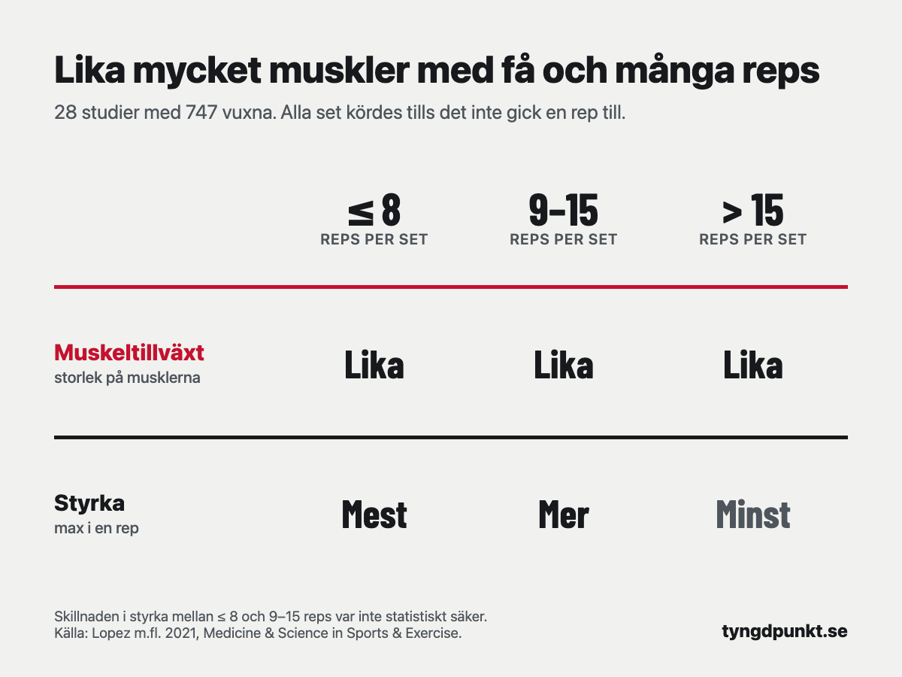

För att bygga muskler fungerar nästan alla repantal, från under 8 upp till runt 30 reps per set, så länge setet körs nära gränsen för vad du orkar. En metaanalys av 28 studier fann ingen skillnad i muskeltillväxt mellan få och många reps. 8–12 reps är ofta det smidigaste valet. För styrka är färre reps med tyngre vikt bättre.

## Hur många reps för maximal muskeltillväxt?

Det finns inget särskilt repantal som ger mest muskler. Så landar de översikter vi har läst, och det går emot det många har lärt sig på gymmet.

Lopez och kollegor slog 2021 ihop 28 studier med 747 friska vuxna. Alla studierna lät deltagarna köra seten tills det inte gick en rep till. Träningen delades in i tre nivåer efter hur många reps man orkade per set: tungt (högst 8 reps), medeltungt (9–15 reps) och lätt (fler än 15 reps). Musklerna växte lika mycket i alla tre. Det gällde både i hela materialet och när forskarna bara tittade på studierna med högst kvalitet.

Schoenfeld och kollegor kom till samma slutsats i en genomgång samma år. Musklerna växte lika mycket på en bred skala av belastningar, så länge vikten var minst runt 30 procent av ens max. Det gällde oavsett ålder och om man hade tränat förut eller inte. Deras egen studie på vana män är ett exempel: åtta veckors helkroppsträning med runt 10 reps per set gav samma ökning i muskeltjocklek i biceps, triceps och lår som med runt 30 reps per set.

Författarna skriver att det alltså inte finns någon särskild "hypertrofizon", alltså inget repantal där musklerna växer bäst.

| Reps per set | Muskeltillväxt | Styrka |
|---|---|---|
| Högst 8 | Lika | Mest |
| 9–15 | Lika | Mer än lätt träning |
| Fler än 15 | Lika | Minst |

*Källa: Lopez m.fl. 2021. Alla set kördes tills det inte gick en rep till.*

## Varför säger alla 8–12 reps?

Gymmets gamla tumregel kallas repetitionskontinuumet. Den säger att 1–5 reps med 80–100 procent av ditt max ger styrka, 8–12 reps med 60–80 procent ger muskler och 15 reps eller fler med under 60 procent ger uthållighet. Schoenfeld och kollegor gick igenom forskningen bakom regeln och fann att den stämmer för styrka, men inte för muskeltillväxt.

Ändå är 8–12 reps ett bra val i praktiken, men av andra skäl. Med 25–30 reps per set blir varje set långt, och passet med. Många reps till gränsen gör dessutom ont och känns jobbigare, och det kan få folk att sluta träna. Åt andra hållet behövs fler set för samma tillväxt när man kör väldigt få reps, och då ökar belastningen på lederna.

Det medeltunga spannet ger alltså samma resultat på kortare tid och med mindre obehag. Det betyder inte att du måste ligga där. Den som tycker om tunga set eller tränar hemma med lätta hantlar kan bygga muskler ändå.

## Hur många reps för att bygga styrka?

Här spelar repantalet roll. I Lopez metaanalys ökade styrkan mer med tung och medeltung träning än med lätt. Tung träning (högst 8 reps) gav ännu lite mer än medeltung, men den skillnaden var inte statistiskt säker.

En förklaring som Schoenfeld och kollegor tar upp är att nervsystemet vänjer sig vid att ta i maximalt när man lyfter tungt. Vill du bli starkare i knäböj eller bänkpress behöver du alltså lägga en del av träningen på tunga set med få reps. Vill du främst bygga muskler räcker det att seten är ansträngande.

## Hur nära gränsen ska man köra?

Nära, men inte nödvändigtvis ända fram. Att alla repantal fungerar förutsätter att setet blir tungt på slutet. Tio reps med en vikt du hade klarat 25 gånger bygger inte mycket.

Refalo och kollegor gick 2023 igenom 15 studier som jämförde set till gränsen, alltså tills det inte gick en rep till, med set där man slutade tidigare. Fördelen med att köra ända till gränsen var liten. När forskarna bara tog med studierna där gränsen var helt tydlig syntes ingen säker fördel alls. Deras slutsats är att det viktiga är att komma tillräckligt nära gränsen och att göra tillräckligt många set i veckan, runt 12–20 per muskelgrupp. Läs mer om hur du räknar [set per muskelgrupp i veckan](/artiklar/set-per-muskelgrupp/).

Ett vanligt sätt att mäta det är reps kvar: hur många reps du hade orkat till om du fortsatt. Studierna ovan ger ingen exakt siffra. En försiktig tolkning är att ett par reps kvar räcker för att setet ska räknas som tungt, och att den sista repen inte behöver vara en kamp varje gång.

## Hur väljer man rätt vikt för sina reps?

Utgå från ditt max. Det du orkar lyfta en gång kallas 1RM, och ju fler reps du ska göra, desto lättare vikt behöver du. Du behöver inte testa ditt max för att veta det. [Räkna ut ditt 1RM](/1rm/) ur ett vanligt set med kalkylatorn, som använder Epleys formel: vikt × (1 + reps ÷ 30).

**Räkneexempel.** Johan klarar 60 kg i bänkpress 10 gånger. Hans uppskattade max blir 60 × (1 + 10 ÷ 30) = 80 kg. Räknar man baklänges från 80 kg får man ungefär vilken vikt han borde klara på andra repantal:

| Reps | Vikt (kg) |
|---|---|
| 5 | 69 |
| 8 | 63 |
| 10 | 60 |
| 12 | 57 |
| 15 | 53 |
| 20 | 48 |

*Uträknat med Epleys formel från ett max på 80 kg, avrundat till hela kilo.*

Vill Johan bygga muskler kan han välja vilken rad som helst och köra till nära gränsen. Vill han också bli starkare i bänkpress kan han lägga ett par tunga set med 5 reps först i passet och sedan köra resten av seten med 10–12 reps. Formeln är säkrast mellan 3 och 10 reps. Vid 20 reps och uppåt spelar uthållighet större roll, så då kan den verkliga vikten skilja sig mer.

## Ska man variera antalet reps?

Det kan vara en fördel, men fördelen är osäker. Schoenfeld och kollegor nämner både kortare och längre studier som tyder på att det kan ge lite mer tillväxt att blanda tunga, medeltunga och lätta set. De skriver samtidigt att det behövs mer forskning innan man kan säga hur mycket det betyder i praktiken.

Ett enkelt sätt är att låta övningen styra. Tunga flerledsövningar som knäböj, marklyft och bänkpress passar bra med 5–8 reps. Mindre övningar som bicepscurl, sidolyft och vadpress passar bättre med 10–20 reps, där det är svårt att lyfta tungt med bra teknik.

Gäller det kvinnor finns mindre forskning. Schoenfeld och kollegor påpekar att få studier på ämnet gjorts på kvinnor. Det finns inga särskilda siffror för kvinnor i de översikter vi har läst, så samma råd är den bästa utgångspunkten.

Samma sak gäller under en deff. Det är träningen som säger åt kroppen att behålla musklerna, så behåll vikterna och repantalen så gott det går. Läs mer om hur du [deffar utan att tappa muskler](/artiklar/deffa-utan-att-tappa-muskler/).

## I appen

I Tyngdpunkt ökar programmen först reps och sedan vikt efter hur passen gick, och vi följer ditt uppskattade max i varje övning.

## Vanliga frågor

### Är 3 set med 10 reps bra för att bygga muskler?

Ja. 10 reps ligger mitt i spannet där musklerna växer bra, och tre set per övning är vanligt. Se till att de sista reparna är tunga, och räkna ihop hur många set du gör per muskelgrupp och vecka.

### Bygger man muskler med lätta vikter?

Ja, om du kör seten nära gränsen. I studierna växte musklerna lika mycket med fler än 15 reps per set som med färre. Det tar längre tid och känns jobbigare, men det fungerar.

### Hur många reps per set för nybörjare?

8–12 reps är ett bra sätt att börja. Vikten blir lagom tung för att lära sig tekniken, och musklerna växer lika bra som vid andra repantal. Lopez och kollegor såg att otränade fick mer muskeltillväxt än vana, oavsett belastning.

### Hur många reps och set för styrka?

Färre reps med tyngre vikt, ungefär 1–5 reps med 80–100 procent av ditt max, enligt den klassiska regeln. Forskningen stöder att tung träning ger mer styrka än lätt.

### Måste man köra till failure?

Nej. Failure betyder att du kör tills det inte går en rep till. Refalos genomgång fann ingen säker fördel med det jämfört med att sluta strax innan. Ett par reps kvar räcker för de flesta set.

## Källor

- Lopez P, Radaelli R, Taaffe DR, Newton RU, Galvão DA, Trajano GS, Teodoro JL, Kraemer WJ, Häkkinen K, Pinto RS (2021). Resistance Training Load Effects on Muscle Hypertrophy and Strength Gain: Systematic Review and Network Meta-analysis. *Medicine & Science in Sports & Exercise*, 53(6), 1206–1216. [Europe PMC](https://europepmc.org/article/PMC/PMC8126497)
- Schoenfeld BJ, Grgic J, Van Every DW, Plotkin DL (2021). Loading Recommendations for Muscle Strength, Hypertrophy, and Local Endurance: A Re-Examination of the Repetition Continuum. *Sports*, 9(2), 32. [Europe PMC](https://europepmc.org/article/PMC/PMC7927075)
- Refalo MC, Helms ER, Trexler ET, Hamilton DL, Fyfe JJ (2023). Influence of Resistance Training Proximity-to-Failure on Skeletal Muscle Hypertrophy: A Systematic Review with Meta-analysis. *Sports Medicine*, 53(3), 649–665. [Europe PMC](https://europepmc.org/article/PMC/PMC9935748)
