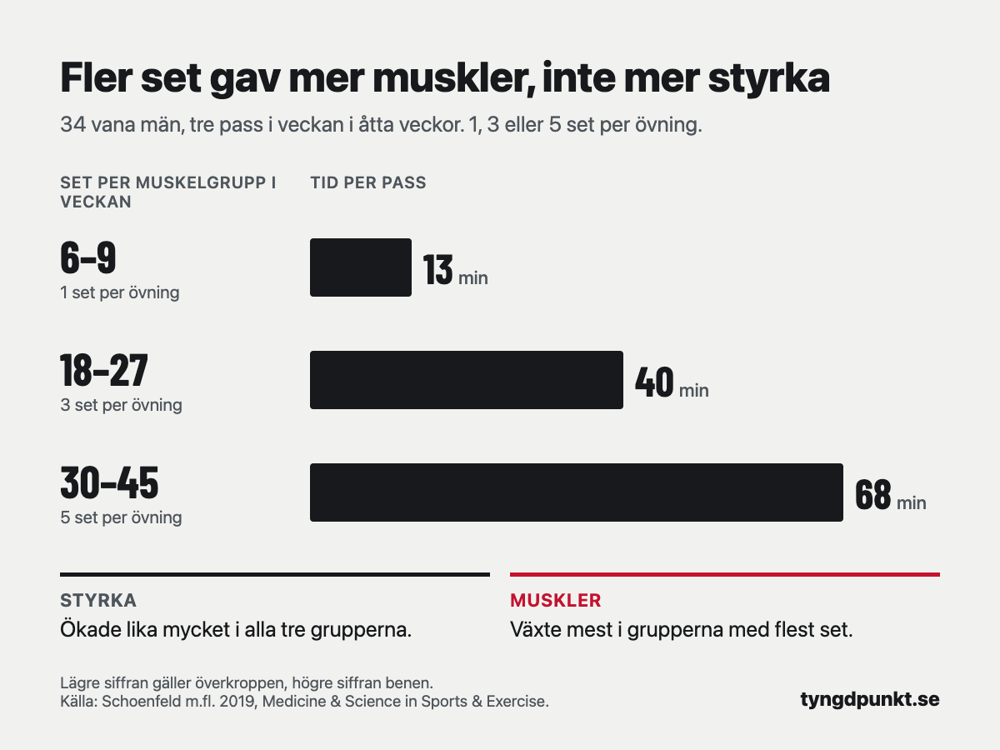

För att bygga muskler räcker runt 10–20 set per muskelgrupp i veckan för de flesta. En metaanalys från 2017 visade att varje extra set gav lite mer muskeltillväxt. En översikt från 2022 landade i 12–20 set för vana män, och fler än 20 set gav sällan mer. För att bli starkare räcker betydligt färre set.

## Hur många set per muskelgrupp i veckan för att bygga muskler?

Ju fler set, desto mer växer musklerna, men varje extra set ger lite mindre än det förra. Det är den samlade bilden från tre genomgångar av forskningen.

Schoenfeld och kollegor slog 2017 ihop 15 studier med 34 träningsgrupper. Fler set i veckan gav mer muskeltillväxt. Varje extra set per muskelgrupp och vecka var kopplat till 0,37 procent mer ökning i muskelstorlek. När författarna delade in seten i tre nivåer (under 5, 5–9 och 10 eller fler per muskel) syntes samma mönster, men skillnaden var inte statistiskt säker. Studierna sträckte sig sällan över tio set, så analysen kunde inte säga var nyttan planar ut.

Baz-Valle och kollegor tittade 2022 på just det. De tog bara med studier på män mellan 18 och 35 år som hade styrketränat i minst ett år, och jämförde 12–20 set i veckan med fler än 20. För framsida lår och biceps fanns ingen skillnad. För triceps gav fler än 20 set mer, men där räknade studierna också med set i flerledsövningar som bänkpress. Deras slutsats är att 12–20 set per muskelgrupp och vecka är en rimlig grundrekommendation för unga, vana män.

Pelland och kollegor gick 2026 igenom 67 studier med 2 058 deltagare. Muskeltillväxten ökade med antalet set, men med avtagande effekt. Fler set gav också mer styrka, men där avtog effekten betydligt snabbare.

| Set per muskelgrupp i veckan | Studie | Vad som hände |
|---|---|---|
| Under 5, 5–9, 10 eller fler | Schoenfeld 2017, 15 studier | Fler set gav mer tillväxt, cirka 0,37 % per extra set |
| 12–20 mot fler än 20 | Baz-Valle 2022, vana män | Ingen skillnad för lår och biceps, mer gav mer för triceps |
| 6–9, 18–27, 30–45 | Schoenfeld 2019, 34 vana män | Musklerna växte mest med flest set, styrkan ökade lika mycket |

Spannet 10–20 set är alltså en bra utgångspunkt. Eftersom varje set ger lite mindre än det förra lönar sig den övre delen mest för den som har tid och orkar återhämta sig.

## Hur många set behöver man för att bli starkare?

Färre än man tror. Schoenfeld och kollegor lät 2019 vana män träna tre helkroppspass i veckan i åtta veckor, med 1, 3 eller 5 set per övning. Varje set kördes med 8–12 reps tills det inte gick en rep till. Det blev 6–9, 18–27 eller 30–45 set per muskelgrupp i veckan, där den lägre siffran gäller överkroppen och den högre benen.

Knäböj och bänkpress ökade lika mycket i alla tre grupperna, trots att passen tog i snitt 13, 40 och 68 minuter. Musklerna växte däremot mest i grupperna med fler set, till exempel i framsida lår och biceps.

Är målet att bli starkare i några få lyft räcker det alltså långt med ett par tunga set per övning. Är målet större muskler lönar sig fler set.

## Hur räknar man set per muskelgrupp?

Ett set räknas när det är tungt på riktigt. Studierna ovan räknade set som kördes ända tills det inte gick en rep till, eller nästan dit. Uppvärmningsset med lätt vikt räknas inte.

Det svåra är övningar som tränar flera muskler. Bänkpress tränar bröstet mest, men också triceps och framsida axlar. Pelland och kollegor testade olika sätt att räkna och fick bäst träff när en övning räknades som ett helt set för den muskel den främst tränar och som ett halvt set för muskler som hjälper till. Det är också den enklaste tumregeln att använda själv:

- **Huvudmuskeln** räknas som 1 set.
- **Musklerna som hjälper till** räknas som 0,5 set.

**Räkneexempel.** Sara tränar helkropp tre gånger i veckan. Varje pass kör hon knäböj 3 set, bänkpress 3 set, sittande rodd 3 set, axelpress 2 set och bicepscurl 2 set.

- Framsida lår: 3 set knäböj × 3 pass = 9 set.
- Bröst: 3 set bänkpress × 3 pass = 9 set.
- Biceps: 2 set curl × 3 pass = 6 hela set. Rodden ger 9 × 0,5 = 4,5 set. Totalt 10,5 set.
- Triceps: bänkpressen ger 9 × 0,5 = 4,5 set och axelpressen 6 × 0,5 = 3 set. Totalt 7,5 set.

Biceps hamnar inom 10–20, medan bröst och lår ligger strax under. Vill Sara bygga mer i bröstet kan hon lägga till ett set bänkpress per pass. Då blir det 4 × 3 = 12 set i veckan. Hon behöver inte göra allt på en gång. Ett eller två set mer för en muskelgrupp i taget räcker, och sedan ser hon om hon orkar med det.

## Hur många set per muskelgrupp per pass?

Dela upp veckans set på två eller tre pass i stället för att göra allt på ett. Baz-Valle och kollegor skriver att spannet 12–20 set gäller när varje muskelgrupp tränas två gånger i veckan, och att fler pass gör det lättare att hinna med mer volym.

| Set i veckan | Fördelat på 2 pass | Fördelat på 3 pass |
|---|---|---|
| 10 | 5 per pass | 3–4 per pass |
| 12 | 6 per pass | 4 per pass |
| 16 | 8 per pass | 5–6 per pass |
| 20 | 10 per pass | 6–7 per pass |

Spelar det då någon roll hur ofta man tränar en muskel, om antalet set är detsamma? För muskeltillväxt verkar det spela liten roll. I Pellands genomgång var effekten av fler pass i veckan så liten att den kan vara noll. Styrkan ökade däremot med fler pass, även där med avtagande effekt. Frågan om hur ofta man ska träna samma muskelgrupp tar vi upp i en egen artikel.

## Ska nybörjare köra lika många set?

Siffrorna ovan kommer främst från vana män. Baz-Valles genomgång tog bara med personer som hade tränat i minst ett år, och i Schoenfelds studie från 2019 hade alla tränat minst tre gånger i veckan i ett år. Det säger alltså inte så mycket om vad en nybörjare behöver.

Ett försiktigt råd är att börja i den nedre delen, runt 10 set per muskelgrupp och vecka, och lägga till set först när framstegen avtar. Det ger tid att lära sig övningarna och att vänja kroppen vid träningen.

Gäller det kvinnor finns mindre forskning. I Pellands genomgång var 79 procent av deltagarna män och 21 procent kvinnor. Det finns inga särskilda siffror för kvinnor i de här översikterna, så samma spann är den bästa utgångspunkten vi har.

## Behöver man lika många set när man deffar?

Det är lätt att skära ned på träningen när man äter mindre, men det är fel ända att spara på. Det är styrketräningen som säger åt kroppen att behålla musklerna. Läs mer om hur du [deffar utan att tappa muskler](/artiklar/deffa-utan-att-tappa-muskler/). Där gäller det att gå ner lugnt och äta [tillräckligt med protein](/artiklar/hur-mycket-protein-per-dag/), och att fortsätta träna lika tungt som innan.

Hur många set som behövs under en deff tar studierna ovan inte upp. Vårt råd är att behålla vikterna och hellre ta bort ett set än att sänka vikten om orken tryter.

## I appen

I Tyngdpunkt ingår program som ökar vikt och reps själva efter hur passen gick, och en gång i veckan kan förslaget vara ett set till, med uträkningen synlig.

## Vanliga frågor

### Är 10 set per muskelgrupp i veckan för lite?

Nej, för de flesta är 10 set en bra nivå att börja på. Schoenfelds metaanalys visade att varje extra set gav lite mer tillväxt, och Pellands genomgång att effekten avtar. Den som vill ha mer kan öka mot 20.

### Kan man träna för många set?

I Baz-Valles genomgång gav fler än 20 set i veckan ingen extra tillväxt för lår och biceps, men det gav mer för triceps. Fler set tar längre tid och kräver mer återhämtning. Märker du att vikterna sjunker från vecka till vecka kan det vara ett tecken på att volymen är för hög.

### Räknas uppvärmningsset?

Nej. Räkna bara set som är tunga, alltså de där du har högst ett par reps kvar när du slutar. Uppvärmning med lätt vikt räknas inte.

### Hur många set per övning?

Det beror på hur många övningar du kör för muskeln. 3 set per övning är vanligt. Har du en övning för bröstet och tränar det två gånger i veckan blir det 6 set i veckan, och då kan det vara värt att lägga till en övning eller ett set.

### Gäller samma antal set för kvinnor och män?

Forskningen bygger mest på män, men det finns inga särskilda siffror för kvinnor i de översikter vi läst. Utgå från samma spann, 10–20 set i veckan.

## Källor

- Schoenfeld BJ, Ogborn D, Krieger JW (2017). Dose-response relationship between weekly resistance training volume and increases in muscle mass: A systematic review and meta-analysis. *Journal of Sports Sciences*, 35(11), 1073–1082. [Europe PMC](https://europepmc.org/article/MED/27433992)
- Baz-Valle E, Balsalobre-Fernández C, Alix-Fages C, Santos-Concejero J (2022). A Systematic Review of The Effects of Different Resistance Training Volumes on Muscle Hypertrophy. *Journal of Human Kinetics*, 81, 199–210. [Europe PMC](https://europepmc.org/article/PMC/PMC8884877)
- Schoenfeld BJ, Contreras B, Krieger J, Grgic J, Delcastillo K, Belliard R, Alto A (2019). Resistance Training Volume Enhances Muscle Hypertrophy but Not Strength in Trained Men. *Medicine & Science in Sports & Exercise*, 51(1), 94–103. [Europe PMC](https://europepmc.org/article/PMC/PMC6303131)
- Pelland JC, Remmert JF, Robinson ZP, Hinson SR, Zourdos MC (2026). The Resistance Training Dose Response: Meta-Regressions Exploring the Effects of Weekly Volume and Frequency on Muscle Hypertrophy and Strength Gains. *Sports Medicine*, 56(2), 481–505. [Europe PMC](https://europepmc.org/article/MED/41343037)
