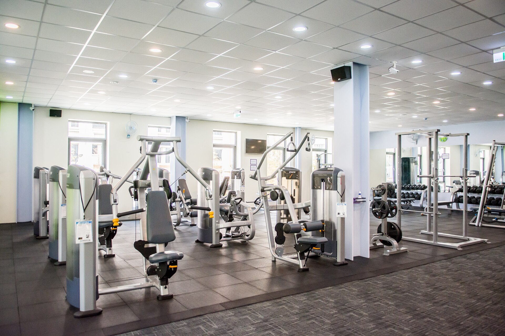
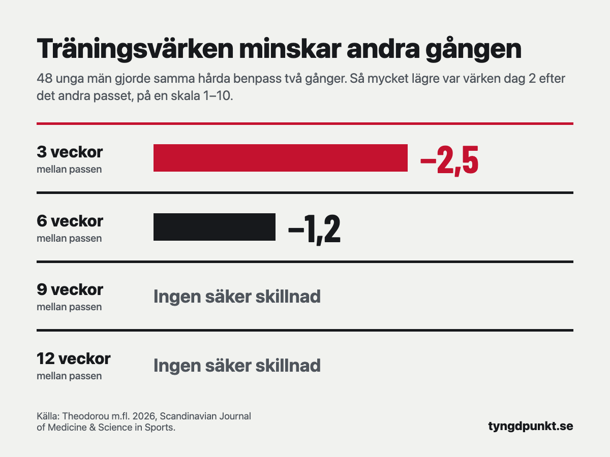

Träningsvärk kommer inte direkt efter passet. Den är som värst 48–72 timmar efteråt och klingar sedan av. Den beror på små skador i muskelfibrerna efter en ovan eller ny belastning, särskilt när muskeln bromsar en vikt. Du kan träna med träningsvärk, men lättare eller andra muskler i 1–2 dagar. Värken säger inte hur mycket musklerna växer.

## Vad är träningsvärk och varför får man det?

Träningsvärk är den ömhet och stelhet du känner i en muskel någon dag efter ett pass. Muskeln gör ont när du rör den eller trycker på den, den känns stel och orkar mindre än vanligt. Ibland är den också lite svullen.

Hotfiel och kollegor beskriver i en översikt från 2018 träningsvärk som en lindrig skada på muskelcellerna, så liten att den bara syns i mikroskop. Den uppstår av träning som kroppen inte är van vid, och av excentriskt arbete, alltså när muskeln bromsar en rörelse. Exempel är vägen ned i en knäböj, att sänka hantlarna i en bicepscurl eller att springa nedför en backe.

Mjölksyra nämns ofta som orsak, men det är bara en av flera förklaringar som har föreslagits genom åren. Cheung och kollegor räknade 2003 upp sex sådana: mjölksyra, kramp, skador på bindväven, skador på muskeln, inflammation och enzymer som läcker ut. De skrev att det troligen krävs en kombination för att förklara värken. En översikt från 2026 kommer till samma slutsats: träningsvärk är mer än en muskelskada. Inflammation och nerver som blir mer känsliga spelar också in.

Därför får du mest träningsvärk när du:

- börjar träna efter ett uppehåll,
- gör en övning du inte har gjort förut,
- ökar mängden mycket på en gång, till exempel många fler set än vanligt,
- gör övningar där musklerna bromsar mycket, som vägen ned i en djup knäböj.

## Hur länge sitter träningsvärk i?

Värken börjar sällan direkt. Den kommer med fördröjning och är som värst 48–72 timmar efter passet, så de flesta har mest ont dag två eller tre. Efter toppen avtar den.

Sitter värken i mer än en vecka, eller blir den värre i stället för bättre, är det något annat än vanlig träningsvärk. Mer om det längst ned, under När är det inte vanlig träningsvärk?

**Räkneexempel.** Sara är 27 år och har just börjat på gym. Hon kör sitt första benpass med knäböj och utfallssteg en tisdag kl. 19.

- 48 timmar senare är det torsdag kl. 19.
- 72 timmar senare är det fredag kl. 19.

Hon kan alltså räkna med att benen är som ömmast torsdag och fredag. Har hon ett benpass planerat på torsdagen är det klokt att flytta det till lördag, eller köra det lättare. Torsdagens pass kan i stället bli överkropp.

## Ska man träna med träningsvärk?

Ja, men lättare. Cheung och kollegor rekommenderar att man drar ned på hur tungt och hur länge man tränar i 1–2 dagar efter ett pass som gett mycket träningsvärk. Ett annat sätt är att träna de muskler som inte är ömma, så att de som är det får vila.

Det finns två skäl att inte köra lika hårt som vanligt:

1. **Musklerna orkar mindre.** Träningsvärk följs av sämre kraft, och det tar en tid innan den är tillbaka. Du lyfter alltså troligen mindre än vanligt, och passet ger mindre än du tror.
2. **Rörelserna blir sämre.** Cheung beskriver att värken minskar rörligheten och att kroppen kan börja kompensera med andra muskler. Det lägger ovan belastning på senor och leder och kan öka risken att skada sig.

Lätt rörelse känns ofta bra. Enligt Cheung är träning det som bäst lindrar värken medan man håller på, men effekten är kortvarig och värken kommer tillbaka efteråt.

Med ett program som tränar varje muskel två gånger i veckan brukar det gå ihop: mellan ett pass på måndag och nästa på torsdag går 72 timmar, och då har värken passerat toppen. Läs mer om [hur ofta du kan träna samma muskelgrupp](/artiklar/hur-ofta-trana-samma-muskelgrupp/).

## Betyder träningsvärk att träningen var bra?

Nej. Värken visar att musklerna fick en belastning de inte var vana vid. Den visar inte hur mycket de växer.

Damas och kollegor gick 2018 igenom forskningen om muskelskador och muskeltillväxt. Deras slutsats var att skadorna inte är det som får musklerna att växa. Träning som inte ger några större skador gav lika stor ökning av muskler och styrka som träning som gjorde det. De beskriver också vad som händer under de första veckorna:

| Antal pass | Vad som händer med muskeln |
|---|---|
| Upp till 4 | Muskeln ser större ut, men det är mest svullnad efter skadorna |
| Runt 10 | En liten verklig tillväxt börjar |
| Runt 18 | Tydlig tillväxt syns |

Kroppen lägger alltså först sitt arbete på att laga skadorna. Först när de minskar går mer av byggandet till ny muskel. Mycket träningsvärk är ingen fördel och kan göra att du tränar sämre resten av veckan.

Ett bättre mått på om träningen fungerar är att du över tid klarar [fler reps](/artiklar/reps-for-att-bygga-muskler/) eller mer vikt. Det är det som visar att du blir starkare, och för att bygga muskler betyder [antalet hårda set i veckan](/artiklar/set-per-muskelgrupp/) mer än hur ont det gör dagen efter.

## Varför får man mindre träningsvärk efter några pass?

Musklerna anpassar sig redan efter ett pass. Gör du samma sak igen blir värken mindre, och kraften kommer tillbaka snabbare. Det kallas på engelska *repeated bout effect*, ungefär "effekten av upprepad belastning".

Hur länge skyddet sitter i undersökte Theodorou och kollegor i en studie från 2026. 48 unga män gjorde ett mycket hårt pass för framsida lår: 5 set om 15 bromsande reps i en testmaskin. Sedan delades de upp i fyra grupper som gjorde samma pass igen efter 3, 6, 9 eller 12 veckor. Andra dagen efter passet skattade de värken på en skala från 1 till 10.

Värken var 2,5 poäng lägre andra gången när passet upprepades efter 3 veckor och 1,2 poäng lägre efter 6 veckor. Efter 9 och 12 veckor fanns ingen säker skillnad. Efter tolv veckor var skyddet borta för de flesta mått som forskarna mätte.

Det förklarar varför det gör så ont att börja om efter ett längre uppehåll. Har det gått ett par månader är musklerna tillbaka på ruta ett, i alla fall när det gäller värken. Cheung och kollegor rekommenderar därför att nya och bromsande övningar förs in gradvis under 1–2 veckor. Det gäller både när du börjar träna och när du lägger in något nytt.

För Sara betyder det att första veckan blir värst. Kör hon samma benpass varje vecka blir värken mindre redan nästa gång. Tar hon en paus på tre månader över sommaren är det klokt att börja om med lättare vikter och färre set.

## Vad kan man göra åt träningsvärk?

Värken går över av sig själv. Vill du lindra den finns det metoder som har effekt, och några som inte har det.

Dupuy och kollegor gick 2018 igenom 99 studier av olika sätt att återhämta sig efter träning. Afonso och kollegor gjorde 2021 en metaanalys av 10 studier med 229 deltagare som bara gällde stretching.

| Metod | Effekt på träningsvärken | Källa |
|---|---|---|
| Massage | Minskar, störst effekt av alla metoder | Dupuy 2018 |
| Lätt aktivitet, till exempel cykling i lugnt tempo | Minskar | Dupuy 2018 |
| Kompressionskläder | Minskar | Dupuy 2018 |
| Bad i kallt vatten | Minskar | Dupuy 2018 |
| Växelvis kallt och varmt vatten | Minskar | Dupuy 2018 |
| Stretching efter passet | Ingen säker skillnad mot att bara vila, efter 24, 48 eller 72 timmar | Afonso 2021 |

Gillar du att stretcha kan du fortsätta med det. Räkna bara inte med att värken går över fortare. Vill du testa något, är massage det som har bäst stöd.

Det bästa sättet är ändå att få mindre värk från början. Öka mängden gradvis, lägg in nya övningar under 1–2 veckor och träna samma muskler regelbundet, så att skyddet håller i sig.

## När är det inte vanlig träningsvärk?

Vanlig träningsvärk kommer ett tag efter passet och blir bättre när toppen har passerat. Kontakta vården eller ring 1177 om:

- smärtan är mycket stark, så att du knappt kan röra muskeln,
- muskeln är kraftigt svullen,
- du känner dig sjuk, till exempel med feber eller illamående,
- smärtan kom plötsligt under passet, som ett hugg, och sitter på ett ställe,
- värken inte blir bättre efter en vecka.

Har du en sjukdom eller tar läkemedel som påverkar musklerna, prata med vården innan du börjar träna hårt.

## I appen

I Tyngdpunkt ingår program som ökar vikt och reps själva efter hur passen gick, först reps och sedan vikt, så att belastningen ökar i små steg.

## Vanliga frågor

### Varför får man träningsvärk först dag 2?

Värken kommer med fördröjning och är som värst 48–72 timmar efter passet. Skadorna i muskeln följs av en reaktion i kroppen som tar tid, med bland annat inflammation, och det är den som gör att värken kommer i efterhand.

### Är det farligt att träna med träningsvärk?

Inte om du tränar lättare. Musklerna orkar mindre och rör sig sämre när de är ömma, så kör inte tungt med samma muskler. Träna andra muskler eller lätt i 1–2 dagar.

### Bygger man mer muskler om man får träningsvärk?

Nej. Forskningen visar att träning utan stora muskelskador ger lika mycket muskler och styrka. Värken visar att belastningen var ny, inte att den var bättre.

### Varför får jag ingen träningsvärk längre?

Musklerna har vant sig. Efter några pass med samma övningar blir värken mindre, även om du blir starkare. Det är ett tecken på anpassning, inte att träningen har slutat fungera.

### Hjälper stretching mot träningsvärk?

Inte enligt den metaanalys som har gjorts. Stretching efter passet gav ingen säker skillnad mot att vila, varken efter 24, 48 eller 72 timmar. Massage och lätt aktivitet hade bättre stöd.

## Källor

- Hotfiel T, Freiwald J, Hoppe MW, Lutter C, Forst R, Grim C, Bloch W, Hüttel M, Heiss R (2018). Advances in Delayed-Onset Muscle Soreness (DOMS): Part I: Pathogenesis and Diagnostics. *Sportverletzung Sportschaden*, 32(4), 243–250. [Europe PMC](https://europepmc.org/article/MED/30537791)
- Cheung K, Hume P, Maxwell L (2003). Delayed onset muscle soreness: treatment strategies and performance factors. *Sports Medicine*, 33(2), 145–164. [Europe PMC](https://europepmc.org/article/MED/12617692)
- Jemni M, Quodling N, Hammami N, Groves S, Ijaz A, Pulyanova D, Hoffman NH, Bottoms L, Carrick FR, Gu Y (2026). Rethinking neurophysiology of delayed onset muscle soreness: updated concepts and mechanisms for mitigation across endurance, resistance, and plyometric exercise. *Frontiers in Sports and Active Living*, 8, 1709704. [Europe PMC](https://europepmc.org/article/PMC/PMC13627368)
- Damas F, Libardi CA, Ugrinowitsch C (2018). The development of skeletal muscle hypertrophy through resistance training: the role of muscle damage and muscle protein synthesis. *European Journal of Applied Physiology*, 118(3), 485–500. [Europe PMC](https://europepmc.org/article/MED/29282529)
- Theodorou AA, Margaritelis NV, Karyofyllidou AV, Christodoulou F, Jamurtas AZ, Fatouros IG, Kyparos A, Nikolaidis MG, Paschalis V (2026). The Duration of the Repeated-Bout Effect After Eccentric Exercise. *Scandinavian Journal of Medicine & Science in Sports*, 36(10), e70381. [Europe PMC](https://europepmc.org/article/PMC/PMC13674372)
- Dupuy O, Douzi W, Theurot D, Bosquet L, Dugué B (2018). An Evidence-Based Approach for Choosing Post-exercise Recovery Techniques to Reduce Markers of Muscle Damage, Soreness, Fatigue, and Inflammation: A Systematic Review With Meta-Analysis. *Frontiers in Physiology*, 9, 403. [Europe PMC](https://europepmc.org/article/PMC/PMC5932411)
- Afonso J, Clemente FM, Nakamura FY, Morouço P, Sarmento H, Inman RA, Ramirez-Campillo R (2021). The Effectiveness of Post-exercise Stretching in Short-Term and Delayed Recovery of Strength, Range of Motion and Delayed Onset Muscle Soreness: A Systematic Review and Meta-Analysis of Randomized Controlled Trials. *Frontiers in Physiology*, 12, 677581. [Europe PMC](https://europepmc.org/article/PMC/PMC8133317)
