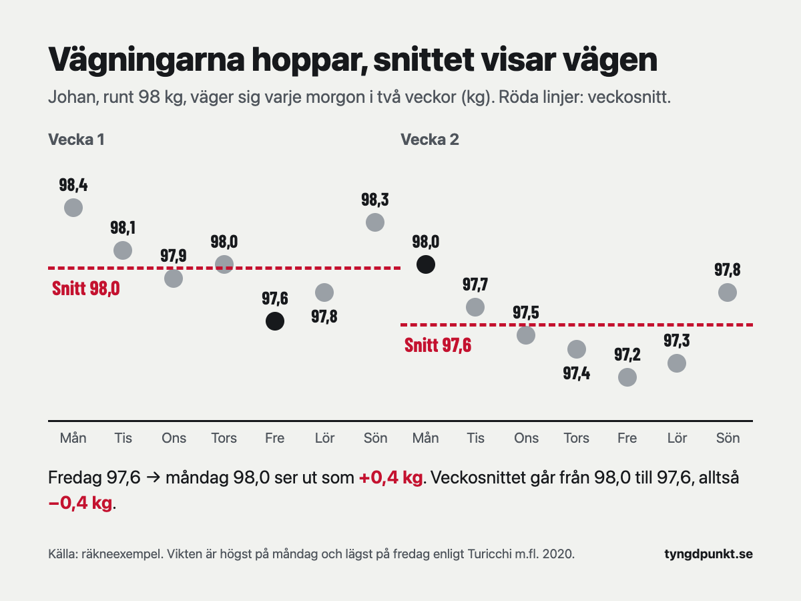

Ja, för de flesta som vill gå ner i vikt fungerar det bra att väga sig varje dag, så länge du jämför veckosnitt och inte enskilda dagar. I en studie gick de som vägde sig varje dag ner 6,1 kg mer än de som vägde sig de flesta dagar. Väg dig på morgonen, efter toalettbesöket och före frukost.

## Är det bra att väga sig varje dag?

För den som vill gå ner i vikt talar forskningen mest för det. Steinberg och kollegor lät 2013 91 vuxna med övervikt antingen väga sig varje dag på en uppkopplad våg eller vänta på sin tur. De som vägde sig fick också ett diagram över vikten och ett mejl i veckan med tips och återkoppling. Efter sex månader hade de gått ner 6,55 procent av sin vikt, jämfört med 0,35 procent i gruppen som väntade. De vägde sig i snitt 6,1 dagar i veckan.

När samma forskare senare jämförde deltagarna inom den gruppen syntes en skillnad till. Hälften vägde sig verkligen varje dag. De andra vägde sig i snitt 5,4 dagar i veckan. De som vägde sig varje dag gick ner 6,1 kg mer och hade börjat med fler vanor som hjälper vid viktnedgång: i snitt 17,6 mot 11,2 av de 37 vanor som forskarna frågade om (Steinberg 2015). Det är en jämförelse inom en grupp och inte ett försök där vägningen lottades, så det kan också vara så att de mest motiverade vägde sig oftast.

Utanför studierna syns samma mönster. Vuorinen och kollegor följde 2021 nästan 9 800 personer med en uppkopplad våg i snitt i tre år. Ju fler dagar de vägde sig, desto mer gick de ner, men sambandet var svagt.

Vågen gör inget själv. I Madigans sammanställning från 2015 fanns bara ett försök där vägningen var det enda som ändrades, och där gav den ingen säker effekt. Det som fungerade var vägningen ihop med en plan för maten och träningen. Där syntes ingen skillnad mellan att väga sig varje dag och en gång i veckan. Vågen visar om planen fungerar. Den ersätter inte planen.

## Varför ska man inte väga sig varje dag?

Det vanligaste skälet man hör är att vägningen ska göra att man mår sämre. För de flesta vuxna stämmer det inte. Zheng och kollegor gick 2015 igenom 17 studier och fann inget samband mellan regelbunden vägning och nedstämdhet eller oro. I Benns sammanställning av 29 tester från 2016 fanns inget samband med humöret, synen på kroppen eller ätstörningar, men ett litet negativt samband med hur man ser på sig själv. I Steinbergs försök från 2014 blev de som vägde sig varje dag inte mer nedstämda och hetsåt inte mer. De var dessutom något mindre missnöjda med kroppen efter sex månader.

Men det gäller inte alla. Pacanowski och kollegor lät 2023 69 kvinnor mellan 18 och 22 år väga sig varje dag i två veckor, i en studie om att förebygga viktökning. De fick ett diagram över vikten varje dag men inga andra råd. Jämfört med en grupp som i stället tog tempen varje dag svängde deras humör mer, och de kände mer stress över vikten och var mindre nöjda med kroppen. Forskarna uppmanar till försiktighet med att ge unga vuxna rådet att väga sig varje dag.

En enkel tumregel är att vågen ska ge dig information. Gör siffran att du hoppar över måltider, tränar för att kompensera eller mår dåligt resten av dagen är det bättre att väga dig mer sällan eller inte alls, och följa midjemåttet och styrkan i stället. Har du eller har du haft en ätstörning ska du prata med vården innan du börjar väga dig regelbundet.

## Hur mycket kan vikten variera från dag till dag?

Mer än många tror, och därför är enskilda vägningar svåra att tolka. Turicchi och kollegor följde 2020 vikten hos över 1 400 vuxna i ett europeiskt projekt där deltagarna vägde sig hemma på en uppkopplad våg. Inom en vecka svängde vikten runt 0,35 procent. Den var högst på måndagen och sjönk sedan till fredagen, alltså upp under helgen och ner under vardagarna.

0,35 procent låter lite, men det är drygt två tredjedelar av en veckas nedgång i en lugn takt. ISSN, det internationella sällskapet för idrottsnutrition, anger 0,5–1 procent av kroppsvikten i veckan som en lämplig takt för idrottare som vill behålla musklerna.

| Vikt | Svängning inom en vecka (0,35 %) | Nedgång på 0,5 % i veckan |
|---|---|---|
| 60 kg | 0,21 kg | 0,30 kg |
| 70 kg | 0,25 kg | 0,35 kg |
| 80 kg | 0,28 kg | 0,40 kg |
| 90 kg | 0,32 kg | 0,45 kg |
| 100 kg | 0,35 kg | 0,50 kg |

Svängningen är ett snitt. Enskilda dagar kan skilja mer, till exempel efter en salt middag eller ett tungt pass. ISSN räknar upp vätska, glykogen (kolhydratförrådet i musklerna), det som finns i magen och tarmarna, menscykeln, svullnad efter träning, resor och hur mycket salt och kolhydrater du ätit. Inget av det är fett. Varför vikten ibland står still i veckor går vi igenom i [varför står vikten still trots kaloriunderskott](/artiklar/vikten-star-still/).

Julen är värd att nämna nu. I Turicchis studie ökade vikten med 1,35 procent från början av december till de första dagarna i januari, och deltagarna gick inte ner allt igen under månaderna efter.

## Ska man väga sig på morgonen eller kvällen?

På morgonen. Klockslaget spelar mindre roll än att förhållandena är desamma varje gång. På kvällen väger du också det du ätit och druckit under dagen, och det skiljer sig från dag till dag. På morgonen är magen så tom den blir.

I Turicchis studie fick deltagarna rådet att väga sig direkt när de vaknat, i lätta kläder eller utan kläder och med tom blåsa. Ett bra sätt är:

- direkt efter toalettbesöket,
- före frukost och innan du dricker något,
- utan kläder eller i samma lätta kläder varje gång,
- på samma våg, på samma ställe på ett hårt golv.

Väger du dig efter träningen har du ofta svettats bort vätska, och vikten blir lägre än den egentligen är. Det är ingen fettminskning, och vätskan kommer tillbaka när du dricker.

## Hur räknar man ut veckosnittet?

Lägg ihop veckans vägningar och dela med antalet. Jämför sedan snittet med förra veckans. Enligt ISSN blir vikten lättare att tolka med ett rullande snitt över 7–14 dagar och minst ett mått till, till exempel midjemåttet, styrkan eller bilder.

**Räkneexempel.** Johan är 41 år, väger 98 kg och vill gå ner i fett. Han väger sig varje morgon i två veckor.

| | Mån | Tis | Ons | Tors | Fre | Lör | Sön | Snitt |
|---|---|---|---|---|---|---|---|---|
| Vecka 1 | 98,4 | 98,1 | 97,9 | 98,0 | 97,6 | 97,8 | 98,3 | 98,0 |
| Vecka 2 | 98,0 | 97,7 | 97,5 | 97,4 | 97,2 | 97,3 | 97,8 | 97,6 |

Snittet för vecka 1 är 686,1 ÷ 7 ≈ 98,0 kg och för vecka 2 682,9 ÷ 7 ≈ 97,6 kg. Johan har alltså gått ner ungefär 0,4 kg.

Hade han bara jämfört fredagen i vecka 1 med måndagen i vecka 2 hade det sett ut som om han gått upp 0,4 kg. Det är samma mönster som i Turicchis studie: lägst på fredagen, högst efter helgen.

Snittet säger också något om kalorierna. Ett kilo fett motsvarar ungefär 7 700 kcal, så 0,4 kg i veckan är 0,4 × 7 700 ÷ 7 ≈ 440 kcal per dag i underskott. För Johan är 0,4 kg ungefär 0,4 procent av vikten, alltså lite under spannet 0,5–1 procent. Vill han gå något fortare kan han [räkna ut sitt kaloribehov](/kaloribehov/) och se hur stort underskottet bör vara. Hur det räknas fram går vi igenom i [kaloriunderskott: så räknar du ut hur stort det ska vara](/artiklar/kaloriunderskott/).

Ge det minst två veckor innan du ändrar något. En enda veckas snitt kan också påverkas av en helg med mycket salt eller en resa.

## Hur ofta ska man väga sig om man inte vill göra det varje dag?

Några gånger i veckan räcker för att se trenden, särskilt om du väger dig samma dagar varje vecka. I Vuorinens studie vägde sig deltagarna i snitt 2,8 gånger i veckan. Väger du dig bara en gång i veckan, välj samma veckodag, eftersom vikten följer veckodagarna.

Det som verkar spela roll är att inte sluta helt. Hos Vuorinen hade 72,5 procent av deltagarna minst en period på 30 dagar eller mer utan vägning. Under uppehållen gick vikten upp, med 0,58 kg för dem med normalvikt, 0,93 kg för dem med övervikt och 1,37 kg för dem med fetma. Det är ett samband och säger inte om uppehållet var orsaken. Det kan också vara så att man slutar väga sig när man slutat följa planen.

Styrketränar du kan vågen dessutom stå still medan midjan blir smalare, eftersom du kan bygga muskler och gå ner i fett samtidigt. Mer om det står i [väger muskler mer än fett](/artiklar/muskler-vager-mer-an-fett/). Följ därför styrkan och midjemåttet vid sidan av vikten.

## I appen

I Tyngdpunkt loggar du både mat och träning. En gång i veckan går vi igenom vikttrenden, inte enskilda vägningar, och ställer den mot vad du ätit och hur styrkan har utvecklats. Ett förslag på ändring kommer först när du följt planen och vikten ändå går fel.

## Vanliga frågor

### Är det dåligt att väga sig varje dag?

För de flesta vuxna som vill gå ner i vikt är det inte det. I forskningsöversikterna syns inget samband med nedstämdhet eller ätstörningar. Unga kvinnor mådde däremot sämre av daglig vägning i en studie. Mår du dåligt av siffran, väg dig mer sällan och följ andra mått.

### Ska man väga sig med eller utan kläder?

Utan kläder, eller i samma lätta kläder varje gång. Det viktiga är att det är likadant varje gång, så att skillnaderna beror på kroppen och inte på kläderna.

### Varför väger jag mer på måndagar?

Helgens mat och dryck ger ofta mer salt, kolhydrater och vätska i kroppen. I Turicchis studie var vikten högst på måndagen och sjönk sedan under veckan till fredagen. Jämför därför veckosnitt, eller samma veckodag varje vecka.

### Hur mycket kan vikten variera mellan morgon och kväll?

Det beror på vad och hur mycket du ätit och druckit under dagen, och vi har inte hittat någon pålitlig siffra. Därför är det bättre att alltid väga sig på morgonen, då förhållandena är som mest lika.

## Källor

- Steinberg DM, Tate DF, Bennett GG, Ennett S, Samuel-Hodge C, Ward DS (2013). The efficacy of a daily self-weighing weight loss intervention using smart scales and e-mail. *Obesity*, 21(9), 1789–1797. [Europe PMC](https://europepmc.org/article/MED/23512320)
- Steinberg DM, Bennett GG, Askew S, Tate DF (2015). Weighing every day matters: daily weighing improves weight loss and adoption of weight control behaviors. *Journal of the Academy of Nutrition and Dietetics*, 115(4), 511–518. [Europe PMC](https://europepmc.org/article/MED/25683820)
- Vuorinen AL, Helander E, Pietilä J, Korhonen I (2021). Frequency of self-weighing and weight change: cohort study with 10,000 smart scale users. *Journal of Medical Internet Research*, 23(6), e25529. [Europe PMC](https://europepmc.org/article/MED/34075879)
- Madigan CD, Daley AJ, Lewis AL, Aveyard P, Jolly K (2015). Is self-weighing an effective tool for weight loss: a systematic literature review and meta-analysis. *International Journal of Behavioral Nutrition and Physical Activity*, 12, 104. [Europe PMC](https://europepmc.org/article/MED/26293454)
- Zheng Y, Klem ML, Sereika SM, Danford CA, Ewing LJ, Burke LE (2015). Self-weighing in weight management: a systematic literature review. *Obesity*, 23(2), 256–265. [Europe PMC](https://europepmc.org/article/MED/25521523)
- Benn Y, Webb TL, Chang BP, Harkin B (2016). What is the psychological impact of self-weighing? A meta-analysis. *Health Psychology Review*, 10(2), 187–203. [Europe PMC](https://europepmc.org/article/MED/26742706)
- Steinberg DM, Tate DF, Bennett GG, Ennett S, Samuel-Hodge C, Ward DS (2014). Daily self-weighing and adverse psychological outcomes: a randomized controlled trial. *American Journal of Preventive Medicine*, 46(1), 24–29. [Europe PMC](https://europepmc.org/article/MED/24355668)
- Pacanowski CR, Dominick G, Crosby RD, Engel SG, Cao L, Linde JA (2023). Daily self-weighing compared with an active control causes greater negative affective lability in emerging adult women: a randomized trial. *Applied Psychology: Health and Well-Being*, 15(4), 1695–1713. [Europe PMC](https://europepmc.org/article/MED/37339756)
- Turicchi J, O'Driscoll R, Horgan G, m.fl. (2020). Weekly, seasonal and holiday body weight fluctuation patterns among individuals engaged in a European multi-centre behavioural weight loss maintenance intervention. *PLoS One*, 15(4), e0232152. [Europe PMC](https://europepmc.org/article/MED/32353079)
- Aragon AA, Campbell BI, Schoenfeld BJ, m.fl. (2026). International Society of Sports Nutrition position stand: diets for body weight reduction. *Journal of the International Society of Sports Nutrition*, 23(1). [Europe PMC](https://europepmc.org/article/PMC/PMC13665703)
