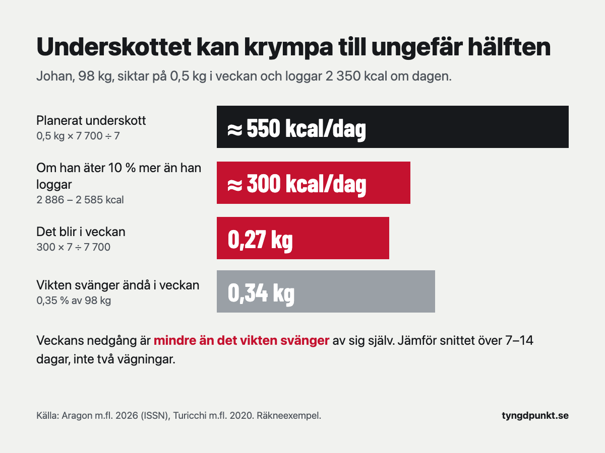

Står vikten still trots kaloriunderskott beror det oftast på något av två skäl. Antingen är underskottet mindre än du tror, eller så döljs fettet du gått ner av vätska och vanliga svängningar. Vikten varierar i snitt 0,35 procent inom en vecka, och de flesta äter mer än de loggar. Jämför snittet över 7–14 dagar innan du ändrar något.

## Varför står vikten still trots kaloriunderskott?

Det finns ett fåtal förklaringar, och de går att skilja åt. I ISSN:s genomgång från 2026, där det internationella sällskapet för idrottsnutrition sammanfattar forskningen om viktnedgång, delas de in i tre grupper. Den första är kortsiktigt brus som döljer fettminskningen. Den andra är att kroppen har nått en ny jämvikt, så att det du äter nu motsvarar det du gör av med. Den tredje är att du följer planen sämre än du tror, oftast utan att märka det.

| Orsak | Hur det märks | Vad du gör |
|---|---|---|
| Vätska, glykogen och maginnehåll | Vikten hoppar upp och ner från dag till dag | Följ snittet över 7–14 dagar |
| Mer mat än du loggar | Snittet står still i flera veckor | Väg maten och logga allt under en till två veckor |
| Kaloribehovet har sjunkit | Det gick fort i början, sedan allt långsammare | Räkna om behovet med din nya vikt |
| Mindre vardagsrörelse | Färre steg, mer stillasittande | Håll stegen uppe |
| Du bygger muskler samtidigt | Midjemåttet minskar och styrkan ökar | Mät midjan och följ styrkan |

Börja uppifrån. De två första orsakerna är lättast att göra något åt, och dem bör du utesluta innan du drar ner på maten.

## Hur mycket kan vikten variera från dag till dag?

Mer än många tror. Turicchi och kollegor följde vikten hos över 1 400 vuxna i ett europeiskt projekt för viktkontroll, som vägde sig med en uppkopplad våg. Inom en vecka svängde vikten i snitt 0,35 procent. Den var högst på måndagen och lägst på fredagen, alltså upp under helgen och ner under vardagarna. Hos männen var svängningen 0,41 procent och hos kvinnorna 0,29 procent.

För den som väger 98 kg är 0,35 procent ungefär 0,34 kg. Det är nästan lika mycket som en hel veckas nedgång i en lugn takt. Väger du dig en måndag efter en helg med restaurangmat kan det se ut som om veckan inte gav någonting, fast fettet har minskat.

ISSN räknar upp vad som kan flytta vikten på kort sikt: vätska, glykogen (kolhydratförrådet i musklerna och levern), det som finns i magen och tarmarna, vätska som följer menscykeln, svullnad efter ett nytt eller tungt pass, resor och hur mycket salt och kolhydrater du ätit. Allt det påverkar vågen, men inget av det är fett.

Därför rekommenderar ISSN att man följer ett rullande snitt över 7–14 dagar och dessutom minst ett mått till, till exempel midjemåttet, styrkan eller bilder. Väg dig gärna varje morgon på samma sätt och räkna ut veckosnittet. Det är snitten du jämför, vecka mot vecka.

## Äter du mer än du tror?

Det är svårt att se själv. Enligt ISSN beror viktplatåer till stor del på att planen följs sämre, och det sker oftast utan att man vet om det.

Lichtman och kollegor undersökte 1992 tio personer med fetma som sa att de inte gick ner i vikt trots att de åt mindre än 1 200 kcal om dagen. Forskarna mätte både vad de gjorde av med och vad de faktiskt åt. Ämnesomsättningen låg inom 5 procent av det som förväntades. Däremot hade de i snitt underskattat sitt intag med 47 procent och överskattat sin fysiska aktivitet med 51 procent.

Det gäller inte bara personer med övervikt. I ISSN:s sammanställning underskattade personer som behållit en viktnedgång sitt intag med 25 procent. Även dietister, som kan mer om mat än de flesta, underskattade sitt intag med drygt 10 procent.

Oftast är det småsaker: oljan i stekpannan, en näve nötter, smakbitar under matlagningen, en extra skvätt mjölk i kaffet och helgerna som aldrig loggas. Var för sig är det lite, men det blir mycket tillsammans.

**Räkneexempel.** Johan är 41 år, 183 cm lång, väger 98 kg och styrketränar fyra pass i veckan. Hans kaloribehov är ungefär 2 886 kcal. Uträkningen steg för steg står i [gå ner 1 kg i veckan](/artiklar/ga-ner-1-kg-i-veckan/). Han vill gå ner 0,5 kg i veckan.

- Planerat underskott: 0,5 × 7 700 ÷ 7 = 550 kcal per dag. Han loggar därför 2 886 − 550 ≈ 2 350 kcal om dagen.
- Säg att han i själva verket äter 10 procent mer än han loggar: 2 350 × 1,1 = 2 585 kcal.
- Verkligt underskott: 2 886 − 2 585 = 301 kcal, ungefär 300 kcal per dag.
- Det blir 300 × 7 ÷ 7 700 = 0,27 kg i veckan, i stället för 0,5 kg.

Johan går alltså fortfarande ner, men i ungefär halva takten. Samtidigt svänger hans vikt runt 0,34 kg inom en vecka. Jämför han två enskilda vägningar kan det se ut som om ingenting händer.

Vill du se om det här gäller dig: väg maten på en köksvåg och logga allt du äter i en till två veckor, även helgerna och det du dricker. Det är tråkigt, men det är det säkraste sättet att veta.

## Har ditt kaloribehov sjunkit?

Ja, om du har gått ner en del. En mindre kropp gör av med mindre energi, både i vila och när den rör sig. I Mifflin–St Jeor sjunker vilan med 10 kcal för varje kilo du går ner. När Johan har gått ner 5 kg gör han av med 50 kcal mindre i vila, och med träningen inräknad blir det 50 × 1,5 = 75 kcal mindre per dag. Äter han samma mängd som i början blir underskottet mindre för varje kilo.

Det är också därför viktnedgången ofta går fort de första veckorna och sedan saktar in. Enligt ISSN brukar en viktnedgång gå bra de första 8–12 veckorna, och sedan går det långsammare tills vikten planar ut.

Vardagsrörelsen kan också minska. Det är alla steg, all tid du står upp och allt småspring som inte är träning. Enligt ISSN kan den andelen av förbrukningen variera mycket mellan personer och sjunka när man äter mindre. I de studier ISSN beskriver, där deltagarna åt 10–30 procent mindre än sitt behov, minskade aktiviteten utanför träningen med ungefär 200–300 kcal per dag efter ett halvår. Det kan äta upp en stor del av underskottet.

Gå tillbaka till [kalkylatorn och räkna om ditt kaloribehov](/kaloribehov/) med din nuvarande vikt när du har gått ner några kilo. Hur underskottet räknas fram från behovet går vi igenom i [kaloriunderskott: så räknar du ut hur stort det ska vara](/artiklar/kaloriunderskott/).

## Finns svältläge?

Inte så som det brukar beskrivas, alltså att kroppen slutar gå ner i vikt för att man äter för lite. Det finns en verklig anpassning, som kallas adaptiv termogenes. Det betyder att förbrukningen i vila sjunker mer än vad den mindre kroppen förklarar. Men den är oftast liten.

ISSN skriver att den ofta anges till 10–15 procent, och att det sannolikt är en kraftig överskattning, särskilt när vikten har stabiliserats. I en studie som ISSN beskriver gick deltagarna ner 12 kg på ungefär ett halvår, och förbrukningen i vila var då 54 kcal lägre än väntat. I en annan gick de ner 22 kg på fyra månader, och skillnaden var 61 kcal per dag, för liten för att vara statistiskt säker. Det är verkliga siffror, men de förklarar inte att vikten står helt still i veckor.

Studien av Lichtman pekar åt samma håll. De som trodde att deras kropp inte kunde gå ner i vikt hade en normal ämnesomsättning. Det var intaget som var högre än de trodde.

## Kan man gå ner i centimeter men inte i vikt?

Ja. Styrketränar du kan du bygga muskler samtidigt som du går ner i fett. Då kan vikten stå still eller sjunka långsamt, medan midjan blir smalare och vikterna på stången tyngre. Enligt ISSN är det vanligt hos den som styrketränar med ett program som ökar över tid, särskilt i början. En viktplatå behöver alltså inte vara en platå i fettet.

Därför är midjemåttet och styrkan bra att följa vid sidan av vågen. Mät midjan på samma ställe och vid samma tid, till exempel en morgon i veckan. Minskar midjan och styrkan håller i sig eller ökar, går det åt rätt håll även om vågen står still. Hur mycket protein du behöver för att behålla och bygga muskler under en viktnedgång står i [hur mycket protein per dag](/artiklar/hur-mycket-protein-per-dag/).

## Hur länge kan vikten stå still innan man ändrar något?

Det finns ingen gräns som alla forskare är överens om. ISSN anser att en period på 4–8 veckor utan förändring kan räknas som en verklig platå, om planen har följts väl. Kortare än så är det svårt att skilja en platå från vanliga svängningar.

I praktiken kan du gå igenom det i den här ordningen:

1. **Titta på snittet.** Jämför veckosnitt, inte enskilda vägningar. Har snittet sjunkit lite, även om det går långsamt, finns det fortfarande ett underskott.
2. **Kontrollera loggningen.** Väg maten och logga allt under en till två veckor.
3. **Räkna om behovet** med din nuvarande vikt.
4. **Justera lite.** Står snittet fortfarande still efter det kan du dra ner med 100–200 kcal per dag, eller röra dig mer, och följa vikten några veckor till.

ISSN föreslår också att se en period där vikten står still som en övning i att hålla vikten. Det är ju målet efter en viktnedgång. ISSN nämner också planerade pauser: ungefär en vecka efter varje 3–5 kg, eller en längre period med vikten stilla på 1–3 månader efter varje 5–10 kg.

Har du en sjukdom, tar läkemedel som påverkar vikten, är gravid eller ammar, eller har eller har haft en ätstörning ska du inte försöka lösa en viktplatå på egen hand. Prata med vården.

## I appen

I Tyngdpunkt loggar du både mat och träning. En gång i veckan stämmer vi av vikttrenden mot det du ätit och hur väl du följt planen. Har du följt den och vikten ändå står still får du ett förslag på en ändring, med uträkningen synlig. Har planen inte följts säger vi det i stället för att ändra målet.

## Vanliga frågor

### Kan man gå upp i vikt trots kaloriunderskott?

På vågen, ja, några dagar i taget. Salt mat, mer kolhydrater, ett tungt pass eller menscykeln kan ge mer vätska i kroppen. Fett går du däremot inte upp i med ett verkligt underskott. Stiger snittet i flera veckor är underskottet sannolikt mindre än du tror.

### Hur länge kan en viktplatå hålla på?

Så länge du äter lika mycket som du gör av med. ISSN räknar en period på 4–8 veckor utan förändring som en verklig platå, om planen följts väl. Kortare perioder är oftast vanliga svängningar.

### Ska man äta mer om vikten står still?

Inte för att komma ur ett svältläge, eftersom den anpassningen är liten. En planerad paus på en vecka eller längre kan däremot göra det lättare att orka fortsätta. Enligt ISSN kan en sådan paus bevara förbrukningen i vila något, men den ger ingen tydlig fördel för andelen fett och muskler.

### Hur ofta ska man väga sig?

Väg dig gärna varje morgon på samma sätt och räkna ut ett snitt för veckan. Det är snitten du jämför. En enskild vägning kan skilja sig från dagen innan utan att fettet har ändrats.

## Källor

- Aragon AA, Campbell BI, Schoenfeld BJ, m.fl. (2026). International Society of Sports Nutrition position stand: diets for body weight reduction. *Journal of the International Society of Sports Nutrition*, 23(1). [Europe PMC](https://europepmc.org/article/PMC/PMC13665703)
- Turicchi J, O'Driscoll R, Horgan G, m.fl. (2020). Weekly, seasonal and holiday body weight fluctuation patterns among individuals engaged in a European multi-centre behavioural weight loss maintenance intervention. *PLoS One*, 15(4), e0232152. [Europe PMC](https://europepmc.org/article/PMC/PMC7192384)
- Lichtman SW, Pisarska K, Berman ER, m.fl. (1992). Discrepancy between self-reported and actual caloric intake and exercise in obese subjects. *New England Journal of Medicine*, 327(27), 1893–1898. [Europe PMC](https://europepmc.org/article/MED/1454084)
