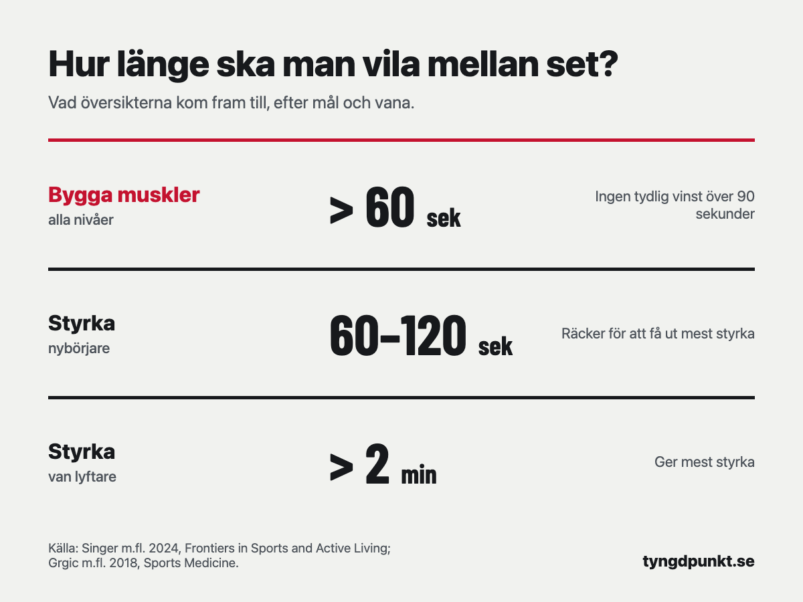

Vila minst en till två minuter mellan seten. För att bygga muskler gav mer än 60 sekunders vila lite större muskeltillväxt i en metaanalys av 9 studier, men det syntes ingen tydlig vinst av att vila längre än 90 sekunder. För styrka behöver vana lyftare oftast mer än 2 minuter, medan nybörjare klarar sig med 60–120 sekunder.

## Hur länge ska man vila mellan set för att bygga muskler?

Lite mer än en minut räcker för de flesta. Singer och kollegor gick 2024 igenom alla studier som jämfört olika vilotider och mätt hur mycket musklerna växte. De hittade 9 studier med friska vuxna, där allt utom vilan var lika mellan grupperna.

Musklerna växte i nästan alla grupper, oavsett hur länge deltagarna vilade. Jämförde man kort vila (högst 60 sekunder) med längre vila fick den längre vilan en liten fördel, både i armarna och i låren. Skillnaden var troligen liten. Forskarna delade också in vilan i fyra nivåer:

| Vila mellan set | Nivå i studien | Muskeltillväxt |
|---|---|---|
| Högst 60 sekunder | Kort | Bra, men lite mindre |
| 61–119 sekunder | Mellan | Bra |
| 120–179 sekunder | Lång | Bra |
| 3 minuter eller mer | Mycket lång | Bra |

*Källa: Singer m.fl. 2024. Skillnaderna mellan nivåerna var små och osäkra.*

Deras slutsats är att musklerna kan växa med många olika vilotider, men att det lönar sig lite att vila mer än 60 sekunder. Däremot fann de inget som tydde på att det hjälper att vila mer än 90 sekunder.

Det går emot ett gammalt råd. Den amerikanska organisationen NSCA har rekommenderat 30–90 sekunders vila för muskeltillväxt. Rådet bygger på att kort vila höjer halten av vissa hormoner efter passet. Singer och kollegor skriver att de korta höjningarna inte verkar betyda särskilt mycket för hur musklerna växer, och att riktlinjerna borde ses över.

## Varför ska man vila mellan set?

För att orka lika mycket i nästa set. Musklerna behöver återhämta sig en stund efter ett tungt set. Vilar du för kort orkar du färre reps i nästa set med samma vikt, eller så måste du sänka vikten.

Det är troligen därför längre vila ger lite mer muskler. Singer och kollegor beskriver en studie där deltagarna tränade benen i 10 veckor med antingen 60 eller 180 sekunders vila. Med 180 sekunder växte lårmuskeln 13,1 procent, mot 6,8 procent med 60 sekunder. Gruppen med kort vila orkade också färre reps. När de korta vilorna kompletterades med fler set, så att den totala mängden blev lika, växte musklerna lika mycket.

Det som avgör är alltså hur mycket tungt arbete musklerna får. Kort vila fungerar om du gör fler set för att jämna ut det. Läs mer om hur många [set per muskelgrupp i veckan](/artiklar/set-per-muskelgrupp/) som behövs.

Enligt samma genomgång planar skillnaden i hur mycket man orkar ut efter ett par minuter. Mellan 2 och 3 minuters vila är skillnaden i antal reps liten.

## Hur länge ska man vila mellan set för styrka?

Längre än för muskler, åtminstone om du har tränat ett tag. Grgic och kollegor gick 2018 igenom 23 studier med totalt 491 deltagare som tränat med olika vilotider och mätt styrkan.

Deras slutsats:

- Styrkan ökar ordentligt även med kort vila, under 60 sekunder.
- Vana lyftare verkar behöva mer än 2 minuters vila för att få ut mest styrka.
- För otränade räcker 60–120 sekunder för att få ut mest styrka.

Schoenfeld och kollegor testade det på 21 unga män som redan styrketränade. I 8 veckor körde de helkroppspass tre gånger i veckan, med 3 set om 8–12 reps i 7 övningar. Den ena gruppen vilade 1 minut mellan seten, den andra 3 minuter. Gruppen med 3 minuters vila blev starkare i både knäböj och bänkpress, och framsidan av låret växte mer.

En äldre översikt av de Salles och kollegor kom fram till samma sak för styrka: 3–5 minuters vila gav mer reps över flera set och större ökning av maxstyrkan.

## Hur länge ska man vila mellan övningar?

Det finns ingen forskning som skiljer på vila mellan set och vila mellan övningar. Det enklaste är att behandla bytet som en vanlig vila. Tiden det tar att gå till nästa maskin och ställa in vikten räknas in.

Singer och kollegor påpekar att studierna blandade olika slags övningar, och att vilan kanske borde anpassas efter hur krävande övningen är. Ett rimligt sätt att tolka det är att ge tunga flerledsövningar som knäböj och marklyft längre vila än små övningar som sidolyft.

Det gäller också hur många reps du kör. Ett set med 5 tunga reps belastar på ett annat sätt än ett set med 15 lätta. Läs mer om [hur många reps du behöver för att bygga muskler](/artiklar/reps-for-att-bygga-muskler/).

## Hur mycket tid tar vilan i ett pass?

Mer än man tror. Varje extra minut per vila blir många minuter över ett helt pass.

**Räkneexempel.** Johan kör 5 övningar med 3 set i varje, alltså 15 set. Mellan 15 set blir det 14 vilor. Så här mycket av passet går åt till vila:

| Vila per set | Vila i passet |
|---|---|
| 1 minut | 14 minuter |
| 2 minuter | 28 minuter |
| 3 minuter | 42 minuter |

*Uträknat för 15 set och 14 vilor. Tiden för själva seten tillkommer.*

Med 3 minuters vila tar vilan alltså 28 minuter mer än med 1 minut. För Johan, som vill bygga muskler och har ont om tid, är runt 2 minuter ett rimligt mellanläge. Vill han bli starkare i knäböj kan han vila 3 minuter mellan de tunga seten först i passet och kortare mellan de mindre övningarna.

Har du ont om tid finns två vägar. Antingen kortar du vilan och lägger till ett set per övning, som i studien ovan. Eller så tränar du fler pass i veckan med färre set per pass. Läs mer om [hur ofta du ska träna samma muskelgrupp](/artiklar/hur-ofta-trana-samma-muskelgrupp/).

## Spelar det roll om du kör till failure?

Inte för vilan, enligt Singer och kollegor. Failure betyder att du kör tills det inte går en rep till. Fördelen med längre vila såg ungefär likadan ut oavsett om deltagarna körde till failure eller slutade med några reps kvar.

Forskningen har luckor. De flesta studier har gjorts på unga, otränade personer, och ingen har mätt hur bröst, rygg eller axlar svarar på olika vilotider. Studierna var också korta, 5–10 veckor. Över längre tid kan små skillnader bli större.

## Vanliga frågor

### Räcker 1 minut vila mellan set?

Ja, musklerna växer även med 1 minuts vila. Men du orkar ofta färre reps i nästa set, och det kostar lite muskeltillväxt. Vilar du kort kan du lägga till ett set för att jämna ut det.

### Är 3 minuter vila för länge?

Nej, inte för styrka. Vana lyftare blev starkare med 3 minuters vila än med 1 minut. För muskeltillväxt syntes ingen tydlig vinst av att vila mer än 90 sekunder, men längre vila skadar inte heller. Det tar bara längre tid.

### Vad gör man mellan seten?

Vila, drick vatten och gör dig redo för nästa set. Poängen med vilan är att du ska orka lika många reps nästa gång.

### Ska nybörjare vila kortare?

Nybörjare klarar sig ofta med 60–120 sekunder, även för styrka. I studierna på otränade gav längre vila ingen tydlig skillnad i armarna, men en liten fördel i låren.

### Är kortare vila bättre för att gå ner i vikt?

Det finns inget stöd för det i de studier vi har läst. Vikten styrs av hur mycket du äter i förhållande till vad du gör av med. Under en deff är det viktigaste att orka lyfta tungt, så att musklerna behålls.

## Källor

- Singer A, Wolf M, Generoso L, Arias E, Delcastillo K, Echevarria E, Martinez A, Androulakis Korakakis P, Refalo MC, Swinton PA, Schoenfeld BJ (2024). Give it a rest: a systematic review with Bayesian meta-analysis on the effect of inter-set rest interval duration on muscle hypertrophy. *Frontiers in Sports and Active Living*, 6, 1429789. [Europe PMC](https://europepmc.org/article/PMC/PMC11349676)
- Grgic J, Schoenfeld BJ, Skrepnik M, Davies TB, Mikulic P (2018). Effects of Rest Interval Duration in Resistance Training on Measures of Muscular Strength: A Systematic Review. *Sports Medicine*, 48(1), 137–151. [Europe PMC](https://europepmc.org/article/MED/28933024)
- Schoenfeld BJ, Pope ZK, Benik FM, Hester GM, Sellers J, Nooner JL, Schnaiter JA, Bond-Williams KE, Carter AS, Ross CL, Just BL, Henselmans M, Krieger JW (2016). Longer Interset Rest Periods Enhance Muscle Strength and Hypertrophy in Resistance-Trained Men. *Journal of Strength and Conditioning Research*, 30(7), 1805–1812. [Europe PMC](https://europepmc.org/article/MED/26605807)
- de Salles BF, Simão R, Miranda F, Novaes JS, Lemos A, Willardson JM (2009). Rest interval between sets in strength training. *Sports Medicine*, 39(9), 765–777. [Europe PMC](https://europepmc.org/article/MED/19691365)
